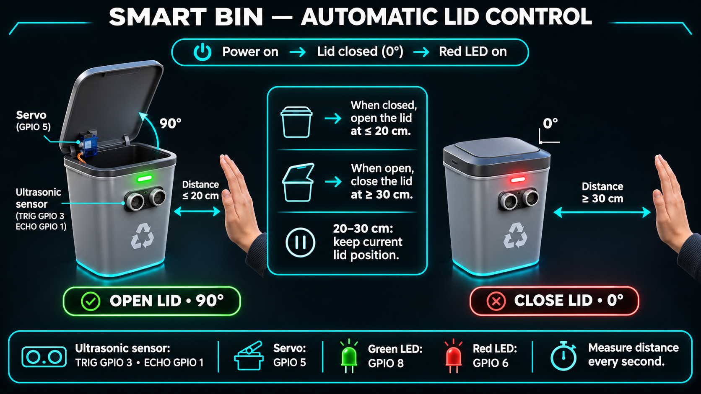
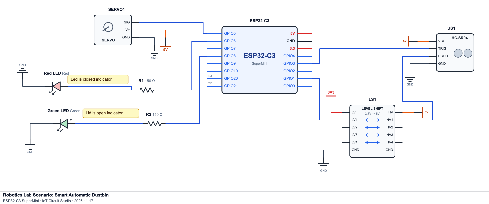

# Robotics Lab Scenario: Smart Automatic Dustbin


<p align="center">

</p>

## Scenario

During a robotics laboratory session, students build a touch-free smart dustbin using an **ESP32-C3**, an **HC-SR04 ultrasonic sensor**, an **SG90 servo motor**, and two status LEDs.

When the system is powered on, the servo connected to **GPIO 5** moves the lid to the closed position at **0°**. The red LED on **GPIO 6** turns on to indicate that the lid is closed, while the green LED on **GPIO 8** remains off.

Every second, the ESP32-C3 measures the distance to an object in front of the ultrasonic sensor:

1. **GPIO 3 (TRIG)** sends a 10-microsecond trigger pulse.
2. The HC-SR04 emits a short burst of ultrasonic sound.
3. The sound reflects from the student's hand or another object.
4. **GPIO 1 (ECHO)** receives the returning pulse.
5. The ESP32-C3 calculates the distance and displays it in the Serial Monitor at **115200 baud**.

When a student's hand comes within **20 cm**, the controller rotates the servo from **0° to 90°**, opening the lid. The green LED turns on and the red LED turns off, allowing waste to be deposited without touching the bin.

The lid remains open while the hand is between the two thresholds. When the hand moves at least **30 cm away**, the servo returns to **0°**, the lid closes, the green LED turns off, and the red LED turns on.

Using **20 cm to open** and **30 cm to close** creates hysteresis. This prevents the lid from repeatedly opening and closing when an object moves near a single threshold.

If the sensor receives no echo within 30 milliseconds, the code reports a distance of **999 cm**. In the current program, this can cause an open lid to close. A more robust version should require several consecutive valid clear readings, use a closing delay, and reopen the lid if an obstruction is detected.

## Control-flow diagram


<p align ="center">

</p>

## Schematics

<p align="center">
  
</p>


## Pin connections

### Signal connections

| Component pin | Connection path | ESP32-C3 pin | Purpose |
|---|---|---:|---|
| SERVO1 (SG90) SIG | Direct | GPIO 5 | Opens and closes the lid |
| Red LED anode (+) | Through R1 (150 Ω) | GPIO 6 | Indicates that the lid is closed |
| Green LED anode (+) | Through R2 (150 Ω) | GPIO 8 | Indicates that the lid is open |
| US1 (HC-SR04) TRIG | Direct | GPIO 3 | Initiates an ultrasonic measurement |
| US1 (HC-SR04) ECHO | LS1 HV1 → LV1 (level shifter) | GPIO 1 | Receives the reflected pulse at 3.3 V logic |

### Power and ground connections

| Component pin | Connects to | Purpose |
|---|---|---|
| SERVO1 V+ | 5 V | Supplies current to the servo |
| SERVO1 GND | GND | Servo return |
| US1 VCC | 5 V | Powers the ultrasonic sensor |
| US1 GND | GND | Sensor return |
| LS1 LV | 3V3 | Low-voltage (ESP32-C3) side reference |
| LS1 HV | 5 V | High-voltage (HC-SR04) side reference |
| LS1 GND | GND | Level-shifter return |
| Red LED cathode (−) | GND | LED return |
| Green LED cathode (−) | GND | LED return |
| ESP32-C3 GND | Common GND | Shared reference for all components |

Unused on the schematic: ESP32-C3 GPIO 0, 2, 4, 7, 9, 10, 20 (RX), 21 (TX), and level-shifter channels LV2–LV4 / HV2–HV4.

## Robotics lab test cases

| Test condition | Expected response |
|---|---|
| No object near the sensor | Lid remains closed and red LED stays on |
| Hand detected at 18 cm | Lid opens and green LED turns on |
| Hand moves to 25 cm | Lid remains open |
| Hand moves to 30 cm or farther | Lid closes and red LED turns on |
| Object remains within 20 cm | Lid remains open |
| No echo is received | Program reports 999 cm and may close an open lid |

## Electrical safety

The HC-SR04's **ECHO output can reach 5 V**, while the ESP32-C3 uses **3.3 V logic**. A voltage divider or logic-level converter must therefore be placed between ECHO and **GPIO 1**.

The servo should use a suitable external **5 V power supply**. The external supply, sensor, servo, and ESP32-C3 must all share a common ground.

## Team collaboration on GitHub

You will build this project as a team. Your team keeps its code, documentation, and test results in one shared GitHub repository, and each member pushes their own commits. Your instructor uses the commit history to see what each person contributed.

### Suggested team roles

| Role | Main responsibility |
|---|---|
| Repository owner | Creates the repository, invites teammates, sets up branch protection, and merges pull requests |
| Hardware lead | Wiring, schematic updates, and the pin connection tables |
| Firmware lead | Sensor reading, servo control, LED logic, and hysteresis |
| Test & documentation lead | Runs the test cases, records results, and maintains the `README.md` |

In small teams, one person can take on more than one role. Every member must still write and commit code.

### Step 1: Create the repository (repository owner)

1. Sign in to [GitHub](https://github.com) and select **New repository**.
2. Name it `smart-automatic-dustbin-team-<team-number>`.
3. Add a description, tick **Add a README file**, and choose the **Arduino** `.gitignore` template.
4. Select **Create repository**.

### Step 2: Invite your teammates

1. In the repository, go to **Settings → Collaborators → Add people**.
2. Invite each teammate by their GitHub username, and add your instructor too.
3. Each teammate accepts the invitation from their email or from GitHub notifications.

### Step 3: Protect the `main` branch

1. Go to **Settings → Branches → Add branch protection rule** (or **Rulesets**).
2. Enter `main` as the branch name pattern.
3. Turn on **Require a pull request before merging** and **Require approvals (1)**.

Once this rule is on, nobody can push straight to `main`. Every change has to come in through a pull request that a teammate has reviewed.

### Step 4: Clone the repository (every member)

```bash
git clone https://github.com/<owner-username>/smart-automatic-dustbin-team-<team-number>.git
cd smart-automatic-dustbin-team-<team-number>
git config user.name "Your Name"
git config user.email "your-github-email@example.com"
```

### Step 5: Use this folder structure

```text
smart-automatic-dustbin-team-<team-number>/
├── README.md              # Project overview, team members, and roles
├── firmware/
│   └── smart_dustbin/
│       └── smart_dustbin.ino
├── hardware/
│   ├── schematic.png
│   └── pin-connections.md
├── docs/
│   ├── control-flow.png
│   └── test-results.md    # Results of the robotics lab test cases
└── media/                 # Photos and a short demo video link
```

### Step 6: Work on feature branches

Make a new branch for each task, and don't work directly on `main`.

```bash
git checkout main
git pull                                   # get the latest team changes
git checkout -b feature/ultrasonic-sensor  # create your branch

# ...edit files, then:
git add .
git commit -m "Add HC-SR04 distance measurement with 30 ms timeout"
git push -u origin feature/ultrasonic-sensor
```

Suggested branches:

| Branch | Owner | Task |
|---|---|---|
| `feature/ultrasonic-sensor` | Firmware lead | Trigger pulse, echo timing, distance calculation |
| `feature/servo-lid` | Firmware lead | Servo open/close at 0° and 90° |
| `feature/status-leds` | Hardware lead | Red/green LED logic |
| `feature/hysteresis` | Any member | 20 cm open / 30 cm close logic |
| `feature/robust-close` | Any member | Consecutive clear readings and closing delay |
| `docs/test-results` | Test & documentation lead | Test case table with actual results |

### Step 7: Open a pull request and review

1. On GitHub, select **Compare & pull request** for your branch.
2. Write a short description that says what changed and how you tested it.
3. Ask at least one teammate to review it.
4. The reviewer reads the code, leaves comments, and either approves it or asks for changes.
5. After approval, merge the pull request and delete the branch.
6. Everyone runs `git checkout main` and `git pull` to stay up to date.

### Step 8: Track tasks with Issues and a Project board

- Create a GitHub Issue for each task, for example "Servo does not return to 0°".
- Assign each issue to a team member.
- Link pull requests to issues by writing `Closes #<issue-number>` in the PR description.
- If you want a task board, create a GitHub Project with the columns To do, In progress, Review, and Done.

### Collaboration rules

- Commit small changes that work, and commit often. Write messages that say what changed, such as `Fix servo jitter by detaching after move`. A message like `update` tells your team nothing.
- Pull from `main` before you start work each session to avoid merge conflicts.
- If a merge conflict happens, resolve it together with the teammate who made the other change.
- Never commit Wi-Fi passwords, API keys, or other secrets.
- In reviews, comment on the code rather than the person, and explain why you're suggesting a change.

### Team submission checklist

- [ ] The repository is shared with the instructor
- [ ] `README.md` lists the team members, their roles, and their GitHub usernames
- [ ] Final firmware is on `main` and compiles without errors
- [ ] Every team member has commits and at least one merged pull request
- [ ] Every member has reviewed at least one pull request
- [ ] `docs/test-results.md` records the actual result for each test case
- [ ] Photos or a demo video link show the working smart dustbin
