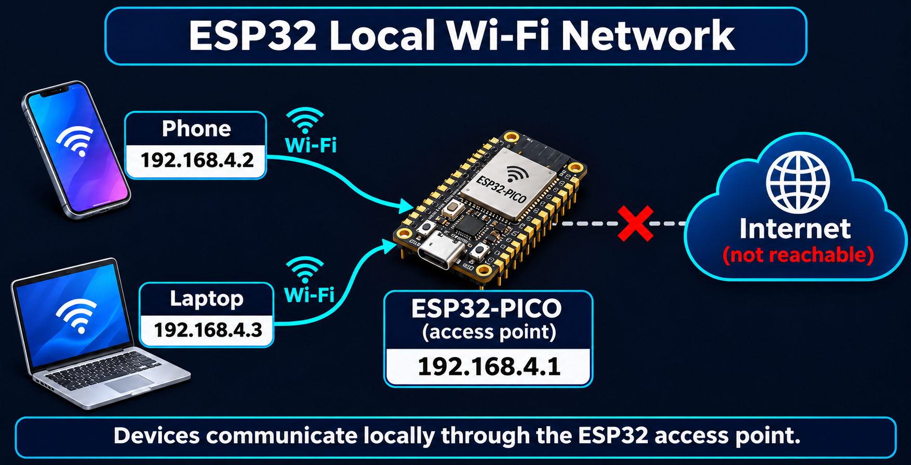
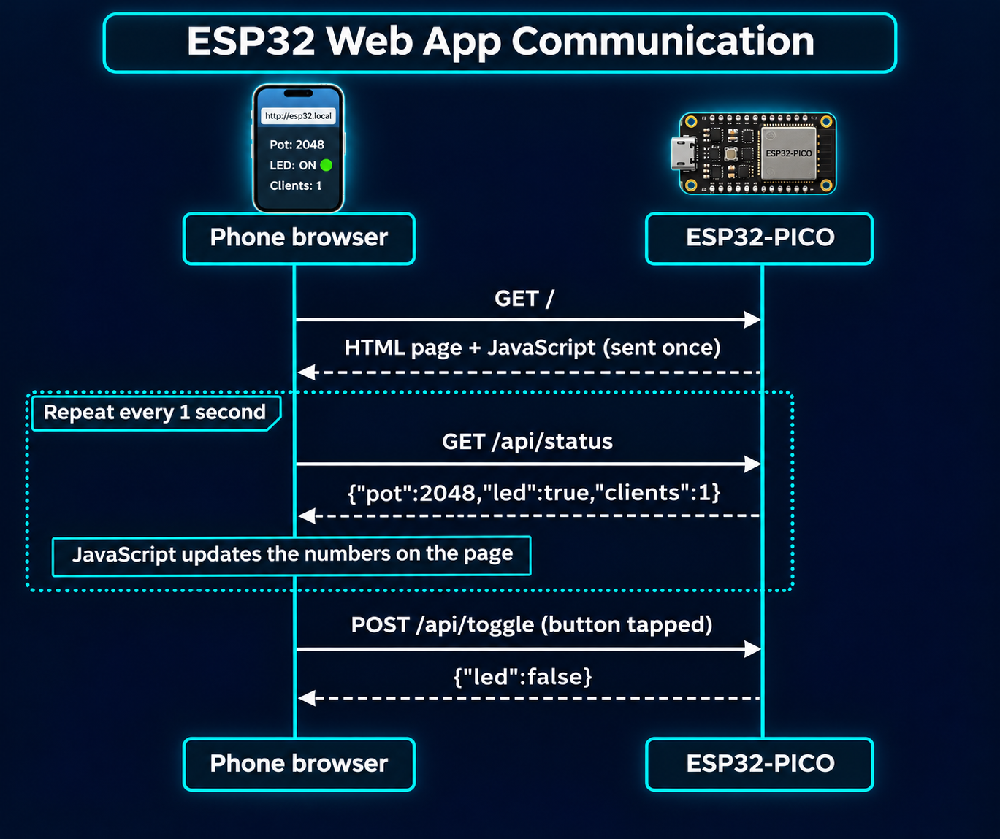
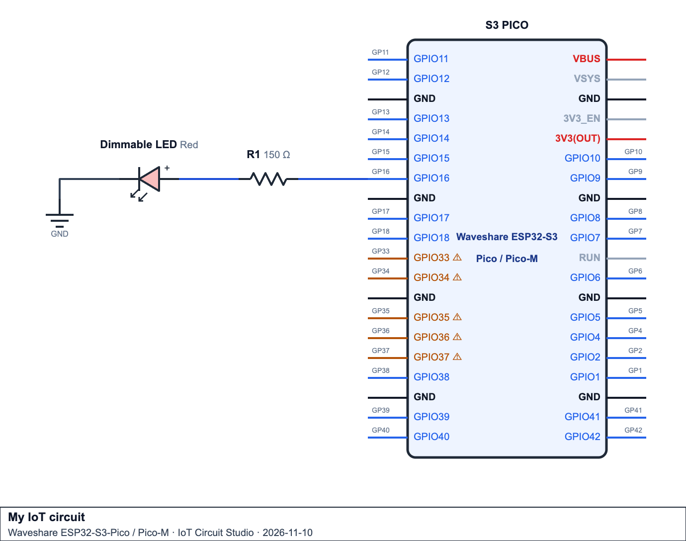
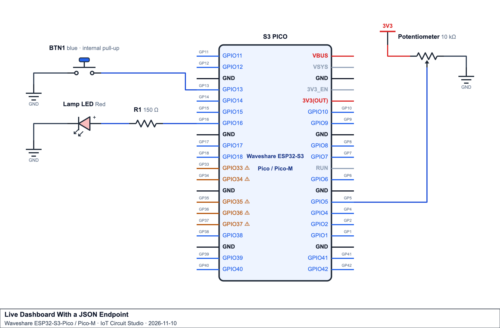
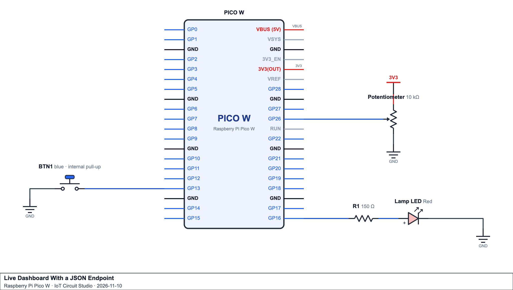
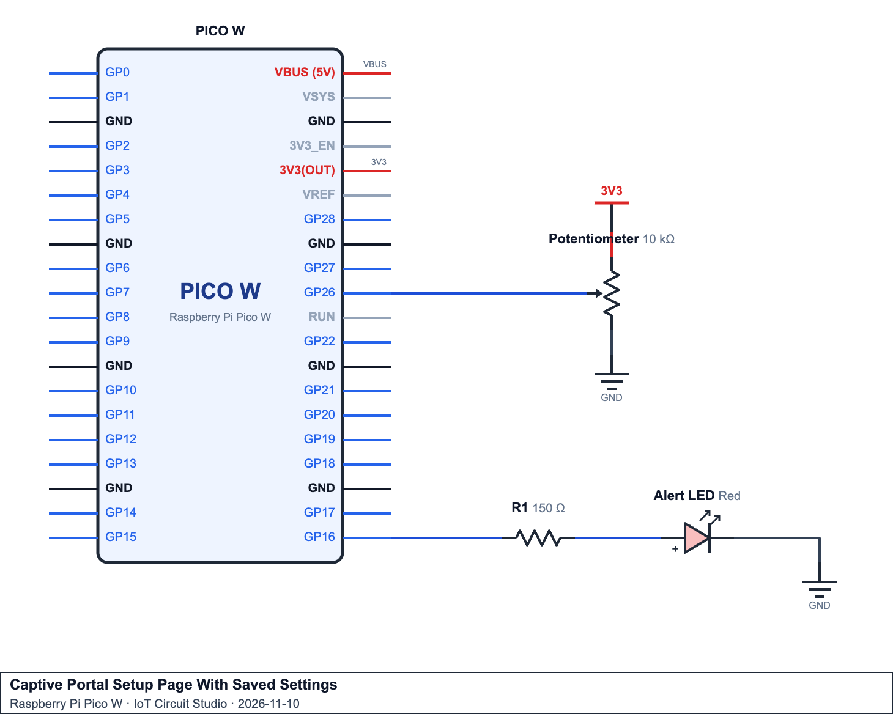

# Wi-Fi Modes - Access Point Mode (AP)

## Introduction
In Station mode the microcontroller joins someone else's network. In **Access Point mode** it does the opposite: it **creates its own Wi-Fi network**, and phones and laptops join it. The [Networking and Database Connection](Week-10-Networking-and-Database-Connection.md) Resource introduced this with `WiFi.softAP()` and a simple web page with a toggle link (Example 5). This page builds on that example.

You'll learn how to choose the network's channel, client limit and IP address, how to see exactly which devices join and leave, how to read values a user types into a web form, how to build a page that updates live without reloading, and how to make the setup page **pop up automatically** when a phone joins (a captive portal), the same way hotel Wi-Fi and new smart-home gadgets do. People use Access Point mode to control devices in sheds, paddocks, tunnels and workshops when there's no router nearby.


## Key Concepts

### Key Concept 1 - What a Soft Access Point 
An **access point** is the device that runs a Wi-Fi network. Normally that's your router. When the microcontroller runs in Access Point mode (`WIFI_AP`), it becomes a small router itself. The "soft" in **soft AP** means the access point is made in software on a general-purpose chip, not by dedicated router hardware.


<p align = "center">

</p>
As an access point, the microcontroller does three jobs at once:

| Job | What it means |
|---|---|
| **Broadcasts the network** | Sends out "beacons" about 10 times a second announcing the SSID, so it shows up in phones' Wi-Fi lists |
| **DHCP server** | Hands out IP addresses to devices that join: `192.168.4.2`, `.3`, `.4`... It keeps `192.168.4.1` for itself |
| **Gateway and web server** | Devices send their traffic to it. With `WebServer.h` it answers web requests, so a phone's browser can show its pages |

**There is no internet.** The microcontroller isn't joined to any router, so it can't reach Supabase, NTP or any website, and neither can the phones joined to it. Phones usually warn "No internet connection" and may try to switch back to mobile data or another Wi-Fi network. Choose **"Stay connected"** / **"Use without internet"**.

#### When to choose Access Point mode
| Choose AP mode when... | Choose Station mode when... |
|---|---|
| There's no router where the device is (paddock, shed, tunnel, bush) | A router or hotspot is in range |
| People control the device **locally**, standing next to it | The device must reach the **internet** (cloud, NTP, notifications) |
| The device is being **set up** for the first time (typing in the home Wi-Fi details) | The device is already set up and running |
| It must keep working even when the building's network is down | Many people need access from anywhere |

#### Example - The smallest access point
This sketch does nothing except start an access point and count who joins. It's enough to see all three jobs from the table above.

```cpp
#include <WiFi.h>

void setup() {
  Serial.begin(115200);
  WiFi.mode(WIFI_AP);                       // run a network, don't join one
  WiFi.softAP("My-First-AP", "iot12345");   // start broadcasting the name

  Serial.print("Join My-First-AP, then browse to http://");
  Serial.println(WiFi.softAPIP());          // 192.168.4.1
}

void loop() {
  Serial.print("Devices joined: ");
  Serial.println(WiFi.softAPgetStationNum());
  delay(2000);                              // fine here: there's no web server to keep answering
}
```

**Try it:**
1. Upload and open the Serial Monitor. `Devices joined: 0` repeats every 2 seconds.
2. Open your phone's Wi-Fi list. `My-First-AP` appears because of the beacons.
3. Join it with the password `iot12345`. The count changes to `1`.
4. Open the network's details on the phone (tap the ⓘ or the network name). The phone's IP address is `192.168.4.2` and the router/gateway is `192.168.4.1`. The DHCP server handed out that address, and the microcontroller is the gateway.
5. The phone warns that there's no internet, because the microcontroller isn't connected to anything else.

> **Pico W:** the same sketch works, but the address printed is `192.168.42.1` and the phone gets `192.168.42.2` (or the next free address after it).

Three projects, and the mode each one would use:

| Project | Mode | Why |
|---|---|---|
| A water-tank level display at a farm dam, checked by the farmer standing next to it | **Access Point** | No router within range, and the farmer only needs the reading while they're there |
| A classroom temperature logger that uploads to Supabase every minute | **Station** | It has to reach the internet, and the school Wi-Fi is in range |
| A smart plug that's set up from a phone, then runs on the home Wi-Fi | **AP first, then Station** | AP mode for the one-off setup page (Key Concept 6), then Station mode to join the home network it was given |

### Key Concept 2 - Configuring the Access Point
In Example 5 of the Networking Resource, the access point was started with just a name and password. That works, but every other setting is left on its default: channel 1, any 4 devices can join, and the address is fixed at `192.168.4.1`. In a real project you usually want control over these. A shed controller might allow only one phone, so two people can't fight over the same pump. A classroom full of devices needs each network spread across different channels and given its own name.

Configuring an access point always follows the same four steps:

| Step | Function | Why |
|---|---|---|
| 1. Choose the mode | `WiFi.mode(WIFI_AP)` | Tells the radio to run a network, not join one |
| 2. Set the address (optional) | `WiFi.softAPConfig(ip, gateway, subnet)` | Only needed if you don't want the default address |
| 3. Start the network | `WiFi.softAP(ssid, password, ...)` | Starts broadcasting the name and handing out addresses |
| 4. Check it worked | `if (!WiFi.softAP(...))` and `WiFi.softAPIP()` | A failed start is otherwise silent |

#### The full `softAP()` call
`WiFi.softAP()` takes more than a name and password:

```cpp
WiFi.softAP(ssid, password, channel, ssid_hidden, max_connection);
```

| Parameter | Default | Meaning and rules |
|---|---|---|
| `ssid` | (required) | Network name, up to 32 characters |
| `password` | `NULL` (open) | **8-63 characters** for a WPA2 secured network, or `""`/`NULL` for an open network. 1-7 characters makes `softAP()` fail and return `false` |
| `channel` | `1` | The 2.4 GHz channel, 1-13. Pick one the networks around you aren't crowding (a scan shows which, see the Station mode page) |
| `ssid_hidden` | `0` | `1` hides the name from Wi-Fi lists; users must type it in by hand. This **isn't** security: the name is still visible to Wi-Fi tools |
| `max_connection` | `4` | Most devices allowed to join at once, up to 10. Extra devices are refused |

`ssid` is the name people see in their phone's Wi-Fi list, so make it describe the device (`Shed-Pump`, `Lab-AP-CDED`), not the chip (`ESP32`). Keep to letters, numbers and dashes. Spaces and symbols are allowed but are easy to mistype when the network is hidden.

`password` sets the network key. With 8 or more characters the network uses WPA2, which encrypts everything sent between the phone and the microcontroller. The 8-character minimum is part of the WPA2 standard, so the ESP32 refuses a 7-character password instead of quietly accepting it. With no password the network is open: anyone in range can join and anyone with Wi-Fi tools can read the traffic, including any values typed into your web forms. Only use an open network for short tests or for a captive portal setup page (Key Concept 6).

`channel` picks the radio frequency. The 2.4 GHz band is split into channels 1-13 (channels 12 and 13 are allowed in Australia, but some phones from other countries can't see them). Neighbouring channels overlap, so the only three that don't interfere with each other are 1, 6 and 11. If every board in a classroom stays on the default channel 1 along with the school's Wi-Fi, they all share the same slice of airtime and web pages become slow or stop loading. Spreading the boards across 1, 6 and 11 fixes it. A home router may hop to a quieter channel by itself, but a soft AP stays on whatever channel you set.

> **Running AP and Station together (`WIFI_AP_STA`)?** The ESP32 has only one radio, so both networks must use the same channel. When the Station side joins a router, the access point is moved to the router's channel, whatever you asked for.

`ssid_hidden` blanks out the name in the beacons, but the beacons still go out. Phones that already know the name can join, and any Wi-Fi scanning app shows the hidden network (and its name, as soon as someone joins). So hiding the name only keeps the network out of normal Wi-Fi lists. The password is what stops people joining.

`max_connection` is the client limit. Each joined device uses some of the microcontroller's memory and a share of its time on air. The ESP32 allows up to 10, but a web server on a microcontroller handles one request at a time, so 4 or fewer usually gives the quickest response. A low limit also works as a basic form of access control: with `max_connection` set to `1`, the first phone to join "owns" the device until it leaves.

#### Parameters are matched by position
C++ fills in parameters **in order**, from left to right. There's no way to skip one, so to set `max_connection` (the fifth parameter) you must also give `channel` and `ssid_hidden`, even if you want their default values:

```cpp
WiFi.softAP("Lab-AP", "iot12345", 6, 0, 2);   // channel 6, visible, at most 2 devices
//          ssid      password    ch hid max
```

Writing `WiFi.softAP("Lab-AP", "iot12345", 2)` doesn't limit the network to 2 devices; it puts it on **channel 2**, because the third value is always the channel. Storing the settings in named constants at the top of the sketch makes the call easy to read:

```cpp
const char* AP_SSID     = "Lab-AP";
const char* AP_PASSWORD = "iot12345";
const int   AP_CHANNEL  = 6;
const int   AP_HIDDEN   = 0;    // 0 = visible, 1 = hidden
const int   AP_MAX      = 2;

WiFi.softAP(AP_SSID, AP_PASSWORD, AP_CHANNEL, AP_HIDDEN, AP_MAX);
```

#### Checking the result
`WiFi.softAP()` returns `true` or `false` straight away. There's nothing to wait for, unlike `WiFi.begin()` in Station mode, so it never needs a retry loop. **Always check the return value.** If you don't, a short password fails silently and the network just never appears.

```cpp
if (!WiFi.softAP(AP_SSID, AP_PASSWORD, AP_CHANNEL, AP_HIDDEN, AP_MAX)) {
  Serial.println("[ERROR] Access point did not start. Check the password length.");
  while (true) { delay(1000); }   // stop here: nothing else will work without the network
}

Serial.print("Access point running at http://");
Serial.println(WiFi.softAPIP());
```

The common reasons it returns `false` are a password of 1-7 characters, an SSID longer than 32 characters, or a channel outside 1-13. Printing `WiFi.softAPIP()` straight after confirms the address to type into the phone's browser.

#### A unique network name
If a whole class runs the same sketch, twenty networks all called `ESP32-AP` appear and nobody knows which is theirs. Every ESP32 has its own **MAC address**, a hardware ID set in the factory that no other device shares, so its last few characters make a unique name:

```cpp
WiFi.mode(WIFI_AP);
String mac = WiFi.softAPmacAddress();     // e.g. "24:6F:28:AB:CD:ED"
String suffix = mac.substring(12);        // "CD:ED"
suffix.replace(":", "");                  // "CDED"
String apName = "Lab-AP-" + suffix;       // "Lab-AP-CDED"
WiFi.softAP(apName.c_str(), "iot12345");
```

A MAC address is always 17 characters: six pairs of hex digits separated by colons. `substring(12)` starts at character 12 (counting from 0) and keeps the rest, which is the last two pairs. The first half of a MAC identifies the **manufacturer**, so every ESP32 in the room shares it; the last pairs are what make each board different. `.c_str()` converts the Arduino `String` into the plain C text that `softAP()` expects.

`WiFi.mode(WIFI_AP)` must come first, because the access point MAC address isn't ready until the radio is in AP mode. Print `apName` to the Serial Monitor (or put it on a label on the device) so the user knows which network to pick.

> **Pico W:** the access point MAC address is blank until the network has started, so Example 1's Pico version uses `pico_get_unique_board_id_string()` instead. The idea is the same: take the last few characters of an ID that's unique to that board.

#### Choosing the IP address
The access point uses `192.168.4.1` unless you change it (on the Pico W the default is `192.168.42.1`). `WiFi.softAPConfig()` sets a different address, for example to avoid confusion with another network or to match a printed label on the device:

```cpp
IPAddress apIP(192, 168, 10, 1);
IPAddress subnet(255, 255, 255, 0);

WiFi.softAP(AP_SSID, AP_PASSWORD);
WiFi.softAPConfig(apIP, apIP, subnet);    // the microcontroller is its own gateway
```

`softAPConfig()` takes three addresses:

| Argument | Value here | Meaning |
|---|---|---|
| `local_ip` | `192.168.10.1` | The microcontroller's own address. This is what users type into the browser |
| `gateway` | `192.168.10.1` | Where joined devices send traffic that's meant for another network. There's no router, so it's the microcontroller again, which is why `apIP` is passed twice |
| `subnet` | `255.255.255.0` | Which part of the address is the network and which part is the device. `255.255.255.0` means the first three numbers (`192.168.10`) are the network, and the last number (1-254) picks the device |

Devices that join now get `192.168.10.2`, `.3`, and so on from the built-in DHCP server, which always hands out addresses in the same network as `local_ip`.

When choosing an address:
- Use a private range, one that's never used on the internet: `192.168.x.x` or `10.x.x.x`.
- Avoid `192.168.0.x` and `192.168.1.x`. Most home routers use them, so a laptop joined to both the router (by cable) and the access point can send requests to the wrong device.
- End the address in `.1`. Gateways usually sit there, and it leaves `.2` upwards free for joining devices.

> **Order matters on the Pico W.** The ESP32 accepts `softAPConfig()` before or after `softAP()`. On the Pico W it must come before `softAP()`: called after, it returns `true` but the address doesn't change. Calling it first, as the Pico examples do, works on both boards. Check its return value too, as Example 1 does.

#### Useful access point functions
| Function | Returns |
|---|---|
| `WiFi.softAPIP()` | The microcontroller's address on its own network (default `192.168.4.1`) |
| `WiFi.softAPSSID()` | The network name it's broadcasting |
| `WiFi.softAPmacAddress()` | Its MAC address on the access point side |
| `WiFi.softAPgetStationNum()` | How many devices are joined right now |
| `WiFi.softAPsetHostname(name)` | Sets the name the access point reports |
| `WiFi.softAPdisconnect(true)` | Shuts the access point down and turns the radio off |

You'll mostly use these to check and report what the access point is doing. Print `softAPSSID()` and `softAPIP()` at startup so you know what to join and where to browse, and use `softAPgetStationNum()` to react when someone joins (Example 1 lights an LED with it). `softAPdisconnect(true)` is useful in setup-mode devices: once the user has entered the home Wi-Fi details, the access point is shut down and the device switches to Station mode.

#### Example - A one-phone pump controller
**Scenario:** a pump in a shed is controlled from a phone. Only one person should control it at a time, the school Wi-Fi nearby already uses channels 1 and 6, and the installer wants the address `192.168.50.1` printed on the label. Every shed has a controller, so each network needs its own name.

```cpp
#include <WiFi.h>

const char* AP_PASSWORD = "pump2468";
const int   AP_CHANNEL  = 11;   // channels 1 and 6 are busy with the school Wi-Fi
const int   AP_HIDDEN   = 0;    // visible, so the installer can find it
const int   AP_MAX      = 1;    // one phone controls the pump at a time

const IPAddress AP_IP(192, 168, 50, 1);
const IPAddress AP_SUBNET(255, 255, 255, 0);

void setup() {
  Serial.begin(115200);
  WiFi.mode(WIFI_AP);

  // Unique name from the end of the MAC address, e.g. "Shed-Pump-CDED".
  String suffix = WiFi.softAPmacAddress().substring(12);
  suffix.replace(":", "");
  String apName = "Shed-Pump-" + suffix;

  if (!WiFi.softAP(apName.c_str(), AP_PASSWORD, AP_CHANNEL, AP_HIDDEN, AP_MAX)) {
    Serial.println("[ERROR] Access point did not start. Is the password 8-63 characters?");
    return;
  }
  if (!WiFi.softAPConfig(AP_IP, AP_IP, AP_SUBNET)) {
    Serial.println("[ERROR] The custom IP address was rejected.");
  }

  Serial.println("Access point running");
  Serial.print("  SSID:    "); Serial.println(WiFi.softAPSSID());
  Serial.print("  Address: http://"); Serial.println(WiFi.softAPIP());
  Serial.print("  Channel: "); Serial.println(AP_CHANNEL);
  Serial.print("  Max:     "); Serial.println(AP_MAX);
}

void loop() {
}
```

Serial Monitor output:

```
Access point running
  SSID:    Shed-Pump-CDED
  Address: http://192.168.50.1
  Channel: 11
  Max:     1
```

To check each setting, try these tests:

| Test | What you should see | Setting it proves |
|---|---|---|
| Join with a phone and check its Wi-Fi details | Phone address `192.168.50.2`, router `192.168.50.1` | `softAPConfig()` |
| Try to join with a second phone while the first is still joined | The second phone can't join (it keeps trying, or says it couldn't connect) | `max_connection = 1` |
| Look at the network in a Wi-Fi analyser app | `Shed-Pump-CDED` on channel 11 | `channel` and the unique name |
| Change the password to `"pump"` and upload again | `[ERROR] Access point did not start...` and no network appears | The return value check |

### Key Concept 3 - Who's Connected? Access Point Events
`WiFi.softAPgetStationNum()` gives a count, but not *who* joined or *when*. Wi-Fi events (introduced on the Station mode page) have access point versions too:

| Event | When it fires | Useful info |
|---|---|---|
| `ARDUINO_EVENT_WIFI_AP_START` | The access point has started | |
| `ARDUINO_EVENT_WIFI_AP_STACONNECTED` | A device joined | `info.wifi_ap_staconnected.mac` (6 bytes) |
| `ARDUINO_EVENT_WIFI_AP_STAIPASSIGNED` | The DHCP server gave a device an IP address | `info.wifi_ap_staipassigned.ip.addr` |
| `ARDUINO_EVENT_WIFI_AP_STADISCONNECTED` | A device left (or walked out of range) | `info.wifi_ap_stadisconnected.mac` |

The same rule applies as in Station mode: the event function runs on the Wi-Fi system's own task, so it only **copies the details and sets flags**. `loop()` does the printing and LED work.

A MAC address arrives as 6 separate bytes. This helper turns it into the familiar text form:

```cpp
// Turns a 6-byte MAC address into text such as "A4:5E:60:12:34:56".
String macToText(const volatile uint8_t* mac) {
  char text[18];
  snprintf(text, sizeof(text), "%02X:%02X:%02X:%02X:%02X:%02X",
           mac[0], mac[1], mac[2], mac[3], mac[4], mac[5]);
  return String(text);
}
```

> **Privacy note:** phones often use a **random MAC address** for each network they join (iPhone "Private Wi-Fi Address", Android "Randomised MAC"), so the MAC you see isn't the phone's real hardware address and can change. Don't use MAC addresses to identify people.

#### Example - A visitor log
**Scenario:** a workshop display should log every phone that joins and leaves, with the time in seconds since start-up and the address it was given.

```cpp
#include <WiFi.h>

// Filled in by the event function, read and cleared by loop().
volatile bool deviceJoined = false;
volatile bool addressGiven = false;
volatile bool deviceLeft   = false;
volatile uint8_t joinedMac[6];
volatile uint8_t leftMac[6];
volatile uint32_t givenAddress = 0;

// Turns a 6-byte MAC address into text such as "A4:5E:60:12:34:56".
String macToText(const volatile uint8_t* mac) {
  char text[18];
  snprintf(text, sizeof(text), "%02X:%02X:%02X:%02X:%02X:%02X",
           mac[0], mac[1], mac[2], mac[3], mac[4], mac[5]);
  return String(text);
}

// Runs on the Wi-Fi task: copy the details, set a flag, nothing else.
void onWiFiEvent(WiFiEvent_t event, WiFiEventInfo_t info) {
  switch (event) {
    case ARDUINO_EVENT_WIFI_AP_STACONNECTED:
      memcpy((void*)joinedMac, info.wifi_ap_staconnected.mac, 6);
      deviceJoined = true;
      break;
    case ARDUINO_EVENT_WIFI_AP_STAIPASSIGNED:
      givenAddress = info.wifi_ap_staipassigned.ip.addr;
      addressGiven = true;
      break;
    case ARDUINO_EVENT_WIFI_AP_STADISCONNECTED:
      memcpy((void*)leftMac, info.wifi_ap_stadisconnected.mac, 6);
      deviceLeft = true;
      break;
    default:
      break;
  }
}

void setup() {
  Serial.begin(115200);
  WiFi.onEvent(onWiFiEvent);          // register before starting, so no event is missed
  WiFi.mode(WIFI_AP);
  WiFi.softAP("Workshop-AP", "iot12345");
}

void loop() {
  unsigned long seconds = millis() / 1000;

  if (deviceJoined) {
    deviceJoined = false;
    Serial.printf("[%lu s] Joined: %s\n", seconds, macToText(joinedMac).c_str());
  }
  if (addressGiven) {
    addressGiven = false;
    Serial.printf("[%lu s] Given address %s\n", seconds, IPAddress(givenAddress).toString().c_str());
  }
  if (deviceLeft) {
    deviceLeft = false;
    Serial.printf("[%lu s] Left:   %s (%d still joined)\n", seconds,
                  macToText(leftMac).c_str(), WiFi.softAPgetStationNum());
  }
}
```

Serial Monitor output when a phone joins, then walks away 80 seconds later:

```
[12 s] Joined: 6A:1F:C2:90:4B:17
[12 s] Given address 192.168.4.2
[93 s] Left:   6A:1F:C2:90:4B:17 (0 still joined)
```

Each join fires two events. First the device joins the Wi-Fi, then a moment later DHCP gives it an address. A device that has joined but has no address yet can't load your web page. The `6A:...` MAC is a randomised one (the second character `A` gives it away), as the privacy note above explains.

> **Pico W:** these events don't exist on the Pico W. Compare `WiFi.softAPgetStationNum()` with the previous count instead, as Example 1's Pico version does.

### Key Concept 4 - Taking Input From a Web Page
Example 5 on the Networking and Database Connection page used fixed links (`/toggle`). Real control panels need the user to send a **value**, such as a brightness level, a setpoint or a name. Browsers send values in the address as **query parameters**:

```
http://192.168.4.1/set?brightness=180&mode=auto
                   └path┘└──────── query parameters ───────┘
```

An HTML **form** builds that address for you when the user presses Submit:

```html
<form action="/set" method="get">
  <input type="range" name="brightness" min="0" max="255" value="128">
  <input type="submit" value="Set">
</form>
```

On the microcontroller, `WebServer` gives you the values:

| Function | Returns |
|---|---|
| `server.hasArg("brightness")` | `true` if the request includes `brightness` |
| `server.arg("brightness")` | Its value as a `String`, e.g. `"180"` (an empty string if missing) |
| `server.arg("brightness").toInt()` | The value as a number. Watch out: `toInt()` gives `0` for text that isn't a number |

#### Never trust input
Anyone joined to the network can type any address into their browser, such as `/set?brightness=9999` or `/set?brightness=abc`. **Validate every value** before using it, and reply with the right status code:

| Code | Meaning | Use it when |
|---|---|---|
| `200` OK | Here's the page/data | A normal page or a successful request |
| `303` See Other | Go to this other address | After a change, send the browser back to `/` (with a `Location` header) |
| `400` Bad Request | Your request is wrong | A value is missing, isn't a number or is out of range |
| `403` Forbidden | You're not allowed | A wrong PIN or password |
| `404` Not Found | There's nothing here | An unknown path |

```cpp
// Returns true only if the text is 1-4 digits with nothing else, e.g. "180" but not "", "-5" or "12a".
bool isWholeNumber(const String& text) {
  if (text.length() == 0 || text.length() > 4) return false;
  for (unsigned int i = 0; i < text.length(); i++) {
    if (!isDigit(text[i])) return false;
  }
  return true;
}
```

#### Example - A thermostat setpoint
**Scenario:** a heater controller lets the user set a target temperature between 10 and 35 °C.

The form on the page uses `type="number"`, which also stops most bad values in the browser:

```html
<form action="/set" method="get">
  Target (°C): <input type="number" name="setpoint" min="10" max="35" value="22">
  <input type="submit" value="Set">
</form>
```

The handler checks the value anyway, because anyone can skip the form and type the address directly:

```cpp
int setpoint = 22;   // °C

void handle_set() {
  if (!server.hasArg("setpoint")) {
    server.send(400, "text/plain", "Missing setpoint");
    return;
  }

  String text = server.arg("setpoint");
  if (!isWholeNumber(text)) {
    server.send(400, "text/plain", "Setpoint must be a whole number");
    return;
  }

  int value = text.toInt();
  if (value < 10 || value > 35) {
    server.send(400, "text/plain", "Setpoint must be 10-35");
    return;
  }

  setpoint = value;                    // only now is the value trusted
  Serial.printf("Setpoint changed to %d C\n", setpoint);
  server.sendHeader("Location", "/");  // send the browser back to the main page
  server.send(303);
}

// in setup():
server.on("/set", handle_set);
```

What happens with different requests:

| Request | Reply | Why |
|---|---|---|
| `/set?setpoint=24` | `303`, back to `/` | Valid: `setpoint` becomes 24 |
| `/set` | `400 Missing setpoint` | No value sent |
| `/set?setpoint=abc` | `400 ...whole number` | Without `isWholeNumber()`, `toInt()` would give `0` |
| `/set?setpoint=-5` | `400 ...whole number` | `-` isn't a digit |
| `/set?setpoint=90` | `400 Setpoint must be 10-35` | A number, but out of range |

The checks go from cheapest to most specific: is it there, is it a number, is it in range. The global `setpoint` only changes once every check has passed.

### Key Concept 5 - Live Pages: JSON Endpoints and `fetch()`
A page that refreshes itself every 5 seconds (`<meta http-equiv='refresh'>`) flickers, scrolls back to the top and re-sends the whole page each time. A better design splits the job in two:

1. **`/`** sends the page (HTML + a little JavaScript) **once**.
2. **`/api/status`** sends just the current values as **JSON**, e.g. `{"pot":2048,"led":true,"clients":1}`.
3. JavaScript in the page calls `fetch('/api/status')` every second and updates only the numbers on screen.


<p align ="center">

</p>
This is the same JSON you sent **to** Supabase in Station mode. Now the microcontroller is the **server** and the phone is the **client**.

#### Storing the page with a raw string literal
A web page has lots of `"` quotes, which would each need a `\` in a normal C++ string. A **raw string literal** keeps the text exactly as written:

```cpp
const char PAGE[] = R"rawliteral(
<!DOCTYPE html>
<html><body><h1 id="title">Hello</h1></body></html>
)rawliteral";
```

Everything between `R"rawliteral(` and `)rawliteral"` is part of the string, quotes and line breaks included.

#### Use POST for actions
A `GET` request should only **read**. Browsers may load `GET` links early to speed things up, or repeat them on refresh, which could switch a pump on by accident. Actions that **change** something, such as toggling an LED, should use `POST`. `server.on("/api/toggle", HTTP_POST, handle_toggle)` only runs the handler for a `POST`.

#### Example - A live potentiometer and LED dashboard
**Scenario:** a bench display shows a potentiometer reading that updates every second, and a button that toggles an LED without reloading the page.

The JSON endpoint and the toggle action on the microcontroller:

```cpp
const int POT_PIN = 34;
const int LED_PIN = 16;
bool ledOn = false;

// GET /api/status -> {"pot":2048,"led":false,"clients":1}
void handle_status() {
  char json[64];
  snprintf(json, sizeof(json), "{\"pot\":%d,\"led\":%s,\"clients\":%d}",
           analogRead(POT_PIN), ledOn ? "true" : "false", WiFi.softAPgetStationNum());
  server.send(200, "application/json", json);
}

// POST /api/toggle -> flips the LED, then replies with the new status
void handle_toggle() {
  ledOn = !ledOn;
  digitalWrite(LED_PIN, ledOn ? HIGH : LOW);
  handle_status();
}

// in setup():
server.on("/", handle_root);                          // sends PAGE once
server.on("/api/status", HTTP_GET, handle_status);
server.on("/api/toggle", HTTP_POST, handle_toggle);   // POST: it changes something
```

The page, stored in `PAGE` with a raw string literal:

```cpp
const char PAGE[] = R"rawliteral(
<!DOCTYPE html>
<html><body>
  <h1>Bench Dashboard</h1>
  <p>Pot: <span id="pot">--</span></p>
  <p>LED: <span id="led">--</span></p>
  <button onclick="toggle()">Toggle LED</button>

<script>
async function update() {
  try {
    const res = await fetch('/api/status');
    const data = await res.json();
    document.getElementById('pot').textContent = data.pot;
    document.getElementById('led').textContent = data.led ? 'On' : 'Off';
  } catch (e) {
    document.getElementById('pot').textContent = 'offline';   // the phone left the network
  }
}

async function toggle() {
  await fetch('/api/toggle', { method: 'POST' });
  update();                     // show the new state straight away
}

update();                       // fill in the numbers as soon as the page opens
setInterval(update, 1000);      // then refresh them every second
</script>
</body></html>
)rawliteral";
```

The page (about 700 bytes) goes over Wi-Fi once. After that, each update is about 40 bytes of JSON. If something isn't updating, open `http://192.168.4.1/api/status` in the browser first. Seeing the raw JSON there tells you the microcontroller side works, and the problem is in the JavaScript.

### Key Concept 6 - Captive Portals
When you join hotel or airport Wi-Fi, a sign-in page pops up by itself. That's a **captive portal**. New smart plugs and cameras use the same trick for setup: join "SmartPlug-Setup" and the setup page opens without typing any address.

**How it works:** as soon as a phone joins a network, it checks for internet by loading a known test address (for example `captive.apple.com` on iPhone, `connectivitycheck.gstatic.com` on Android). The microcontroller "captures" this check:
1. A **DNS server** on the microcontroller answers **every** name lookup ("where is captive.apple.com?") with its own address, `192.168.4.1`.
2. The phone's test request therefore arrives at the microcontroller's web server, on a path it doesn't recognise.
3. `server.onNotFound()` replies with a **302 redirect** to `http://192.168.4.1/`.
4. The phone sees it didn't get its expected test answer, decides it's behind a sign-in page, and **opens that page automatically**.

```cpp
#include <DNSServer.h>

const byte DNS_PORT = 53;
DNSServer dnsServer;

// in setup(), after softAP():
dnsServer.start(DNS_PORT, "*", WiFi.softAPIP());   // "*" = answer every name with our IP

// in loop():
dnsServer.processNextRequest();
```

```cpp
// Sends any unknown address (including phones' internet checks) to the setup page.
void handle_redirect() {
  server.sendHeader("Location", String("http://") + WiFi.softAPIP().toString() + "/", true);
  server.send(302, "text/plain", "");
}
```

> **Notes:** the pop-up opens in a small "sign-in" browser, which can behave a little differently from the normal browser. If it doesn't pop up, opening any `http://` address (e.g. `http://example.com`) in the normal browser also lands on the page. On recent ESP32 Arduino cores `DNSServer` answers in the background and `processNextRequest()` does nothing, but calling it keeps the sketch working on older cores too.

#### Saving settings with `Preferences`
A setup page is useless if the settings vanish at the next power cut. The built-in `Preferences` library saves small values (numbers, short text) in the microcontroller's flash, under a key name:

```cpp
#include <Preferences.h>
Preferences prefs;

prefs.begin("settings", false);              // open the "settings" area (false = read and write)
int threshold = prefs.getInt("threshold", 3000);   // read; 3000 if nothing saved yet
prefs.putInt("threshold", 2500);             // save
String name = prefs.getString("name", "Sensor");
prefs.putString("name", "Shed 2");
```

Flash memory wears out after many thousands of writes to the same place, so **only save when a value changes** (when the user presses Save), never on every pass of `loop()`.

#### Example - A sensor setup portal that remembers its threshold
**Scenario:** a sensor is installed in a shed. The installer joins `Sensor-Setup`, the setup page pops up by itself, they type an alarm threshold and press Save. The value is still there after a power cut.

```cpp
#include <WiFi.h>
#include <WebServer.h>
#include <DNSServer.h>
#include <Preferences.h>

WebServer server(80);
DNSServer dnsServer;
Preferences prefs;

int threshold = 3000;

void handle_root() {
  String page = "<!DOCTYPE html><html><body><h1>Sensor setup</h1>";
  page += "<p>Current threshold: " + String(threshold) + "</p>";
  page += "<form action='/save' method='post'>";
  page += "New threshold (0-4095): <input type='number' name='threshold' min='0' max='4095'>";
  page += "<input type='submit' value='Save'></form></body></html>";
  server.send(200, "text/html", page);
}

void handle_save() {
  String text = server.arg("threshold");
  if (!isWholeNumber(text) || text.toInt() > 4095) {
    server.send(400, "text/plain", "Threshold must be 0-4095");
    return;
  }
  threshold = text.toInt();
  prefs.putInt("threshold", threshold);   // saved only when the user presses Save
  server.sendHeader("Location", "/");
  server.send(303);
}

void handle_redirect() {
  server.sendHeader("Location", String("http://") + WiFi.softAPIP().toString() + "/", true);
  server.send(302, "text/plain", "");
}

void setup() {
  Serial.begin(115200);

  prefs.begin("settings", false);
  threshold = prefs.getInt("threshold", 3000);   // 3000 on the very first run

  WiFi.mode(WIFI_AP);
  WiFi.softAP("Sensor-Setup");                   // open: it's only a setup page
  dnsServer.start(53, "*", WiFi.softAPIP());     // every name -> 192.168.4.1

  server.on("/", handle_root);
  server.on("/save", HTTP_POST, handle_save);
  server.onNotFound(handle_redirect);            // catches the phone's internet check
  server.begin();
}

void loop() {
  dnsServer.processNextRequest();
  server.handleClient();
}
```

(`isWholeNumber()` is the helper from Key Concept 4.)

Here's what happens when the installer uses it:
1. On power-up, `getInt()` reads the saved threshold, or `3000` the first time.
2. The phone joins `Sensor-Setup` and asks DNS for `captive.apple.com`. The DNS server answers `192.168.4.1`.
3. The phone requests `/hotspot-detect.html` from the microcontroller. There's no handler for that path, so `handle_redirect()` sends a `302` to `/`.
4. The phone didn't get its expected answer, so it opens the sign-in window showing `handle_root()`'s page.
5. The installer enters `2500` and presses Save. `handle_save()` checks it, saves it with `putInt()` and sends the browser back to `/`, which now shows `Current threshold: 2500`.
6. Unplug the board and plug it back in: the page still shows `2500`.

> **Pico W:** there's no `Preferences` library on the Pico W. Save settings with `EEPROM` (`EEPROM.begin()`, `EEPROM.put()`, `EEPROM.commit()`), as Example 4 does.

### Key Concept 7 - Security and Limits of Access Point Mode
| Issue | What to do |
|---|---|
| **Open networks** (`""` password) let anyone in range join and use your control page | Use a WPA2 password of 8+ characters for anything that controls real equipment |
| **Default passwords** printed in code (`iot12345`) are shared with every copy of the sketch | Give each device its own password, e.g. printed on a label, or set one on the setup page |
| **Hidden SSIDs** only hide the name from normal Wi-Fi lists | Hiding the name keeps Wi-Fi lists tidy, but it doesn't protect the network |
| **Anyone joined can open any page** | Protect dangerous actions with a PIN check (`403` if wrong), and validate every input (`400`) |
| **Plain HTTP** isn't encrypted on the web side | WPA2 encrypts the Wi-Fi link itself, which is enough for a local control panel. Don't send secrets you'd reuse elsewhere |
| **Client limit** (4 by default, up to 10) | Set `max_connection` to what you really need. A lower limit leaves less room for strangers |
| **Range** is shorter than a router's | Expect about 10-30 m indoors |
| **No internet** | If the device also needs the cloud, use AP + Station mode instead |
| **Power** | The access point broadcasts constantly. On batteries, turn it on only when needed (a button), then `WiFi.softAPdisconnect(true)` |

#### Example 1 - A PIN for a dangerous action
**Scenario:** anyone joined to the shed network may look at the tank level, but only staff who know the PIN can start the pump.

```cpp
const char* PUMP_PIN = "4821";   // change this for each installation

// POST /api/pump with the form field pin=...
void handle_pump() {
  if (server.arg("pin") != PUMP_PIN) {
    Serial.println("[WARN] Pump request with a wrong PIN");
    server.send(403, "text/plain", "Wrong PIN");
    return;
  }
  pumpOn = !pumpOn;
  digitalWrite(PUMP_RELAY, pumpOn ? HIGH : LOW);
  server.send(200, "text/plain", pumpOn ? "Pump on" : "Pump off");
}

// in setup():
server.on("/api/pump", HTTP_POST, handle_pump);
```

```html
<form action="/api/pump" method="post">
  PIN: <input type="password" name="pin" inputmode="numeric">
  <input type="submit" value="Start/stop pump">
</form>
```

Using `POST` keeps the PIN out of the address bar and the browser history (a `GET` would show `/api/pump?pin=4821`). The PIN is still sent as plain HTTP, but the WPA2 password protects it on the Wi-Fi link, as the table above explains.

#### Example 2 - Access point on a button, off after 5 minutes
**Scenario:** a battery-powered sensor shouldn't broadcast all day. Pressing the BOOT button turns the access point on, and it turns itself off once nobody has been joined for 5 minutes.

```cpp
const int SETUP_BUTTON = 0;                          // the ESP32's BOOT button
const unsigned long IDLE_TIMEOUT = 5UL * 60 * 1000;  // 5 minutes in milliseconds

bool apOn = false;
unsigned long lastActivity = 0;

void setup() {
  pinMode(SETUP_BUTTON, INPUT_PULLUP);
  WiFi.mode(WIFI_OFF);                               // radio off until it's needed
}

void loop() {
  if (!apOn && digitalRead(SETUP_BUTTON) == LOW) {
    WiFi.mode(WIFI_AP);
    WiFi.softAP("Sensor-AP", "iot12345");
    apOn = true;
    lastActivity = millis();
  }

  if (apOn) {
    if (WiFi.softAPgetStationNum() > 0) {
      lastActivity = millis();                       // someone's joined: reset the timer
    } else if (millis() - lastActivity > IDLE_TIMEOUT) {
      WiFi.softAPdisconnect(true);                   // stop broadcasting
      WiFi.mode(WIFI_OFF);
      apOn = false;
    }
  }
}
```

The timer keeps resetting while anyone is joined, so the network won't disappear while someone is using it.

### Key Concept 8 - Access Point Troubleshooting Checklist
| Symptom | Likely cause | Fix |
|---|---|---|
| The network never appears; `softAP()` returned `false` | Password 1-7 characters | Use 8+ characters, or `""` for open |
| The network appears, but the phone joins and immediately leaves | Phone found "no internet" and switched to mobile data or another network | Tap "Stay connected"; turn mobile data off while testing |
| `http://192.168.4.1` doesn't load | Phone not on the ESP32's network; address changed with `softAPConfig()`; typed `https://` | Check the Wi-Fi the phone is on; print `WiFi.softAPIP()`; use `http://` |
| Page loads very slowly or times out | `loop()` blocked by a `delay()` or slow code, so `server.handleClient()` rarely runs | Remove every `delay()` from `loop()` |
| A fifth device can't join | Client limit reached | Raise `max_connection` (up to 10) |
| Settings page saves but forgets after reset | Values only kept in variables | Save them with `Preferences` |
| Captive portal doesn't pop up | `dnsServer` not started, started with the wrong IP, or no `onNotFound()` redirect | Start it with `WiFi.softAPIP()` after `softAP()`/`softAPConfig()`; add the redirect handler |
| `Brownout detector was triggered` | Not enough power when the radio starts | Use a better USB cable/port |

#### Example - Working through a fault
Printing what the microcontroller thinks is happening usually finds an access point fault faster than guessing. Add this function, call it at the end of `setup()`, and call it again whenever you type `s` in the Serial Monitor:

```cpp
void printApStatus() {
  wifi_mode_t mode = WiFi.getMode();
  Serial.println("--- Access point status ---");
  Serial.print("Mode:     ");
  Serial.println(mode == WIFI_AP ? "AP" : mode == WIFI_AP_STA ? "AP+STA" : "NOT an access point");
  Serial.print("SSID:     "); Serial.println(WiFi.softAPSSID());
  Serial.print("Address:  http://"); Serial.println(WiFi.softAPIP());
  Serial.print("Channel:  "); Serial.println(WiFi.channel());
  Serial.print("Clients:  "); Serial.println(WiFi.softAPgetStationNum());
}

// in loop():
if (Serial.available() && Serial.read() == 's') {
  printApStatus();
}
```

**Fault 1: "My phone joins, but the page won't load."**

```
--- Access point status ---
Mode:     AP
SSID:     Lab-AP-CDED
Address:  http://192.168.10.1
Channel:  6
Clients:  1
```

`Clients: 1` shows the phone **did** join, so the Wi-Fi side works. The address is `192.168.10.1`, because the sketch calls `softAPConfig()`, but the student was typing `192.168.4.1` from an older example. Browsing to `http://192.168.10.1` fixes it.

**Fault 2: "The page loads, but takes 5 seconds and buttons are slow."** The status printout looks normal, so look at `loop()`:

```cpp
// Before: handleClient() only runs once every 5 seconds
void loop() {
  server.handleClient();
  readSensor();
  delay(5000);
}
```

```cpp
// After: handleClient() runs thousands of times a second; the sensor is still read every 5 seconds
unsigned long lastRead = 0;

void loop() {
  server.handleClient();
  if (millis() - lastRead >= 5000) {
    lastRead = millis();
    readSensor();
  }
}
```

**Fault 3: "The network never appears."** The Serial Monitor shows `[ERROR] Access point did not start`. The printout still says `Mode: AP`, because `WiFi.mode()` worked, but the SSID line is blank: the network was never started. The sketch's password is `"iot123"`, only 6 characters. Changing it to 8 or more characters fixes it (first row of the table above).

## Code Examples

### Example 1 - Configurable Access Point With a Client Monitor

**Components:** Microcontroller, 1x LED (lights while any device is joined), 1x 150 Ω resistor.

**Wiring:**

<p align="center">
  
</p>

```cpp
#include <WiFi.h>

const char* AP_PASSWORD = "iot12345";   // 8-63 characters
const int AP_CHANNEL    = 6;
const int AP_HIDDEN     = 0;            // 0 = visible in Wi-Fi lists
const int AP_MAX_CLIENTS = 3;

IPAddress apIP(192, 168, 10, 1);
IPAddress subnet(255, 255, 255, 0);

const int CLIENT_LED = 16;

// Shared with the Wi-Fi event task, so they are volatile.
volatile bool joinedFlag   = false;
volatile bool leftFlag     = false;
volatile bool ipFlag       = false;
volatile uint8_t joinedMac[6];
volatile uint8_t leftMac[6];
volatile uint32_t assignedIP = 0;

int totalJoins = 0;

// Called by the Wi-Fi system when a device joins, gets an IP or leaves. Only copies details and sets flags.
void onWiFiEvent(WiFiEvent_t event, WiFiEventInfo_t info) {
  switch (event) {
    case ARDUINO_EVENT_WIFI_AP_STACONNECTED:
      for (int i = 0; i < 6; i++) joinedMac[i] = info.wifi_ap_staconnected.mac[i];
      joinedFlag = true;
      break;
    case ARDUINO_EVENT_WIFI_AP_STAIPASSIGNED:
      assignedIP = info.wifi_ap_staipassigned.ip.addr;
      ipFlag = true;
      break;
    case ARDUINO_EVENT_WIFI_AP_STADISCONNECTED:
      for (int i = 0; i < 6; i++) leftMac[i] = info.wifi_ap_stadisconnected.mac[i];
      leftFlag = true;
      break;
    default:
      break;
  }
}

// Turns a 6-byte MAC address into text such as "A4:5E:60:12:34:56".
String macToText(const volatile uint8_t* mac) {
  char text[18];
  snprintf(text, sizeof(text), "%02X:%02X:%02X:%02X:%02X:%02X",
           mac[0], mac[1], mac[2], mac[3], mac[4], mac[5]);
  return String(text);
}

// Builds a unique network name from the last 4 characters of this board's MAC address.
String makeUniqueName() {
  String suffix = WiFi.softAPmacAddress().substring(12);   // e.g. "CD:ED"
  suffix.replace(":", "");
  return "Lab-AP-" + suffix;
}

// Prints any join, IP or leave that the event function has flagged, and updates the client LED.
void handleClientFlags() {
  if (joinedFlag) {
    joinedFlag = false;
    totalJoins++;
    Serial.println("[JOIN]  " + macToText(joinedMac));
  }
  if (ipFlag) {
    ipFlag = false;
    Serial.print("[IP]    Gave out ");
    Serial.println(IPAddress(assignedIP));
  }
  if (leftFlag) {
    leftFlag = false;
    Serial.println("[LEAVE] " + macToText(leftMac));
  }

  int clients = WiFi.softAPgetStationNum();
  digitalWrite(CLIENT_LED, clients > 0 ? HIGH : LOW);
}

// Runs once at start-up: starts a configured access point and prints its details.
void setup() {
  Serial.begin(115200);
  pinMode(CLIENT_LED, OUTPUT);

  WiFi.onEvent(onWiFiEvent);
  WiFi.mode(WIFI_AP);

  String apName = makeUniqueName();
  if (!WiFi.softAP(apName.c_str(), AP_PASSWORD, AP_CHANNEL, AP_HIDDEN, AP_MAX_CLIENTS)) {
    Serial.println("[ERROR] Access point failed - is the password 8-63 characters?");
    return;
  }
  if (!WiFi.softAPConfig(apIP, apIP, subnet)) {
    Serial.println("[ERROR] Custom IP address was rejected.");
  }

  Serial.println("Access point running:");
  Serial.print("  SSID:        "); Serial.println(WiFi.softAPSSID());
  Serial.print("  Channel:     "); Serial.println(AP_CHANNEL);
  Serial.print("  Max clients: "); Serial.println(AP_MAX_CLIENTS);
  Serial.print("  IP address:  "); Serial.println(WiFi.softAPIP());
  Serial.print("  MAC address: "); Serial.println(WiFi.softAPmacAddress());
}

// Runs over and over forever. Handles join/leave events as they arrive (no delay()).
void loop() {
  handleClientFlags();
}
```
#### Pico Version 

```cpp
#include <WiFi.h>           // Provides Wi-Fi functions for the Pico W.
#include <pico/unique_id.h> // Provides the board ID used in the Wi-Fi name.

// Wi-Fi settings. Devices use this password to join the Pico W network.
const char* AP_PASSWORD = "iot12345";
const int AP_CHANNEL = 6;

// Optional external LED on GP16 (physical pin 21).
// Wire GP16 through a 330 Ω resistor to the LED anode (+).
// Connect the LED cathode (-) to GND.
const int CLIENT_LED = 16;

// The Pico W's address on its own Wi-Fi network.
const IPAddress AP_IP(192, 168, 10, 1);
const IPAddress AP_SUBNET(255, 255, 255, 0);

// Check for connected devices every 500 milliseconds.
const unsigned long CLIENT_CHECK_INTERVAL = 500;

// These variables remember the access point status and the last check.
bool apStarted = false;
int previousClientCount = -1;  // Forces the first count to be printed, even if it is 0.
unsigned long lastClientCheck = 0;

// Build a Wi-Fi name such as "Lab-AP-A3F2" from the board ID.
// The suffix helps you  tell nearby Pico W networks apart.
String makeNetworkName() {
  // Two hex characters per ID byte, plus one space for the string terminator.
  char boardID[PICO_UNIQUE_BOARD_ID_SIZE_BYTES * 2 + 1];
  pico_get_unique_board_id_string(boardID, sizeof(boardID));

  String suffix = String(boardID).substring(sizeof(boardID) - 5);
  suffix.toUpperCase();
  return String("Lab-AP-") + suffix;
}

void setup() {
  // Open the Serial Monitor at 115200 baud to see the network details.
  Serial.begin(115200);

  // Set up GP16 as an output and start with the LED off.
  pinMode(CLIENT_LED, OUTPUT);
  digitalWrite(CLIENT_LED, LOW);

  // Wait up to three seconds for USB serial to connect.
  // The network still starts if the Serial Monitor is closed.
  unsigned long startTime = millis();
  while (!Serial && millis() - startTime < 3000) {
    delay(10);
  }

  String apName = makeNetworkName();

  // Access point mode lets the Pico W create its own Wi-Fi network.
  WiFi.mode(WIFI_AP);

  // Set the Pico W's IP address, gateway address, and subnet mask
  // before making the Wi-Fi network available.
  if (!WiFi.softAPConfig(AP_IP, AP_IP, AP_SUBNET)) {
    Serial.println("[ERROR] Could not configure the access point IP.");
    return;
  }

  // Start broadcasting the Wi-Fi network with the chosen name and password.
  if (!WiFi.softAP(apName.c_str(), AP_PASSWORD, AP_CHANNEL)) {
    Serial.println("[ERROR] Could not start the access point.");
    return;
  }

  // Tell loop() it can now check for connected devices.
  apStarted = true;

  // Print the network details so you can find it on your phone or Mac.
  Serial.println("Access point running");
  Serial.print("  SSID:        ");
  Serial.println(apName);
  Serial.print("  Channel:     ");
  Serial.println(AP_CHANNEL);
  Serial.print("  IP address:  ");
  Serial.println(WiFi.softAPIP());
  Serial.print("  MAC address: ");
  Serial.println(WiFi.softAPmacAddress());
}

void loop() {
  // Skip client checks if the access point failed to start.
  if (!apStarted) {
    return;
  }

  // Use millis() to space out the checks while keeping loop() responsive.
  unsigned long now = millis();
  if (now - lastClientCheck < CLIENT_CHECK_INTERVAL) {
    return;
  }
  lastClientCheck = now;

  // A client is a device currently connected to the Pico W network.
  int clientCount = WiFi.softAPgetStationNum();

  // Update the LED and print a message only when the count changes.
  if (clientCount == previousClientCount) {
    return;
  }
  previousClientCount = clientCount;

  // HIGH turns the LED on when one or more devices are connected.
  // LOW turns it off when the last device disconnects.
  digitalWrite(CLIENT_LED, clientCount > 0 ? HIGH : LOW);

  Serial.print("[CLIENTS] Connected: ");
  Serial.println(clientCount);
}

```
**How it works**
1. `setup()` registers the event function, switches to Access Point mode and builds a unique name such as `Lab-AP-CDED` from the board's MAC address.
2. `WiFi.softAP()` starts the network on channel 6, visible, with room for 3 devices. If it fails, `setup()` prints why and stops early.
3. `WiFi.softAPConfig()` moves the access point to `192.168.10.1`, so joining devices get `192.168.10.2`, `.3` and `.4`.
4. When a phone joins, the Wi-Fi system calls `onWiFiEvent()`, which copies the phone's MAC address and sets `joinedFlag`. A moment later the DHCP server gives it an IP, which sets `ipFlag`.
5. `handleClientFlags()` in `loop()` prints each event and lights the LED whenever at least one device is joined.
6. Join from a fourth device: it's refused, because `AP_MAX_CLIENTS` is 3.

**What you should see:**
```
Access point running:
  SSID:        Lab-AP-CDED
  Channel:     6
  Max clients: 3
  IP address:  192.168.10.1
  MAC address: 24:6F:28:AB:CD:ED
[JOIN]  A6:3B:91:0C:44:12
[IP]    Gave out 192.168.10.2
[LEAVE] A6:3B:91:0C:44:12
```

**Code Walkthrough**
| Section | Explanation |
|---|---|
| `WiFi.softAP(name, password, channel, hidden, max)` (ESP32) | All five settings, in the order `softAP()` expects them |
| `WiFi.softAP(name, password, channel)` (Pico W) | Only the name, password and channel. The Pico W's Arduino core ignores the hidden and client-limit settings, so the sketch leaves them out |
| `WiFi.softAPConfig(...)` | Changes the access point's address to `192.168.10.1`. The address is passed twice because it's also the gateway: there's no router |
| `softAPConfig()` before `softAP()` (Pico W) | The order matters on the Pico W. Called after `softAP()`, it reports success but the address doesn't change |
| `makeUniqueName()` (ESP32) | `substring(12)` takes the last 5 characters of the MAC text, then `replace()` removes the colon |
| `makeNetworkName()` (Pico W) | `pico_get_unique_board_id_string()` gets the board's unique ID as text, and `substring()` keeps its last 4 characters. It uses the ID because the access point MAC address is blank until the network has started |
| `volatile uint8_t joinedMac[6]` (ESP32) | The event function copies the 6 MAC bytes one at a time into this shared array |
| `IPAddress(assignedIP)` (ESP32) | Turns the raw 32-bit address from the event into something `Serial.println()` prints as `192.168.10.2` |
| `WiFi.softAPgetStationNum()` | The current number of joined devices, used for the LED. The Pico W version has no Wi-Fi events, so this count is how it detects devices joining and leaving |
| `now - lastClientCheck < CLIENT_CHECK_INTERVAL` (Pico W) | Checks the count every 500 ms using `millis()`, so `loop()` never has to wait in a `delay()` |
| `previousClientCount = -1` (Pico W) | A count can never be `-1`, so the first real reading always counts as a change and gets printed, even if it's 0 |
| `while (!Serial && millis() - startTime < 3000)` (Pico W) | Waits up to 3 seconds for the USB Serial Monitor, so the network details aren't lost. The network still starts if the monitor is closed |
| `apStarted` (Pico W) | Set to `true` only after `softAP()` succeeds. Until then, `loop()` skips the client checks |

### Example 2 - Web Control Panel With a Form: Dimmable Lamp

**Components:** Microcontroller, 1x LED (the "lamp"), 1x 150 Ω resistor.

**Wiring:**

<p align="center">
  
</p>


```cpp
#include <WiFi.h>
#include <WebServer.h>

const char* AP_SSID     = "Lamp-Control";
const char* AP_PASSWORD = "iot12345";

const int LAMP_LED = 16;
int brightness = 0;   // 0-255

WebServer server(80);

// Returns true only if the text is 1-4 digits with nothing else, e.g. "180" but not "", "-5" or "12a".
bool isWholeNumber(const String& text) {
  if (text.length() == 0 || text.length() > 4) return false;
  for (unsigned int i = 0; i < text.length(); i++) {
    if (!isDigit(text[i])) return false;
  }
  return true;
}

// Builds the control page: the current brightness, a slider form and two quick links.
String buildPage() {
  const int percent = (brightness * 100 + 127) / 255;

  String html = R"HTML(
<!DOCTYPE html>
<html lang="en">
<head>
  <meta charset="utf-8">
  <meta name="viewport" content="width=device-width, initial-scale=1">
  <title>Desk Lamp | Pico W</title>

  <style>
    :root {
      color-scheme: dark;
      font-family: system-ui, sans-serif;
      color: #f1f5f9;
      background: #0b1120;
    }

    * { box-sizing: border-box; }

    body {
      min-height: 100vh;
      margin: 0;
      padding: 20px;
      display: grid;
      place-items: center;
      background: radial-gradient(ellipse at top, #263452, #0b1120 65%);
    }

    .panel {
      width: min(100%, 420px);
      padding: clamp(20px, 6vw, 32px);
      border: 1px solid #334155;
      border-radius: 24px;
      background: #131c2e;
      box-shadow: 0 20px 55px #0006;
    }

    .eyebrow {
      margin: 0 0 8px;
      color: #fbbf24;
      font-size: 0.8rem;
      font-weight: 700;
      letter-spacing: 0.12em;
      text-transform: uppercase;
    }

    h1 { margin: 0; font-size: 2rem; }

    .current {
      margin: 8px 0 28px;
      color: #b7c5d8;
      font-size: 0.95rem;
    }

    .slider-heading, .scale {
      display: flex;
      justify-content: space-between;
      align-items: center;
      gap: 8px;
    }

    label { font-weight: 600; }

    output {
      color: #fbbf24;
      font-size: 1.5rem;
      font-weight: 750;
      font-variant-numeric: tabular-nums;
    }

    input[type="range"] {
      display: block;
      width: 100%;
      height: 44px;
      margin: 4px 0 0;
      accent-color: #fbbf24;
      cursor: pointer;
    }

    .scale { color: #b7c5d8; font-size: 0.8rem; }

    button, .quick a {
      min-height: 46px;
      border-radius: 12px;
      display: grid;
      place-items: center;
      font: inherit;
      font-weight: 700;
    }

    button {
      width: 100%;
      margin-top: 22px;
      border: 0;
      background: #fbbf24;
      color: #221600;
      cursor: pointer;
    }

    .quick {
      display: grid;
      grid-template-columns: 1fr 1fr;
      gap: 10px;
      margin-top: 10px;
    }

    .quick a {
      border: 1px solid #475569;
      background: #1e293b;
      color: #f1f5f9;
      text-decoration: none;
    }

    button:hover { background: #fcd34d; }
    .quick a:hover { background: #334155; }

    :focus-visible {
      outline: 3px solid #93c5fd;
      outline-offset: 3px;
    }
  </style>
</head>

<body>
  <main class="panel">
    <p class="eyebrow">Pico W · Local control</p>
    <h1>Desk Lamp</h1>
    <p class="current">Applied brightness <strong>{{PERCENT}}%</strong></p>

    <form action="/set" method="get">
      <div class="slider-heading">
        <label for="brightness">Select brightness</label>
        <output id="preview" for="brightness">{{PERCENT}}%</output>
      </div>

      <input id="brightness" name="brightness" type="range"
             min="0" max="255" value="{{LEVEL}}">

      <div class="scale" aria-hidden="true">
        <span>0%</span>
        <span>100%</span>
      </div>

      <button type="submit">Apply brightness</button>
    </form>

    <nav class="quick" aria-label="Brightness shortcuts">
      <a href="/set?brightness=0">Off</a>
      <a href="/set?brightness=255">Full</a>
    </nav>
  </main>

  <script>
    const slider = document.getElementById('brightness');
    const preview = document.getElementById('preview');

    slider.addEventListener('input', () => {
      const percent = Math.round(slider.valueAsNumber * 100 / 255);
      preview.value = percent + '%';
    });
  </script>
</body>
</html>
)HTML";

  // Insert the current LED setting before sending the page.
  html.replace("{{LEVEL}}", String(brightness));
  html.replace("{{PERCENT}}", String(percent));
  return html;
}

// Runs when a browser opens "/": sends the control page.
void handle_root() {
  server.send(200, "text/html", build_page());
}

// Runs for "/set?brightness=N": checks N, changes the lamp, then sends the browser back to "/".
void handle_set() {
  if (!server.hasArg("brightness")) {
    server.send(400, "text/plain", "Missing brightness value");
    return;
  }

  String value = server.arg("brightness");
  if (!isWholeNumber(value)) {
    server.send(400, "text/plain", "Brightness must be a whole number");
    return;
  }

  int level = value.toInt();
  if (level > 255) {
    server.send(400, "text/plain", "Brightness must be 0-255");
    return;
  }

  brightness = level;
  analogWrite(LAMP_LED, brightness);
  Serial.printf("Brightness set to %d\n", brightness);

  server.sendHeader("Location", "/");
  server.send(303);
}

// Runs for any address the server doesn't know: replies 404 Not Found.
void handle_not_found() {
  server.send(404, "text/plain", "Not found");
}

// Runs once at start-up: starts the access point and the web server.
void setup() {
  Serial.begin(115200);
  pinMode(LAMP_LED, OUTPUT);
  analogWrite(LAMP_LED, brightness);

  WiFi.mode(WIFI_AP);
  if (!WiFi.softAP(AP_SSID, AP_PASSWORD)) {
    Serial.println("[ERROR] Access point failed to start");
    return;
  }
  Serial.print("Join \"");
  Serial.print(AP_SSID);
  Serial.print("\" and browse to http://");
  Serial.println(WiFi.softAPIP());

  server.on("/", handle_root);
  server.on("/set", handle_set);
  server.onNotFound(handle_not_found);
  server.begin();
}

// Runs over and over forever. Answers browser requests as they arrive (no delay()).
void loop() {
  server.handleClient();
}
```
#### Pico Version

```cpp
#include <WiFi.h>
#include <WebServer.h>

// The Pico W creates this local Wi-Fi network.
const char* AP_SSID = "Lamp-Control";
const char* AP_PASSWORD = "iot12345";
const IPAddress AP_IP(192, 168, 10, 1);
const IPAddress AP_SUBNET(255, 255, 255, 0);

// The external LED connects to GP16, physical pin 21.
const int LAMP_LED = 16;
const int MAX_BRIGHTNESS = 255;
int brightness = 0;

WebServer server(80);
bool serverStarted = false;

// Accept one to four decimal digits before checking the numeric range.
bool isWholeNumber(const String& text) {
  if (text.length() == 0 || text.length() > 4) {
    return false;
  }

  for (unsigned int i = 0; i < text.length(); i++) {
    if (text[i] < '0' || text[i] > '9') {
      return false;
    }
  }

  return true;
}

// Build the page and insert the current LED brightness.
String buildPage() {
  const int percent = (brightness * 100 + 127) / MAX_BRIGHTNESS;

  String html = R"HTML(
<!DOCTYPE html>
<html lang="en">
<head>
  <meta charset="utf-8">
  <meta name="viewport" content="width=device-width, initial-scale=1">
  <title>Desk Lamp | Pico W</title>
  <style>
    :root {
      color-scheme: dark;
      font-family: system-ui, sans-serif;
      color: #f1f5f9;
      background: #0b1120;
    }

    * { box-sizing: border-box; }

    body {
      min-height: 100vh;
      margin: 0;
      padding: 20px;
      display: grid;
      place-items: center;
      background: radial-gradient(ellipse at top, #263452, #0b1120 65%);
    }

    .panel {
      width: min(100%, 420px);
      padding: clamp(20px, 6vw, 32px);
      border: 1px solid #334155;
      border-radius: 24px;
      background: #131c2e;
      box-shadow: 0 20px 55px #0006;
    }

    .eyebrow {
      margin: 0 0 8px;
      color: #fbbf24;
      font-size: 0.8rem;
      font-weight: 700;
      letter-spacing: 0.12em;
      text-transform: uppercase;
    }

    h1 { margin: 0; font-size: 2rem; }
    .current { margin: 8px 0 28px; color: #b7c5d8; }

    .slider-heading, .scale {
      display: flex;
      justify-content: space-between;
      align-items: center;
      gap: 8px;
    }

    label { font-weight: 600; }

    output {
      color: #fbbf24;
      font-size: 1.5rem;
      font-weight: 750;
      font-variant-numeric: tabular-nums;
    }

    input[type="range"] {
      display: block;
      width: 100%;
      height: 44px;
      margin: 4px 0 0;
      accent-color: #fbbf24;
      cursor: pointer;
    }

    .scale { color: #b7c5d8; font-size: 0.8rem; }

    button, .quick a {
      min-height: 46px;
      border-radius: 12px;
      display: grid;
      place-items: center;
      font: inherit;
      font-weight: 700;
    }

    button {
      width: 100%;
      margin-top: 22px;
      border: 0;
      background: #fbbf24;
      color: #221600;
      cursor: pointer;
    }

    .quick {
      display: grid;
      grid-template-columns: 1fr 1fr;
      gap: 10px;
      margin-top: 10px;
    }

    .quick a {
      border: 1px solid #475569;
      background: #1e293b;
      color: #f1f5f9;
      text-decoration: none;
    }

    button:hover { background: #fcd34d; }
    .quick a:hover { background: #334155; }

    :focus-visible {
      outline: 3px solid #93c5fd;
      outline-offset: 3px;
    }
  </style>
</head>
<body>
  <main class="panel">
    <p class="eyebrow">Pico W · Local control</p>
    <h1>Desk Lamp</h1>
    <p class="current">Applied brightness <strong>{{PERCENT}}%</strong></p>

    <form action="/set" method="get">
      <div class="slider-heading">
        <label for="brightness">Select brightness</label>
        <output id="preview" for="brightness">{{PERCENT}}%</output>
      </div>

      <input id="brightness" name="brightness" type="range"
             min="0" max="255" value="{{LEVEL}}">

      <div class="scale" aria-hidden="true">
        <span>0%</span>
        <span>100%</span>
      </div>

      <button type="submit">Apply brightness</button>
    </form>

    <nav class="quick" aria-label="Brightness shortcuts">
      <a href="/set?brightness=0">Off</a>
      <a href="/set?brightness=255">Full</a>
    </nav>
  </main>

  <script>
    const slider = document.getElementById('brightness');
    const preview = document.getElementById('preview');

    // Update the preview in the browser while the slider moves.
    slider.addEventListener('input', () => {
      const percent = Math.round(slider.valueAsNumber * 100 / 255);
      preview.value = percent + '%';
    });
  </script>
</body>
</html>
)HTML";

  html.replace("{{LEVEL}}", String(brightness));
  html.replace("{{PERCENT}}", String(percent));
  return html;
}

// Serve the current control page when the browser opens "/".
void handleRoot() {
  server.sendHeader("Cache-Control", "no-store");
  server.send(200, "text/html; charset=utf-8", buildPage());
}

// Validate the requested brightness before changing the PWM output.
void handleSet() {
  if (!server.hasArg("brightness")) {
    server.send(400, "text/plain", "Missing brightness value");
    return;
  }

  String value = server.arg("brightness");
  if (!isWholeNumber(value)) {
    server.send(400, "text/plain", "Brightness must be a whole number");
    return;
  }

  int level = value.toInt();
  if (level > MAX_BRIGHTNESS) {
    server.send(400, "text/plain", "Brightness must be between 0 and 255");
    return;
  }

  brightness = level;
  analogWrite(LAMP_LED, brightness);
  Serial.printf("Brightness set to %d\n", brightness);

  // Return to the control page so it displays the applied value.
  server.sendHeader("Cache-Control", "no-store");
  server.sendHeader("Location", "/");
  server.send(303, "text/plain", "");
}

void handleNotFound() {
  server.send(404, "text/plain", "Not found");
}

void setup() {
  Serial.begin(115200);

  // Match the PWM range to the web slider and start with the LED off.
  pinMode(LAMP_LED, OUTPUT);
  analogWriteRange(MAX_BRIGHTNESS);
  analogWrite(LAMP_LED, brightness);

  // Configure the IP address before starting the Wi-Fi access point.
  WiFi.mode(WIFI_AP);
  if (!WiFi.softAPConfig(AP_IP, AP_IP, AP_SUBNET)) {
    Serial.println("[ERROR] Could not configure the access point IP.");
    return;
  }

  if (!WiFi.softAP(AP_SSID, AP_PASSWORD)) {
    Serial.println("[ERROR] Could not start the access point.");
    return;
  }

  // Register the web routes and start listening on port 80.
  server.on("/", HTTP_GET, handleRoot);
  server.on("/set", HTTP_GET, handleSet);
  server.onNotFound(handleNotFound);
  server.begin();
  serverStarted = true;

  Serial.print("Join Wi-Fi network: ");
  Serial.println(AP_SSID);
  Serial.print("Open http://");
  Serial.println(WiFi.softAPIP());
}

void loop() {
  if (serverStarted) {
    server.handleClient();
  }
}

```


**How it works**
1. The page shows a slider inside a `<form>`. When you press **Set**, the browser opens `/set?brightness=180` (whatever the slider shows).
2. `handle_set()` checks the value in three steps: is it there (`hasArg`), is it only digits (`isWholeNumber`), and is it 255 or less. Any failure gets a `400` with a message saying what was wrong.
3. A good value is written to the LED with `analogWrite()`, which dims it using PWM.
4. The `303` redirect sends the browser back to `/`, so refreshing the page doesn't resend the change.

**What you should see:** move the slider and press **Set**: the LED dims and the page shows the new value. Now type these into the address bar and check each gets the right reply:

| Address | Reply |
|---|---|
| `192.168.4.1/set?brightness=40` | LED dims, back to `/` |
| `192.168.4.1/set` | `400 Missing brightness value` |
| `192.168.4.1/set?brightness=abc` | `400 Brightness must be a whole number` |
| `192.168.4.1/set?brightness=999` | `400 Brightness must be 0-255` |
| `192.168.4.1/hello` | `404 Not found` |

**Code Walkthrough**
| Section | Explanation |
|---|---|
| `R"HTML( ... )HTML"` | A raw string literal holding the whole page, so its HTML, CSS and JavaScript need no `\"` escapes |
| `html.replace("{{LEVEL}}", String(brightness))` | Swaps a placeholder in the page for the current value just before sending it. `{{PERCENT}}` works the same way |
| `(brightness * 100 + 127) / 255` | Converts 0-255 into a percentage. Adding `127`, about half of 255, rounds to the nearest whole percent |
| `<form action="/set" method="get">` | When submitted, the browser opens `/set` with each input's `name=value` added as a query parameter |
| `slider.addEventListener('input', ...)` | Updates the percentage on screen while the slider moves. The LED changes only when the form is submitted |
| `server.hasArg()` / `server.arg()` | Check for, then read, a query parameter. `arg()` always gives a `String` |
| `isWholeNumber()` | Rejects `""`, `-5`, `12a` and very long values before `toInt()` can quietly turn them into numbers |
| `analogWrite(LAMP_LED, brightness)` | PWM output, 0 (off) to 255 (full) |
| `analogWriteRange(MAX_BRIGHTNESS)` (Pico W) | Makes 255 the full-brightness value, matching the slider |
| `server.send(400, ...)` | Tells the browser the request was wrong, with a reason, instead of quietly ignoring it |
| `softAPConfig()` before `softAP()` (Pico W) | Sets the address to `192.168.10.1`. On the Pico W it must run first, or the address doesn't change |
| `server.sendHeader("Cache-Control", "no-store")` (Pico W) | Tells the browser not to reuse a saved copy, so the page always shows the current brightness |
| `serverStarted` (Pico W) | Set to `true` only after the web server starts. Until then, `loop()` doesn't call `handleClient()` |

### Example 3 - Live Dashboard With a JSON Endpoint

**Components:** Microcontroller, potentiometer, 1x push button, 1x LED, 1x 220 Ω resistor.

**Wiring:**

<p align="center">
  
</p>


```cpp
#include <WiFi.h>
#include <WebServer.h>

const char* AP_SSID     = "Bench-Dashboard";
const char* AP_PASSWORD = "iot12345";

const int POT_PIN    = 5;   // ADC1 pin - ADC2 pins don't work while the Wi-Fi radio is on
const int BUTTON_PIN = 13;   // wired to GND, uses the internal pull-up
const int LED_PIN    = 16;

const unsigned long READ_INTERVAL = 200;
unsigned long lastReadTime = 0;
int lastPot = 0;
bool buttonDown = false;
bool ledOn = false;

WebServer server(80);

// The dashboard page. Sent once; its JavaScript then asks /api/status for new values every second.
const char PAGE[] = R"rawliteral(
<!DOCTYPE html>
<html>
<head>
  <meta name="viewport" content="width=device-width, initial-scale=1">
  <title>Bench Dashboard</title>
  <style>
    body { font-family: sans-serif; text-align: center; }
    .big { font-size: 2.5em; margin: 0.2em; }
    button { font-size: 1.2em; padding: 0.4em 1em; }
  </style>
</head>
<body>
  <h1>Bench Dashboard</h1>
  <p>Potentiometer</p>
  <p class="big" id="pot">--</p>
  <p>Button: <b id="button">--</b></p>
  <p>LED: <b id="led">--</b></p>
  <p><button onclick="toggleLed()">Toggle LED</button></p>
  <p>Devices connected: <span id="clients">--</span></p>

  <script>
    function refresh() {
      fetch('/api/status')
        .then(response => response.json())
        .then(data => {
          document.getElementById('pot').textContent = data.pot;
          document.getElementById('button').textContent = data.pressed ? 'PRESSED' : 'released';
          document.getElementById('led').textContent = data.led ? 'ON' : 'OFF';
          document.getElementById('clients').textContent = data.clients;
        })
        .catch(() => {
          document.getElementById('pot').textContent = 'no connection';
        });
    }

    function toggleLed() {
      fetch('/api/toggle', { method: 'POST' }).then(refresh);
    }

    setInterval(refresh, 1000);
    refresh();
  </script>
</body>
</html>
)rawliteral";

// Runs when a browser opens "/": sends the dashboard page.
void handle_root() {
  server.send(200, "text/html", PAGE);
}

// Runs for "/api/status": sends the latest readings as JSON.
void handle_status() {
  String json = "{";
  json += "\"pot\":" + String(lastPot) + ",";
  json += "\"pressed\":" + String(buttonDown ? "true" : "false") + ",";
  json += "\"led\":" + String(ledOn ? "true" : "false") + ",";
  json += "\"clients\":" + String(WiFi.softAPgetStationNum());
  json += "}";
  server.send(200, "application/json", json);
}

// Runs for a POST to "/api/toggle": flips the LED and replies with its new state as JSON.
void handle_toggle() {
  ledOn = !ledOn;
  digitalWrite(LED_PIN, ledOn ? HIGH : LOW);
  server.send(200, "application/json", String("{\"led\":") + (ledOn ? "true" : "false") + "}");
}

// Runs for any address the server doesn't know: replies 404 Not Found.
void handle_not_found() {
  server.send(404, "text/plain", "Not found");
}

// Every 200 ms, saves the potentiometer and button readings for the JSON endpoint to use.
void readInputs() {
  if (millis() - lastReadTime < READ_INTERVAL) return;
  lastReadTime = millis();
  lastPot = analogRead(POT_PIN);
  buttonDown = (digitalRead(BUTTON_PIN) == LOW);
}

// Runs once at start-up: sets up the pins, the access point and the web server routes.
void setup() {
  Serial.begin(115200);
  pinMode(BUTTON_PIN, INPUT_PULLUP);
  pinMode(LED_PIN, OUTPUT);

  WiFi.mode(WIFI_AP);
  if (!WiFi.softAP(AP_SSID, AP_PASSWORD)) {
    Serial.println("[ERROR] Access point failed to start");
    return;
  }
  Serial.print("Join \"");
  Serial.print(AP_SSID);
  Serial.print("\" and browse to http://");
  Serial.println(WiFi.softAPIP());

  server.on("/", handle_root);
  server.on("/api/status", handle_status);
  server.on("/api/toggle", HTTP_POST, handle_toggle);
  server.onNotFound(handle_not_found);
  server.begin();
}

// Runs over and over forever. Each pass checks what is due and returns quickly (no delay()).
void loop() {
  server.handleClient();
  readInputs();
}
```

#### Pico Version 

<p align="center">
  
</p>


```cpp
#include <WiFi.h>
#include <WebServer.h>

// The Pico W creates this local Wi-Fi network.
const char* AP_SSID = "Bench-Dashboard";
const char* AP_PASSWORD = "iot12345";

const IPAddress AP_IP(192, 168, 10, 1);
const IPAddress AP_SUBNET(255, 255, 255, 0);

// These are GPIO numbers, not physical pin numbers.
const int POT_PIN = 26;     // GP26 / ADC0, physical pin 31
const int BUTTON_PIN = 13;  // GP13, physical pin 17
const int LED_PIN = 16;     // GP16, physical pin 21

const unsigned long READ_INTERVAL = 200;
unsigned long lastReadTime = 0;

int lastPot = 0;
bool buttonDown = false;
bool ledOn = false;
bool serverStarted = false;

WebServer server(80);

// The browser loads this page once, then requests fresh readings every second.
const char PAGE[] = R"rawliteral(
<!DOCTYPE html>
<html lang="en">
<head>
  <meta charset="utf-8">
  <meta name="viewport" content="width=device-width, initial-scale=1">
  <title>Bench Dashboard | Pico W</title>

  <style>
    :root {
      color-scheme: dark;
      font-family: system-ui, sans-serif;
      --background: #0b1220;
      --panel: #131e30;
      --border: #2b3c55;
      --text: #edf4fc;
      --muted: #a9b9ce;
      --accent: #5eead4;
      --warning: #fcd38b;
    }

    * { box-sizing: border-box; }

    body {
      margin: 0;
      min-height: 100vh;
      color: var(--text);
      background:
        radial-gradient(ellipse at top left, #18334b, transparent 55%),
        var(--background);
    }

    main {
      max-width: 880px;
      margin: 0 auto;
      padding: clamp(20px, 6vw, 52px);
    }

    header {
      display: flex;
      flex-wrap: wrap;
      align-items: flex-end;
      justify-content: space-between;
      gap: 18px;
      margin-bottom: 28px;
    }

    .eyebrow, .label {
      margin: 0;
      color: var(--muted);
      font-size: 0.76rem;
      font-weight: 700;
      letter-spacing: 0.1em;
      text-transform: uppercase;
    }

    .eyebrow { color: var(--accent); }

    h1 {
      margin: 6px 0;
      font-size: clamp(2rem, 6vw, 3.25rem);
      line-height: 1.1;
      letter-spacing: -0.04em;
    }

    .subtitle, .detail { margin: 0; color: var(--muted); }

    .badge {
      display: inline-flex;
      align-items: center;
      gap: 8px;
      width: fit-content;
      padding: 7px 11px;
      border: 1px solid var(--border);
      border-radius: 999px;
      background: #0b1423;
      color: var(--muted);
      font-size: 0.85rem;
      font-weight: 700;
    }

    .badge::before {
      content: "";
      width: 8px;
      height: 8px;
      border-radius: 50%;
      background: currentColor;
    }

    [data-state="online"], [data-active="true"] { color: var(--accent); }
    [data-state="offline"] { color: var(--warning); }

    .grid {
      display: grid;
      grid-template-columns: repeat(3, minmax(0, 1fr));
      gap: 14px;
    }

    .card {
      min-width: 0;
      padding: clamp(16px, 4vw, 24px);
      border: 1px solid var(--border);
      border-radius: 18px;
      background: var(--panel);
      box-shadow: 0 12px 24px #0002;
    }

    .wide { grid-column: 1 / -1; }

    .reading {
      display: flex;
      justify-content: space-between;
      align-items: baseline;
      gap: 12px;
      margin: 8px 0 12px;
    }

    .value {
      font-size: clamp(2.4rem, 8vw, 4rem);
      font-weight: 750;
      font-variant-numeric: tabular-nums;
      line-height: 1;
    }

    #percent { color: var(--accent); font-weight: 700; }

    progress {
      display: block;
      width: 100%;
      height: 12px;
      accent-color: var(--accent);
    }

    .scale {
      display: flex;
      justify-content: space-between;
      margin-top: 8px;
      color: var(--muted);
      font-size: 0.8rem;
    }

    .state {
      display: block;
      margin: 8px 0;
      font-size: 1.45rem;
      font-weight: 750;
    }

    .detail { font-size: 0.85rem; }

    button {
      width: 100%;
      min-height: 44px;
      margin-top: 14px;
      padding: 10px 14px;
      border: 0;
      border-radius: 10px;
      background: var(--accent);
      color: #06231f;
      font: inherit;
      font-weight: 750;
      cursor: pointer;
    }

    button:hover:enabled { background: #99f6e4; }
    button:disabled { opacity: 0.5; cursor: default; }
    button:focus-visible { outline: 3px solid #fff; outline-offset: 4px; }

    .message {
      min-height: 1.5em;
      margin: 16px 0 0;
      color: var(--warning);
      font-size: 0.875rem;
    }

    @media (max-width: 600px) {
      .grid { grid-template-columns: 1fr; }
    }
  </style>
</head>
<body>
  <main>
    <header>
      <div>
        <p class="eyebrow">Raspberry Pi Pico W</p>
        <h1>Bench Dashboard</h1>
        <p class="subtitle">Live readings and LED control</p>
      </div>
      <span id="connection" class="badge" role="status">Connecting</span>
    </header>

    <div class="grid">
      <section class="card wide" aria-labelledby="pot-title">
        <h2 class="label" id="pot-title">Potentiometer</h2>
        <div class="reading">
          <strong class="value" id="pot">--</strong>
          <span id="percent">--%</span>
        </div>
        <progress id="gauge" max="4095" value="0"
                  aria-labelledby="pot-title"></progress>
        <div class="scale">
          <span>0</span>
          <span>4095 ADC counts</span>
        </div>
      </section>

      <section class="card" aria-labelledby="button-title">
        <h2 class="label" id="button-title">Push button</h2>
        <strong class="state" id="button-state">--</strong>
        <p class="detail">Digital input · GP13</p>
      </section>

      <section class="card" aria-labelledby="led-title">
        <h2 class="label" id="led-title">External LED</h2>
        <strong class="state" id="led-state">--</strong>
        <p class="detail">Digital output · GP16</p>
        <button id="toggle" type="button" disabled>Toggle LED</button>
      </section>

      <section class="card" aria-labelledby="clients-title">
        <h2 class="label" id="clients-title">Connected devices</h2>
        <strong class="state" id="clients">--</strong>
        <p class="detail">On the Pico W network</p>
      </section>
    </div>

    <p id="message" class="message" role="status"></p>
  </main>

  <script>
    const connection = document.getElementById('connection');
    const pot = document.getElementById('pot');
    const percent = document.getElementById('percent');
    const gauge = document.getElementById('gauge');
    const buttonState = document.getElementById('button-state');
    const ledState = document.getElementById('led-state');
    const clients = document.getElementById('clients');
    const toggle = document.getElementById('toggle');
    const message = document.getElementById('message');

    let online = false;
    let busy = false;

    function showLed(isOn) {
      ledState.textContent = isOn ? 'On' : 'Off';
      ledState.dataset.active = isOn;
      toggle.textContent = isOn ? 'Turn LED off' : 'Turn LED on';
    }

    // Wait for each status request to finish before scheduling the next.
    async function refresh() {
      try {
        if (busy) return;

        const response = await fetch('/api/status', { cache: 'no-store' });
        if (!response.ok) throw new Error('Status request failed');

        const data = await response.json();
        if (busy) return;

        pot.textContent = data.pot;
        gauge.value = data.pot;
        percent.textContent = Math.round(data.pot * 100 / 4095) + '%';

        buttonState.textContent = data.pressed ? 'Pressed' : 'Released';
        buttonState.dataset.active = data.pressed;
        showLed(data.led);
        clients.textContent = data.clients;

        online = true;
        connection.textContent = 'Live';
        connection.dataset.state = 'online';
      } catch {
        online = false;
        connection.textContent = 'Offline';
        connection.dataset.state = 'offline';
      } finally {
        toggle.disabled = !online || busy;
        setTimeout(refresh, 1000);
      }
    }

    toggle.addEventListener('click', async () => {
      busy = true;
      toggle.disabled = true;
      message.textContent = '';

      try {
        const response = await fetch('/api/toggle', { method: 'POST' });
        if (!response.ok) throw new Error('LED request failed');

        const data = await response.json();
        showLed(data.led);
      } catch {
        message.textContent = 'Could not confirm the LED change. Check the connection.';
      } finally {
        busy = false;
        toggle.disabled = !online;
      }
    });

    refresh();
  </script>
</body>
</html>
)rawliteral";;

// Read the inputs. INPUT_PULLUP means the button reads LOW when pressed.
void sampleInputs() {
  lastPot = analogRead(POT_PIN);
  buttonDown = digitalRead(BUTTON_PIN) == LOW;
}

void handleRoot() {
  server.send(200, "text/html; charset=utf-8", PAGE);
}

// Send the latest input readings and the number of Wi-Fi clients as JSON.
void handleStatus() {
  char json[96];
  snprintf(json, sizeof(json),
           "{\"pot\":%d,\"pressed\":%s,\"led\":%s,\"clients\":%u}",
           lastPot,
           buttonDown ? "true" : "false",
           ledOn ? "true" : "false",
           static_cast<unsigned int>(WiFi.softAPgetStationNum()));

  server.send(200, "application/json", json);
}

// A POST from the dashboard toggles the external LED.
void handleToggle() {
  ledOn = !ledOn;
  digitalWrite(LED_PIN, ledOn ? HIGH : LOW);

  server.send(200, "application/json",
              ledOn ? "{\"led\":true}" : "{\"led\":false}");
}

void handleNotFound() {
  server.send(404, "text/plain", "Not found");
}

void setup() {
  Serial.begin(115200);

  analogReadResolution(12);
  pinMode(BUTTON_PIN, INPUT_PULLUP);
  pinMode(LED_PIN, OUTPUT);
  digitalWrite(LED_PIN, LOW);
  sampleInputs();

  // Set the dashboard address before starting the access point.
  WiFi.mode(WIFI_AP);
  if (!WiFi.softAPConfig(AP_IP, AP_IP, AP_SUBNET)) {
    Serial.println("[ERROR] Could not configure the access point IP.");
    return;
  }

  if (!WiFi.softAP(AP_SSID, AP_PASSWORD)) {
    Serial.println("[ERROR] Could not start the access point.");
    return;
  }

  server.on("/", HTTP_GET, handleRoot);
  server.on("/api/status", HTTP_GET, handleStatus);
  server.on("/api/toggle", HTTP_POST, handleToggle);
  server.onNotFound(handleNotFound);
  server.begin();
  serverStarted = true;

  Serial.print("Join Wi-Fi network: ");
  Serial.println(AP_SSID);
  Serial.print("Open http://");
  Serial.println(WiFi.softAPIP());
}

void loop() {
  // Sample the inputs every 200 ms without delaying web requests.
  unsigned long now = millis();
  if (now - lastReadTime >= READ_INTERVAL) {
    lastReadTime = now;
    sampleInputs();
  }

  if (serverStarted) {
    server.handleClient();
  }
}

```

**How it works**
1. Opening `http://192.168.4.1` loads `PAGE` once. It has empty `--` spaces for the values.
2. The page's JavaScript calls `refresh()` straight away and then every 1000 ms. Each call fetches `/api/status`.
3. `handle_status()` replies with JSON such as `{"pot":2210,"pressed":false,"led":true,"clients":1}`. The JavaScript reads it with `response.json()` and puts each value into its place on the page. Only the numbers change, so the page doesn't flicker or reload.
4. Tapping **Toggle LED** sends a `POST` to `/api/toggle`. Because the route was registered with `HTTP_POST`, typing `/api/toggle` into the address bar (a `GET`) gives `404` instead of toggling the LED.
5. `readInputs()` reads the hardware on its own 200 ms timer, so handlers never call `analogRead()` themselves.

**What you should see:** turn the potentiometer and the number on your phone follows it about once a second. Hold the button and it shows `PRESSED`. Open `http://192.168.4.1/api/status` directly to see the raw JSON. Join from a second phone and both update together, with `Devices connected: 2`.

**Code Walkthrough**
| Section | Explanation |
|---|---|
| `R"rawliteral( ... )rawliteral"` | Stores the HTML/JavaScript exactly as written, with no `\"` needed |
| `fetch('/api/status')` | JavaScript asks the microcontroller for the JSON without leaving the page |
| `response.json()` then `data.pot` | Turns the JSON text into an object whose fields JavaScript can read |
| `server.send(200, "application/json", json)` | Tells the browser the reply is JSON, not a web page |
| `server.on("/api/toggle", HTTP_POST, ...)` | Only a `POST` toggles the LED. A refresh or an early-loaded link can't |
| `.catch(...)` (ESP32) | If the phone loses the ESP32's network, the page shows "no connection" instead of freezing on old numbers |
| `try` / `catch` in `refresh()` (Pico W) | If a request fails, the page shows `Offline` and disables the LED button instead of freezing on old numbers |
| `setTimeout(refresh, 1000)` in `finally` (Pico W) | Schedules the next request only after this one finishes, so slow replies can't pile up |
| `busy` (Pico W) | Pauses status updates while the LED is being toggled, so an older reply can't overwrite the new state |
| `POT_PIN = 26` (Pico W) | GP26 is analog input ADC0. Only GP26, GP27 and GP28 can be used with `analogRead()` here |
| `analogReadResolution(12)` (Pico W) | Gives readings from 0 to 4095. The Pico W's default is 0 to 1023 |
| `snprintf(json, sizeof(json), ...)` (Pico W) | Fills in the JSON text inside a fixed 96-byte array, without building it up from `String` pieces |
| `softAPConfig()` before `softAP()` (Pico W) | Sets the address to `192.168.10.1`. On the Pico W it must run first, or the address doesn't change |
| `sampleInputs()` on a 200 ms `millis()` timer (Pico W) | Reads the hardware in `loop()`, so the web handlers only send the latest saved values |

### Example 4 - Captive Portal Setup Page With Saved Settings

**Scenario:** a tank alarm is installed in a shed. On first use, the installer joins its network, the setup page pops up by itself, and they give the alarm a name and set the level at which it alerts. The settings are kept even after the power goes off.

**Components:** Microcontroller, potentiometer (stands in for a level sensor), 1x LED (alert), 1x 220 Ω resistor.

**Wiring:**

<p align="center">
  
</p>

```cpp
#include <WiFi.h>
#include <WebServer.h>
#include <DNSServer.h>
#include <EEPROM.h>

const char* AP_SSID = "TankAlarm-Setup";
const char* AP_PASSWORD = "setup1234";
const IPAddress AP_IP(192, 168, 10, 1);
const IPAddress AP_SUBNET(255, 255, 255, 0);

const byte DNS_PORT = 53;
DNSServer dnsServer;
WebServer server(80);
bool portalStarted = false;

const int POT_PIN = 26;    // GP26 / ADC0, physical pin 31
const int ALERT_LED = 13;  // GP13, physical pin 17
const int MAX_LEVEL = 4095;
const unsigned long READ_INTERVAL = 500;
unsigned long lastReadTime = 0;
int lastLevel = 0;

String deviceName = "Tank Alarm";
int alertThreshold = 3000;

const uint32_t SETTINGS_MAGIC = 0x54414E4B;  // Identifies a saved Tank Alarm record.

// Store both settings together. Use a char array because a String holds a pointer.
struct StoredSettings {
  uint32_t magic;
  uint16_t threshold;
  char name[21];  // Up to 20 characters plus the string terminator.
};

bool isWholeNumber(const String& text) {
  if (text.length() == 0 || text.length() > 4) return false;

  for (unsigned int i = 0; i < text.length(); i++) {
    if (text[i] < '0' || text[i] > '9') return false;
  }
  return true;
}

// Restrict the name to characters safe to insert into the setup page.
bool isValidName(const String& name) {
  if (name.length() == 0 || name.length() > 20) return false;

  for (unsigned int i = 0; i < name.length(); i++) {
    const char c = name[i];
    const bool letter = (c >= 'A' && c <= 'Z') || (c >= 'a' && c <= 'z');
    const bool digit = c >= '0' && c <= '9';
    if (!letter && !digit && c != ' ' && c != '-') return false;
  }
  return true;
}

void loadSettings() {
  EEPROM.begin(256);

  StoredSettings saved{};
  EEPROM.get(0, saved);
  if (saved.magic != SETTINGS_MAGIC || saved.threshold > MAX_LEVEL ||
      saved.name[sizeof(saved.name) - 1] != '\0') {
    return;
  }

  String name(saved.name);
  if (isValidName(name)) {
    deviceName = name;
    alertThreshold = saved.threshold;
  }
}

bool saveSettings(const String& name, int threshold) {
  StoredSettings saved{};
  saved.magic = SETTINGS_MAGIC;
  saved.threshold = threshold;
  name.toCharArray(saved.name, sizeof(saved.name));
  EEPROM.put(0, saved);

  // Commit the settings to flash so they survive a restart.
  return EEPROM.commit();
}

void updateAlertLED() {
  digitalWrite(ALERT_LED, lastLevel > alertThreshold ? HIGH : LOW);
}

String buildPage(const String& message) {
  String html = R"PAGE(
<!DOCTYPE html>
<html lang="en">
<head>
<meta charset="utf-8">
<meta name="viewport" content="width=device-width, initial-scale=1">
<title>Tank Alarm Setup</title>
<style>
  :root {
    color-scheme: dark;
    font-family: system-ui, sans-serif;
    --background: #0b1420;
    --panel: #122234;
    --line: #2c455a;
    --text: #edf6fb;
    --muted: #b2c7d6;
    --accent: #6de5d2;
    --alert: #ffd08a;
  }
  * { box-sizing: border-box; }
  body {
    margin: 0;
    background: radial-gradient(ellipse at top, #193b50, var(--background) 70%);
    min-height: 100vh;
    color: var(--text);
  }
  main { width: min(100%, 680px); margin: auto; padding: clamp(18px, 5vw, 40px); }
  header { margin-bottom: 24px; }
  .eyebrow {
    margin: 0 0 8px;
    color: var(--accent);
    font-size: .75rem;
    font-weight: 700;
    letter-spacing: .12em;
    text-transform: uppercase;
  }
  h1 { margin: 0; font-size: clamp(2rem, 7vw, 3rem); overflow-wrap: anywhere; }
  h2 { margin: 0 0 14px; font-size: 1.1rem; }
  a { color: var(--accent); }
  .hint { margin: 6px 0 0; color: var(--muted); font-size: .875rem; }
  .card {
    margin-bottom: 14px;
    padding: clamp(16px, 4vw, 24px);
    border: 1px solid var(--line);
    border-radius: 18px;
    background: var(--panel);
  }
  .reading { display: flex; align-items: center; justify-content: space-between; flex-wrap: wrap; gap: 12px; }
  .value { font-size: clamp(2rem, 8vw, 3.1rem); font-weight: 750; font-variant-numeric: tabular-nums; }
  .unit { color: var(--muted); font-size: .9rem; }
  .badge { padding: 6px 11px; border: 1px solid currentColor; border-radius: 999px; color: var(--accent); font-size: .85rem; font-weight: 700; }
  .badge[data-active="true"] { color: var(--alert); }
  progress { display: block; width: 100%; height: 14px; margin: 12px 0; accent-color: var(--accent); }
  .fields { display: grid; grid-template-columns: 2fr 1fr; gap: 14px; }
  label { display: block; font-size: .9rem; font-weight: 650; }
  input, button { min-height: 44px; border-radius: 10px; font: inherit; }
  input { display: block; width: 100%; min-width: 0; margin-top: 7px; padding: 8px 10px; border: 1px solid var(--line); background: var(--background); color: var(--text); }
  button { margin-top: 18px; padding: 10px 18px; border: 0; background: var(--accent); color: #062624; font-weight: 750; cursor: pointer; }
  button:hover { background: #a1f3e5; }
  :focus-visible { outline: 2px solid var(--accent); outline-offset: 3px; }
  .notice { border-left: 3px solid var(--accent); background: var(--background); padding: 10px 14px; }
  @media (max-width: 480px) {
    .fields { grid-template-columns: 1fr; }
    button { width: 100%; }
  }
</style>
</head>
<body>
<main>
  <header>
    <p class="eyebrow">Pico W · Tank alarm setup</p>
    <h1>{{NAME}}</h1>
    <p class="hint">Monitor the tank level and configure its alert threshold.</p>
  </header>
  {{NOTICE}}
  <section class="card" aria-labelledby="level-title">
    <h2 id="level-title">Current level</h2>
    <div class="reading">
      <div><strong class="value" id="level-value">{{LEVEL}}</strong> <span class="unit">/ 4095 ADC counts</span></div>
      <span class="badge" id="alert-badge" data-active="{{ACTIVE}}">{{ALERT}}</span>
    </div>
    <progress id="level-gauge" aria-labelledby="level-title" value="{{LEVEL}}" max="4095"></progress>
    <p class="hint">Alert above <span id="saved-threshold">{{THRESHOLD}}</span> ADC counts. <a href="/">Refresh reading</a>.</p>
    <p class="hint" id="reading-status" role="status"></p>
  </section>
  <section class="card" aria-labelledby="settings-title">
    <h2 id="settings-title">Alarm settings</h2>
    <form action="/save" method="get">
      <div class="fields">
        <label>Device name
          <input name="name" maxlength="20" required value="{{NAME}}">
        </label>
        <label>Alert threshold
          <input name="threshold" type="number" min="0" max="4095" step="1" required value="{{THRESHOLD}}">
        </label>
      </div>
      <button type="submit">Save settings</button>
    </form>
  </section>
</main>
<script>
  const levelValue = document.getElementById('level-value');
  const gauge = document.getElementById('level-gauge');
  const alertBadge = document.getElementById('alert-badge');
  const savedThreshold = document.getElementById('saved-threshold');
  const readingStatus = document.getElementById('reading-status');

  // Refresh the readings without reloading the page or touching the form.
  async function refreshReading() {
    const controller = new AbortController();
    const timeout = setTimeout(() => controller.abort(), 3000);

    try {
      const response = await fetch('/api/level', {
        cache: 'no-store',
        signal: controller.signal
      });
      if (!response.ok) throw new Error('Level request failed');
      const data = await response.json();

      levelValue.textContent = data.level;
      gauge.value = data.level;
      savedThreshold.textContent = data.threshold;
      alertBadge.textContent = data.alert ? 'Alert on' : 'Alert off';
      alertBadge.dataset.active = data.alert;
      readingStatus.textContent = '';
    } catch {
      readingStatus.textContent = 'Connection lost. Showing the last reading.';
    } finally {
      clearTimeout(timeout);
      setTimeout(refreshReading, 1000);
    }
  }

  refreshReading();
</script>
</body>
</html>
)PAGE";

  const bool alertActive = lastLevel > alertThreshold;
  html.replace("{{NAME}}", deviceName);
  html.replace("{{LEVEL}}", String(lastLevel));
  html.replace("{{THRESHOLD}}", String(alertThreshold));
  html.replace("{{ACTIVE}}", alertActive ? "true" : "false");
  html.replace("{{ALERT}}", alertActive ? "Alert on" : "Alert off");

  String notice;
  if (message.length() > 0) {
    notice = "<p class='notice' role='status'>" + message + "</p>";
  }
  html.replace("{{NOTICE}}", notice);
  return html;
}

void handleRoot() {
  server.sendHeader("Cache-Control", "no-store");
  server.send(200, "text/html; charset=utf-8", buildPage(""));
}

// Return the latest sampled level and the same alert state used by the LED.
void handleLevel() {
  String json = "{\"level\":" + String(lastLevel);
  json += ",\"threshold\":" + String(alertThreshold);
  json += lastLevel > alertThreshold ? ",\"alert\":true}" : ",\"alert\":false}";

  server.sendHeader("Cache-Control", "no-store");
  server.send(200, "application/json", json);
}

void handleSave() {
  if (!server.hasArg("name") || !server.hasArg("threshold")) {
    server.send(400, "text/plain", "Name and alert level are both required");
    return;
  }

  String name = server.arg("name");
  name.trim();
  const String thresholdText = server.arg("threshold");

  if (!isValidName(name)) {
    server.send(400, "text/html", buildPage("Name must be 1-20 letters, digits, spaces or hyphens."));
    return;
  }

  if (!isWholeNumber(thresholdText) || thresholdText.toInt() > MAX_LEVEL) {
    server.send(400, "text/html", buildPage("Alert level must be a whole number from 0 to 4095."));
    return;
  }

  const int threshold = thresholdText.toInt();
  if (!saveSettings(name, threshold)) {
    server.send(500, "text/html", buildPage("Could not save settings to flash."));
    return;
  }

  deviceName = name;
  alertThreshold = threshold;
  updateAlertLED();
  Serial.printf("Saved: name=%s, threshold=%d\n", deviceName.c_str(), alertThreshold);

  server.sendHeader("Cache-Control", "no-store");
  server.send(200, "text/html; charset=utf-8", buildPage("Settings saved."));
}

// Redirect unknown HTTP paths, including common captive portal checks.
void handleRedirect() {
  server.sendHeader("Location", String("http://") + AP_IP.toString() + "/");
  server.send(302, "text/plain", "");
}

void updateAlert() {
  const unsigned long now = millis();
  if (now - lastReadTime < READ_INTERVAL) return;

  lastReadTime = now;
  lastLevel = analogRead(POT_PIN);
  updateAlertLED();
}

void setup() {
  Serial.begin(115200);
  pinMode(ALERT_LED, OUTPUT);
  analogReadResolution(12);

  loadSettings();
  lastLevel = analogRead(POT_PIN);
  updateAlertLED();

  WiFi.mode(WIFI_AP);
  if (!WiFi.softAPConfig(AP_IP, AP_IP, AP_SUBNET) ||
      !WiFi.softAP(AP_SSID, AP_PASSWORD)) {
    Serial.println("[ERROR] Access point failed to start.");
    return;
  }

  // Answer wildcard DNS requests with the Pico W's address.
  dnsServer.start(DNS_PORT, "*", AP_IP);

  server.on("/", HTTP_GET, handleRoot);
  server.on("/save", HTTP_GET, handleSave);
  server.on("/api/level", HTTP_GET, handleLevel);
  server.onNotFound(handleRedirect);
  server.begin();
  portalStarted = true;

  Serial.print("Join Wi-Fi network: ");
  Serial.println(AP_SSID);
  Serial.print("Open http://");
  Serial.println(AP_IP);
}

void loop() {
  updateAlert();

  if (portalStarted) {
    dnsServer.processNextRequest();
    server.handleClient();
  }
}

```

**How it works**
1. `setup()` opens the `tankalarm` area of `Preferences` and loads the saved name and threshold. On the very first run nothing is saved, so the defaults `"Tank Alarm"` and `3000` are used.
2. It starts the access point, then the DNS server, which answers every name lookup with `192.168.4.1`.
3. When a phone joins, its internet check (e.g. `captive.apple.com/hotspot-detect.html`) arrives at the web server. That path isn't registered, so `handle_redirect()` sends a `302` to `http://192.168.4.1/`, and the phone opens the setup page by itself.
4. The installer edits the name and alert level and presses **Save**. `handle_save()` checks both values (allowed characters, a number from 0 to 4095). Bad input gets the page back with a message and a `400` code. Good input is saved to flash with `putString()`/`putInt()`.
5. `updateAlert()` reads the level every 500 ms and lights the LED when it's above the threshold.
6. Unplug the board and plug it back in: the Serial Monitor shows `Loaded:` with the values you saved.

**Code Walkthrough**
| Section | Explanation |
|---|---|
| `dnsServer.start(DNS_PORT, "*", AP_IP)` | `"*"` means "answer every name". Every website now points at the microcontroller |
| `dnsServer.processNextRequest()` | Answers one waiting DNS lookup. On the Pico W, DNS doesn't run in the background, so `loop()` has to keep calling this |
| `server.onNotFound(handleRedirect)` | Every unknown path (phones' internet checks included) is redirected to the setup page |
| `isValidName()` | Only letters, digits, spaces and hyphens, so nobody can put HTML or script into the page through the name |
| `struct StoredSettings` | Keeps the settings together as one record. The name is a `char` array because a `String` only holds a pointer to its text, which would be meaningless after a restart |
| `EEPROM.begin(256)` and `EEPROM.get(0, saved)` | Copies 256 bytes of flash into memory, then reads the record from the start of it |
| `SETTINGS_MAGIC` check in `loadSettings()` | If the marker is wrong or the saved values are invalid, nothing usable has been saved, so the defaults `"Tank Alarm"` and `3000` stay in place |
| `EEPROM.put()` then `EEPROM.commit()` | `put()` only changes the copy in memory, and `commit()` writes it to flash. If `commit()` fails, `handleSave()` replies with a `500` error |
| `saveSettings()` only in `handleSave()` | Flash is written only when the user saves, never in `loop()` |
| `analogReadResolution(12)` | Gives readings from 0 to 4095 to match the alert level. The Pico W's default is 0 to 1023 |
| `buildPage(message)` | One function builds the page for every case: normal, saved, or an error message |
| `html.replace("{{NAME}}", deviceName)` | Swaps each placeholder in the page for its current value just before sending it |
| `handleLevel()` at `/api/level` | Replies with the level, threshold and alert state as JSON |
| `refreshReading()` | Fetches `/api/level` and updates only the reading, so anything typed in the form is left alone. `AbortController` gives up on a request after 3 seconds |
| `updateAlertLED()` | Sets the LED in one place. It runs after each reading and after a save, so a new threshold applies straight away |
| `portalStarted` | Set to `true` only after the servers start. Until then, `loop()` doesn't call them |

## Vocabulary
| Term | Definition |
|---|---|
| Access point (AP) | The device that creates and runs a Wi-Fi network for others to join |
| Soft AP | An access point made in software by a general-purpose chip such as a microcontroller |
| `WiFi.softAP()` | Starts the access point; returns `false` if it fails (e.g. a password of 1-7 characters) |
| Channel | The 2.4 GHz frequency slot (1-13) the access point broadcasts on |
| Hidden SSID | A network whose name isn't shown in Wi-Fi lists; not a security feature |
| `max_connection` | The most devices allowed to join the access point at once (default 4, up to 10) |
| `WiFi.softAPConfig()` | Sets the access point's own IP address, gateway and subnet |
| DHCP server | The part of the access point that hands out IP addresses to devices that join |
| Beacon | A short broadcast, about 10 times a second, announcing the network so devices can find it |
| Client / station | A phone, laptop or other device joined to the access point |
| MAC address randomisation | Phones using a different, made-up MAC address on each network, for privacy |
| Query parameter | A `name=value` pair after the `?` in a web address, e.g. `/set?brightness=180` |
| HTML form | Inputs plus a Submit button; the browser sends their values as query parameters |
| `server.arg()` / `server.hasArg()` | Read / check for a query parameter in a `WebServer` handler |
| Input validation | Checking that every value from a user is present, the right type and in range before using it |
| HTTP status code | The number in a reply that says what happened: `200`, `303`, `400`, `403`, `404`... |
| JSON endpoint | A web address that replies with data as JSON instead of a web page, e.g. `/api/status` |
| `fetch()` | JavaScript function that requests data from a web address without reloading the page |
| Raw string literal | `R"rawliteral(...)rawliteral"`: a C++ string written exactly as it appears, quotes and line breaks included |
| GET / POST | GET requests read information; POST requests change something |
| Captive portal | A page that opens automatically when a device joins a network, used for sign-in or setup |
| DNS server | Turns names into IP addresses; in a captive portal it answers every name with the ESP32's address |
| `Preferences` | ESP32 library that saves small values in flash under a key name so they survive a restart |
| `WiFi.softAPdisconnect(true)` | Shuts the access point down and switches the radio off |
