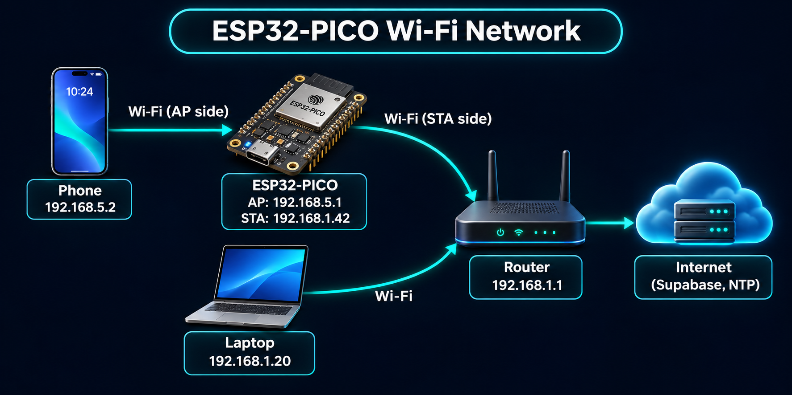
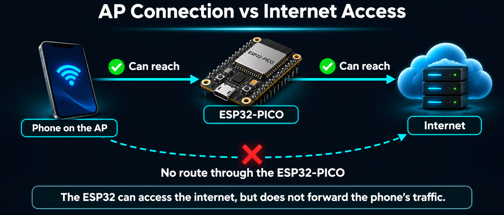
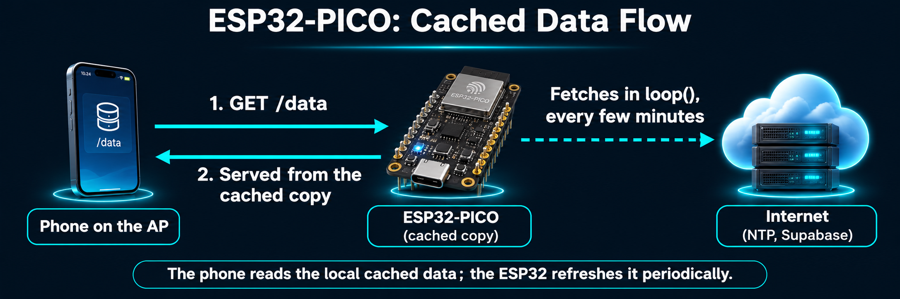
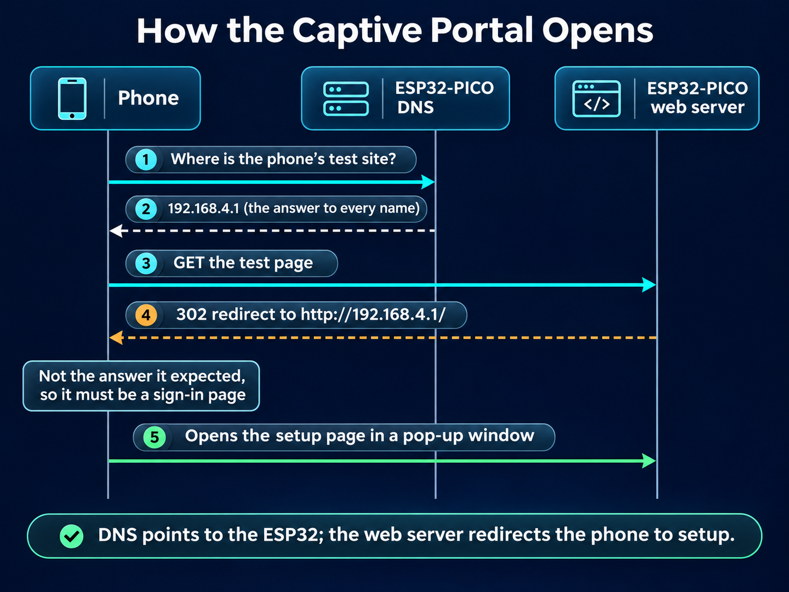
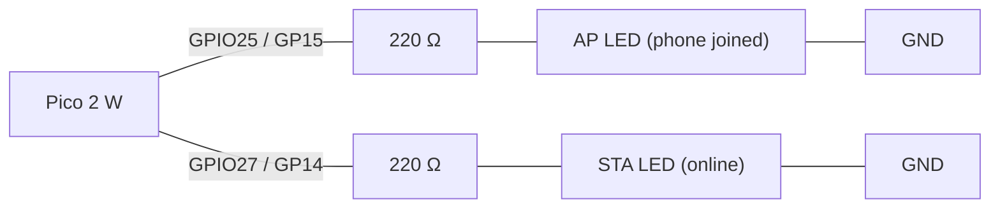
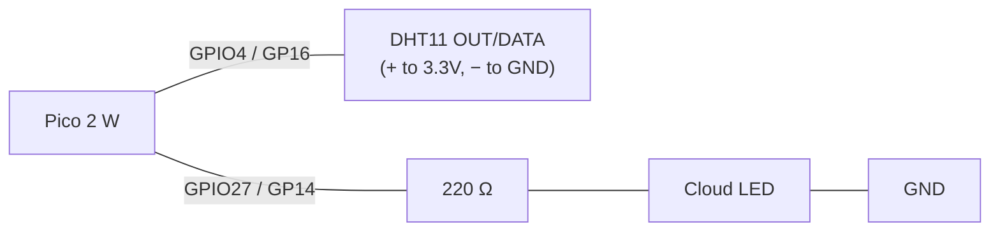
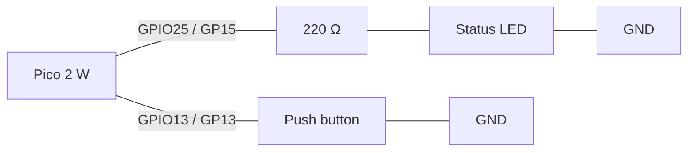

# Week 11: Wi-Fi Modes - AP + Station Mode (`WIFI_AP_STA`)

## Introduction
The WiFi Station Mode showed the microcontroller joining a router to reach the internet. The WiFi Access Point Mode showed it creating its own network for phones to join. **AP + Station mode** does both at once: phones nearby join the microcontroller directly, while the same microcontroller is also joined to a router and talks to the cloud.

That combination is behind two of the most common designs in real IoT products. The first is the **offline-first device**: its local control panel always works, even when the internet or the router is down, and it catches up with the cloud when the connection comes back. The second is **Wi-Fi provisioning**: a brand-new smart plug or camera creates a setup network, you choose your home Wi-Fi on its page, it tests the password while you watch, and then switches itself to normal Station mode.

### Choose your board
Everything on this page works on either board. The ideas are the same; a few Wi-Fi functions differ. Where the code differs, it's shown twice, labelled **ESP32-PICO** and **Raspberry Pi Pico 2 W**. Use the version for your board.

| | ESP32-PICO | Raspberry Pi Pico 2 W |
|---|---|---|
| Boards Manager package | *esp32* by Espressif Systems | *Raspberry Pi Pico/RP2040/RP2350* by Earle F. Philhower |
| Board to select | **ESP32 PICO-D4** | **Raspberry Pi Pico 2W** |
| `WiFi.begin()` | Returns straight away; the router is joined in the background | **Waits** until the router accepts the board, or a timeout (`WiFi.setTimeout()`, 15 s by default). `loop()` and the web server pause meanwhile |
| Noticing Wi-Fi changes | **Events**: `WiFi.onEvent()` calls your function | **No events**: `loop()` checks both sides every 0.5 s and reacts to changes |
| Why a join failed | Reason number in the `STA_DISCONNECTED` event (e.g. `202`) | `cyw43_wifi_link_status()` (e.g. `CYW43_LINK_BADAUTH`) |
| AP and STA MAC addresses | Different (the AP's is one higher) | The same |
| Close only the access point | `WiFi.softAPdisconnect(true)` | `WiFi.disconnectAP()` |
| Stop the station side retrying | `WiFi.disconnect()` | `stopStation()` (shown in Key Concept 2) |
| Save settings in flash | `Preferences` library | `EEPROM` library |
| Restart / free memory / random number | `ESP.restart()` / `ESP.getFreeHeap()` / `esp_random()` | `rp2040.reboot()` / `rp2040.getFreeHeap()` / `rp2040.hwrand32()` |
| Internet time | `configTime()` + `getLocalTime()` | `NTP.begin()` + `time()` |
| Pins used in the examples | GPIO25, GPIO27 (LEDs), GPIO4 (DHT11), GPIO13 (button) | GP15, GP14 (LEDs), GP16 (DHT11), GP13 (button). GP23, GP24, GP25 and GP29 belong to the Wi-Fi chip |

On both boards, call `WiFi.softAPConfig()` **before** `WiFi.softAP()` (the Pico ignores it afterwards).

## Key Concepts

### Key Concept 1 - Two Networks, One Radio
In `WIFI_AP_STA` mode the microcontroller has **two network interfaces** at the same time. Each one has its own address, its own MAC address and its own network:


<p align="center">

</p>


| | Access point side (AP) | Station side (STA) |
|---|---|---|
| Who's on it | Phones that joined the microcontroller's own network | The router, and everything else joined to the router |
| Microcontroller's address | `WiFi.softAPIP()` (e.g. `192.168.5.1`) | `WiFi.localIP()` (e.g. `192.168.1.42`, given by the router) |
| Microcontroller's MAC | `WiFi.softAPmacAddress()` | `WiFi.macAddress()` |
| Started by | `WiFi.softAP()` | `WiFi.begin()` |
| Ready | Straight away | After the router accepts it **and** gives it an address (`WiFi.status() == WL_CONNECTED`) |
| Status | `WiFi.softAPgetStationNum()` | `WiFi.status()`, `WiFi.RSSI()` |

The two sides are **independent**. The access point works whether or not the station side is connected, and `WiFi.status()` only describes the station side.

```cpp
WiFi.mode(WIFI_AP_STA);
WiFi.softAP(AP_SSID, AP_PASSWORD);   // phones can join straight away
WiFi.begin(SSID, PASSWORD);          // ESP32: joins in the background. Pico 2 W: waits for the router (up to the timeout)
```

#### What a "network interface" is
A **network interface** is one connection to one network. Each interface has:
- an **IP address** on that network,
- a **MAC address** (its hardware ID on that Wi-Fi link),
- a **subnet**: the range of addresses it treats as "local" (e.g. `192.168.5.0` to `192.168.5.255`).

A laptop with Ethernet and Wi-Fi has two interfaces. In `WIFI_AP_STA` mode the microcontroller also has two, but both run on the **same Wi-Fi radio**: the software splits it into two virtual interfaces that take turns using the hardware (Key Concept 2).

Think of the microcontroller as a shop with two doors onto two different streets:
- The **AP door** opens onto a small private street the shop built itself. Only phones that joined the microcontroller's network are on it.
- The **STA door** opens onto the main road (the router's network), where the laptop, other devices and the way out to the internet are.

Each door has its own street address, which is why the microcontroller has two IPs.

#### Who hands out the addresses
The two sides get their addresses in opposite ways:

| | AP side | STA side |
|---|---|---|
| Microcontroller's role | **DHCP server**: it hands out addresses | **DHCP client**: it asks for an address |
| Microcontroller's own IP | Chosen by you (default `192.168.4.1`, or set with `softAPConfig()`) | Chosen by the router (e.g. `192.168.1.42`) |
| Phones/laptops get | `192.168.5.2`, `.3`, ... from the microcontroller | Addresses from the router |

On the AP side the microcontroller is the "router" of its own small network. On the STA side it's just another client, the same as your laptop.

#### MAC addresses on the two sides
Every interface has a MAC address (its hardware ID on that Wi-Fi link). The two boards handle this differently:

| | ESP32-PICO | Raspberry Pi Pico 2 W |
|---|---|---|
| STA MAC (`WiFi.macAddress()`) | The base MAC burned into the chip | The MAC stored in the Wi-Fi chip |
| AP MAC (`WiFi.softAPmacAddress()`) | Base MAC + 1 (the last byte goes up by one) | **The same** as the STA MAC |

Sharing one MAC doesn't cause a clash on the Pico, because the two sides are on **different** networks: the router only ever sees the station side, and phones only ever see the AP side. On either board, if you set up MAC filtering or a DHCP reservation on the router, use `WiFi.macAddress()` (the STA MAC), because that's the one the router sees.

#### "Independent" in practice: the timeline at boot
**ESP32-PICO**
```cpp
WiFi.mode(WIFI_AP_STA);
WiFi.softAPConfig(apIP, apIP, apSubnet);
WiFi.softAP(AP_SSID, AP_PASSWORD);   // t = 0 s: AP is up, phones can join now
WiFi.begin(SSID, PASSWORD);          // t = 0 s: STA *starts* trying in the background
server.begin();                      // t = 0 s: web server ready on the AP side
// t ≈ 2-5 s: router accepts → STA gets 192.168.1.42 → server now also reachable there
// router dies later → STA drops, AP and its phones carry on unaffected
```

**Raspberry Pi Pico 2 W**
```cpp
WiFi.setTimeout(8000);               // WiFi.begin() gives up after 8 s
WiFi.mode(WIFI_AP_STA);
WiFi.softAPConfig(apIP, apIP, apSubnet);
WiFi.softAP(AP_SSID, AP_PASSWORD);   // t = 0 s: AP is up, phones can join now
server.begin();                      // t = 0 s: web server set up for the AP side
WiFi.begin(SSID, PASSWORD);          // t = 0-8 s: waits here until the router accepts (or 8 s pass)
// a moment later: the router gives STA 192.168.1.42 → server now also reachable there
// router dies later → STA drops, AP and its phones carry on unaffected
```

Three consequences follow:
1. **`WiFi.status()` only describes the STA side.** A value other than `WL_CONNECTED` does *not* mean the AP is down. Check the AP side with `WiFi.softAPgetStationNum()`.
2. **Never block `setup()` waiting for the router.** This pattern from Station-mode sketches breaks AP + Station:
   ```cpp
   while (WiFi.status() != WL_CONNECTED) { delay(500); }  // ✗ hangs forever if the router is down
   server.begin();                                        //   so the AP side never gets a web server
   ```
   Start the server straight away and check the STA connection in `loop()` (Key Concept 5). On the Pico, call `WiFi.begin()` **last** in `setup()`, because it's the slow step. The AP side is the part that must keep working when the router doesn't.
3. **On the Pico 2 W, every attempt to join the router pauses `loop()`.** Phones stay joined to the AP during the pause, but their pages wait until `WiFi.begin()` returns. That's why the Pico examples use a short timeout (8 s) and only retry every 30 s. The ESP32 doesn't have this pause.

#### When to choose AP + Station
| Use... | When... |
|---|---|
| **Station only** | The device only talks to the cloud, or everyone who uses it is on the same router |
| **Access Point only** | There's no router at all, and no internet is needed |
| **AP + Station** | The device needs the internet **and** people must be able to reach it directly, even when the router or internet is down. Also for **setup**: the device needs its own network to get the home Wi-Fi details, then joins that network |

AP + Station costs more than either mode alone: it uses the most power, and the two sides share the radio's airtime. Use it when the design needs both, not by default.

#### Avoid an address clash
The access point and the router's network must use **different** address ranges. If the router also hands out `192.168.4.x` addresses (some phone hotspots and routers do), the microcontroller has two networks with the same addresses and can't tell where to send replies. Move the access point to a range nobody else uses with `WiFi.softAPConfig()`, for example `192.168.5.1`. Call it **after** `WiFi.mode()` and **before** `WiFi.softAP()`:

```cpp
IPAddress apIP(192, 168, 5, 1);
IPAddress subnet(255, 255, 255, 0);
WiFi.mode(WIFI_AP_STA);
WiFi.softAPConfig(apIP, apIP, subnet);   // must come before softAP()
WiFi.softAP(AP_SSID, AP_PASSWORD);
```

#### How the microcontroller picks which side to reply through
When a request arrives, the reply has to leave through the right interface. The microcontroller decides by comparing the destination IP with each interface's subnet:

| Reply goes to... | Matches... | Sent out through |
|---|---|---|
| `192.168.5.2` (phone on the AP) | AP subnet `192.168.5.x` | **AP** side |
| `192.168.1.20` (laptop on the router) | STA subnet `192.168.1.x` | **STA** side |
| Anything else (e.g. Supabase's public IP) | No local match | The **STA side's gateway** (the router), which forwards it to the internet |

This is why the address clash above matters: if both sides use `192.168.4.x`, a reply to `192.168.4.2` matches **both** interfaces. The network stack picks the first match, which may be the wrong side, and the phone never gets its page.

#### Try it: watch both sides
**ESP32-PICO**
```cpp
#include <WiFi.h>

void setup() {
  Serial.begin(115200);
  WiFi.mode(WIFI_AP_STA);
  WiFi.softAPConfig(IPAddress(192, 168, 5, 1), IPAddress(192, 168, 5, 1), IPAddress(255, 255, 255, 0));
  WiFi.softAP("ESP32-Setup", "12345678");
  WiFi.begin("YourSSID", "YourPassword");   // keeps retrying in the background
}

void loop() {
  Serial.printf("AP : %s  MAC %s  clients %d\n",
                WiFi.softAPIP().toString().c_str(),
                WiFi.softAPmacAddress().c_str(),
                WiFi.softAPgetStationNum());
  Serial.printf("STA: %s  MAC %s  status %d  RSSI %d\n\n",
                WiFi.localIP().toString().c_str(),
                WiFi.macAddress().c_str(),
                WiFi.status(), WiFi.RSSI());
  delay(3000);
}
```

**Raspberry Pi Pico 2 W**
```cpp
#include <WiFi.h>

void setup() {
  Serial.begin(115200);
  WiFi.setTimeout(8000);
  WiFi.mode(WIFI_AP_STA);
  WiFi.softAPConfig(IPAddress(192, 168, 5, 1), IPAddress(192, 168, 5, 1), IPAddress(255, 255, 255, 0));
  WiFi.softAP("Pico-Setup", "12345678");
  WiFi.begin("YourSSID", "YourPassword");   // waits up to 8 s; doesn't retry
}

void loop() {
  Serial.printf("AP : %s  MAC %s  clients %d\n",
                WiFi.softAPIP().toString().c_str(),
                WiFi.softAPmacAddress().c_str(),
                WiFi.softAPgetStationNum());
  Serial.printf("STA: %s  MAC %s  status %d  RSSI %d\n\n",
                WiFi.localIP().toString().c_str(),
                WiFi.macAddress().c_str(),
                WiFi.status(), WiFi.RSSI());
  delay(3000);
}
```
- Join the AP from your phone and watch `clients` go from 0 to 1.
- Turn off your router or hotspot: the STA `status` stops being `3` (`WL_CONNECTED`) while the AP line doesn't change. The ESP32 reconnects by itself when the router comes back; the Pico sketch above doesn't retry, so press its reset button.
- Compare the two MAC addresses: on the ESP32-PICO the last byte differs by one; on the Pico 2 W they're the same.

#### Check your understanding
1. Your sketch prints a `WiFi.status()` other than `3` (`WL_CONNECTED`). Can a phone still load the microcontroller's page? Through which IP?
2. Why should you give the router the STA MAC (`WiFi.macAddress()`), not the AP MAC, for a DHCP reservation? (On the Pico 2 W they're the same value. Why doesn't that confuse the router or the phones?)
3. A phone on the AP has IP `192.168.4.3`, and the router also uses `192.168.4.x`. Why might the page never load?

### Key Concept 2 - One Radio Means One Channel
The microcontroller has **one** Wi-Fi radio, and a radio can only sit on one channel at a time. The station side has no choice: it must use whatever channel the router uses. So **the access point is moved to the router's channel**, whatever channel you asked for in `softAP()`.

What that means in practice:

| Situation | What happens on the access point side |
|---|---|
| The station side joins a router on a different channel | The AP moves to the router's channel. Phones already joined lose the connection for a moment and usually rejoin by themselves |
| The station side is **retrying** a router that's missing or has the wrong password | While it searches, the radio hops between channels. Phones on the AP can't stay connected, and pages time out |
| The station side scans for networks | The radio leaves the AP's channel for a few seconds; phones on the AP may stall |
| Both sides are busy | They share the airtime, so each side is slower than it would be alone |

How to design around it:
- **Pick the router's channel** for `softAP()` when you know it (print `WiFi.channel()` once in Station mode), so nothing has to move.
- **Stop the station side retrying** when it clearly can't connect (e.g. a wrong password during setup): stop it (ESP32: `WiFi.disconnect()`, Pico: `stopStation()` below) so the radio stays on the AP's channel. Provisioning (Key Concept 7) relies on this.
- **Scan** before phones join, or only when the user asks.

#### What a Wi-Fi channel is
The microcontroller only works in the **2.4 GHz** band. That band is divided into **channels** 1 to 13 (1 to 11 in some countries). Each channel is a slice of radio frequencies, and two devices can only hear each other if they're tuned to the same one.

Think of the radio as **one person with one walkie-talkie**. They can talk to the router's group on channel 6, or the phones' group on channel 1, but they can't listen to both channels at once. They also can't ask the router's group to move, because the router decides its own channel. So the only option is for the phones' group (the microcontroller's own AP) to move to channel 6 as well.

> **5 GHz networks:** Because the microcontroller is 2.4 GHz only, it can't join a 5 GHz-only network. If your router shows two network names (e.g. `Home` and `Home-5G`), join the 2.4 GHz one.

#### Why retrying is the worst case
When the station side can't find its router (the router is off, out of range, or the SSID is misspelt), it **scans**: it visits each channel in turn to look for the router. While it's on channel 3, 4, 5 ..., it isn't on the AP's channel, so:
- phones on the AP miss messages, and some phones decide the network is broken and disconnect,
- web pages on the AP side load slowly or time out.

A wrong password is similar: the microcontroller keeps finding the router, failing to log in, and trying again. It's busy with the router instead of the phones.

On the Pico 2 W there's a second cost: `WiFi.begin()` waits for the whole attempt, so `loop()` and the web server are paused too.

So **a station side that keeps retrying makes the AP side unreliable**, even though the AP side has nothing to do with the router. The fix is to **pause retries for a while** so the radio can stay on the AP's channel.

**ESP32-PICO:** the station side retries in the background by itself, so let it try for 15 s, then switch it off for 60 s:
```cpp
const unsigned long STA_TRY_TIME   = 15000;   // try the router for 15 s...
const unsigned long STA_REST_TIME  = 60000;   // ...then leave the radio alone for 60 s
unsigned long staTimer = 0;
bool staTrying = true;

void manageStation() {
  if (WiFi.status() == WL_CONNECTED) return;                     // all good, nothing to do

  if (staTrying && millis() - staTimer > STA_TRY_TIME) {
    WiFi.disconnect();                                            // stop scanning: radio stays on the AP's channel
    staTrying = false;
    staTimer = millis();
    Serial.println("Router not found, pausing retries");
  } else if (!staTrying && millis() - staTimer > STA_REST_TIME) {
    WiFi.begin(SSID, PASSWORD);                                   // try again
    staTrying = true;
    staTimer = millis();
  }
}
```

**Raspberry Pi Pico 2 W:** each `WiFi.begin()` is one attempt that waits until it succeeds or times out. Keep the attempt short, stop the station side completely when it fails, and rest between attempts:
```cpp
#include <pico/cyw43_arch.h>                     // for cyw43_wifi_leave() and cyw43_wifi_link_status()

const unsigned long STA_REST_TIME = 60000;       // leave the radio alone for 60 s between attempts
unsigned long lastAttempt = 0;

// Stops the station side completely, so the radio stops searching and stays on the AP's channel.
void stopStation() {
  WiFi.disconnect();
  cyw43_wifi_leave(&cyw43_state, CYW43_ITF_STA);   // also cancels a join still in progress
}

// Called from loop(): one short attempt, then a long rest.
void manageStation() {
  if (WiFi.status() == WL_CONNECTED) return;                       // all good, nothing to do
  if (lastAttempt != 0 && millis() - lastAttempt < STA_REST_TIME) return;

  lastAttempt = millis();
  WiFi.begin(SSID, PASSWORD);                                       // waits up to WiFi.setTimeout()
  if (cyw43_wifi_link_status(&cyw43_state, CYW43_ITF_STA) != CYW43_LINK_JOIN) {
    stopStation();                                                  // radio stays on the AP's channel
    Serial.println("Router not found, pausing retries");
  }
}
```
On the Pico, also call `WiFi.setTimeout(8000)` in `setup()`.

Call `manageStation()` from `loop()`. Phones get 60 s of a steady AP between each attempt, and the device still reconnects by itself when the router comes back.

#### Finding the router's channel
If the AP starts on the router's channel, nothing has to move when the station side joins. Two ways to find it:

**1. Once, by hand:** connect in Station mode and print it. Then use it as the 3rd argument of `softAP()`.
```cpp
Serial.println(WiFi.channel());          // e.g. 6
WiFi.softAP(AP_SSID, AP_PASSWORD, 6);    // AP starts on channel 6
```

**2. Automatically, at boot:** scan *before* starting the AP (no phones are joined yet, so the scan doesn't disturb anyone) and copy the router's channel.
```cpp
int findChannel(const char* ssid) {
  int n = WiFi.scanNetworks();            // waits until the scan finishes (a few seconds)
  for (int i = 0; i < n; i++) {
    if (String(WiFi.SSID(i)) == ssid) return WiFi.channel(i);   // String() so the text is compared, not the pointers
  }
  return 1;                               // router not found: use channel 1
}

void setup() {
  WiFi.mode(WIFI_AP_STA);
  int ch = findChannel(SSID);
  WiFi.softAP(AP_SSID, AP_PASSWORD, ch);  // AP already on the router's channel
  WiFi.begin(SSID, PASSWORD);
}
```

Routers set to "Auto" channel can change channel by themselves (usually after a restart). If that happens, the microcontroller follows the router and the AP moves too. Phones drop for a moment and rejoin. This is normal.

#### Sharing airtime
Even on the same channel, the radio can only send **or** receive one thing at a time. When the station side is uploading to the cloud, the AP side waits, and the other way round. Each side is slower than it would be alone. For small IoT messages (sensor readings, a status page) you won't notice. It only matters for large transfers, such as serving big images or uploading files over both sides at once.

#### Troubleshooting channel problems
| Symptom | Likely cause | Fix |
|---|---|---|
| Phones keep dropping off the AP every few seconds | The station side is retrying a missing router or a wrong password | Pause retries (`manageStation()` above), or check the SSID and password |
| Phones drop once, a few seconds after boot, then are fine | The station side joined, and the AP moved to the router's channel | Start the AP on the router's channel |
| `WiFi.channel()` shows a different channel than you gave `softAP()` | The AP followed the router | Expected. Use the router's channel |
| (Pico 2 W) `WiFi.channel()` prints `-1` | The station side isn't connected, so there's no router channel to report | Expected while offline |
| (Pico 2 W) AP pages freeze for up to 8 s every 30-60 s | A `WiFi.begin()` attempt is waiting for a missing router | Expected on the Pico. Shorten `WiFi.setTimeout()` or retry less often |
| The microcontroller never sees your home network | The network is 5 GHz only | Join the 2.4 GHz network |
| AP pages freeze for a few seconds now and then | A network scan is running | Scan only at boot or when the user asks |

#### Check your understanding
1. You call `WiFi.softAP("Lab", "12345678", 1)` and the router is on channel 11. Which channel will the AP end up on after the station side connects, and why?
2. Why does a **wrong password** on the station side make web pages on the **AP** side time out?
3. Why is it safe to scan in `setup()` before `softAP()`, but not in `loop()` while phones are joined?

### Key Concept 3 - The Microcontroller Doesn't Share Its Internet
This one surprises a lot of people: a phone joined to the microcontroller's access point still has no internet, even while the microcontroller is joined to a router and is uploading to Supabase without any trouble.


<p align="center">

</p>
A router passes traffic from one network to another (**routing**) and rewrites addresses so many devices can share one internet connection (**NAT**). The microcontroller in `WIFI_AP_STA` mode does neither by default. Each side only talks to the microcontroller itself.

So, in AP + Station designs:
- Phones on the AP still show "No internet". Tell users to stay connected.
- If a phone needs something from the internet (the current time, a cloud value), the **microcontroller** fetches it over the station side and shows it on its own page.
- The phone's browser can only load pages and files the microcontroller serves. Don't link to images, fonts or scripts on the internet in your pages: on the AP side they won't load.

#### Following one packet
Say the phone on the AP opens `google.com`. Step by step:

1. When the phone joined, the microcontroller's DHCP server told it: "your address is `192.168.5.2`, and your **gateway** (the way out to everything else) is `192.168.5.1`", which is the microcontroller itself.
2. Google's address isn't on `192.168.5.x`, so the phone sends the request to its gateway: the microcontroller.
3. The request reaches the microcontroller. It isn't addressed to the microcontroller's own IP, and **forwarding is switched off**, so the microcontroller quietly **drops** it.
4. The phone waits, times out, and shows an error.

Even if the microcontroller did pass the packet on to the router, it still wouldn't work. The router only knows about its own `192.168.1.x` network. Google's reply would be addressed to `192.168.5.2`, and the router would have no idea where that is. **NAT** fixes this on a real router: it swaps the phone's address for its own on the way out, and swaps it back on the way in. The microcontroller doesn't do that by default.

A receptionist in an office building works the same way. The receptionist (the microcontroller) happily takes questions from visitors in the lobby (the AP) and makes phone calls to the outside world (the STA). But they don't pass the lobby's mail outside for visitors. If a visitor wants to know something from outside, they **ask the receptionist**, who finds out and tells them.

> **Can a microcontroller be a real router?** It is possible with advanced firmware that turns on forwarding and NAT, but it's slow and uses a lot of memory. That's not what AP + Station is for, and we don't use it in this course.

#### What the phone does when there's no internet
Phones test every Wi-Fi network they join by quietly loading a known web address (Android and iPhone each have their own). On the microcontroller's AP that test fails, so the phone:
- shows **"No internet"** or **"Connected, no internet"** next to the network name,
- may show a pop-up asking whether to **stay connected**. The user must choose **Keep / Use without internet**, or the phone may disconnect,
- may send traffic over **mobile data** instead. If the microcontroller's page won't load, turning mobile data off for a moment usually fixes it.

Also, **names don't work, only addresses**. The phone has no DNS server to turn `myesp.com` into an address, so users must type `http://192.168.5.1`. (Key Concept 7 shows how a provisioning portal uses a `DNSServer` to catch every name and send it to the microcontroller.)

#### The microcontroller as the middleman
If a page on the AP side needs internet data, the microcontroller fetches it over the station side, **keeps a copy**, and serves that copy from its own page:


<p align="center">

</p>

Two rules:
- **Fetch in `loop()`, not in the web handler.** A handler that waits for the internet makes every phone wait too, and if the internet is down the page never loads (see Key Concept 6).
- **Always have something to show.** Keep the last value and the time it was fetched, and say clearly on the page when it's old or missing.

Example: show the real time on a page served over the AP. The microcontroller gets the time from an internet time server (NTP) over the station side; the phone just asks the microcontroller.

**ESP32-PICO**
```cpp
#include <time.h>

void setup() {
  // ... WiFi.mode(WIFI_AP_STA), softAPConfig(), softAP(), begin(), server routes ...
  configTime(10 * 3600, 0, "pool.ntp.org");   // UTC+10; syncs by itself once the STA side is online
  server.on("/time", handle_time);
  server.begin();
}

// Runs for "/time": answers from the microcontroller's own clock, never waits for the internet.
void handle_time() {
  struct tm now;
  if (getLocalTime(&now, 0)) {                // 0 ms timeout: don't wait
    char buf[32];
    strftime(buf, sizeof(buf), "%H:%M:%S %d/%m/%Y", &now);
    server.send(200, "text/plain", buf);
  } else {
    server.send(200, "text/plain", "Time not synced yet (no internet so far)");
  }
}
```

**Raspberry Pi Pico 2 W**
```cpp
#include <time.h>

void setup() {
  // ... WiFi.mode(WIFI_AP_STA), softAPConfig(), softAP(), server routes, begin() ...
  setenv("TZ", "AEST-10", 1);                 // local time zone: UTC+10 (Brisbane)
  tzset();
  server.on("/time", handle_time);
  server.begin();
}

// Call this once, when the station side comes online (Key Concept 5).
void startTimeSync() {
  NTP.begin("pool.ntp.org");                  // keeps the clock synced in the background from now on
}

// Runs for "/time": answers from the microcontroller's own clock, never waits for the internet.
void handle_time() {
  time_t now = time(nullptr);
  if (now < 1700000000) {                     // the clock starts near 1970 until NTP has answered
    server.send(200, "text/plain", "Time not synced yet (no internet so far)");
    return;
  }
  struct tm local;
  localtime_r(&now, &local);                  // seconds since 1970 → hours, minutes, date in our time zone
  char buf[32];
  strftime(buf, sizeof(buf), "%H:%M:%S %d/%m/%Y", &local);
  server.send(200, "text/plain", buf);
}
```

On the Pico, `NTP.begin()` needs the internet to look up `pool.ntp.org`, so call it once the station side is online, not in `setup()` before the router has been joined. On the ESP32, `configTime()` can go in `setup()`: it waits for the internet by itself.

Once the time has synced, the microcontroller's clock keeps running even if the internet drops later. The phone still gets the right time.

#### Keep your pages self-contained
Anything the page loads from the internet fails on the AP side. The page may also hang while the browser waits for it.

| ✗ Breaks on the AP side | ✓ Works everywhere |
|---|---|
| `<script src="https://cdn.jsdelivr.net/npm/chart.js">` | A small inline `<script>` you wrote, or a simple bar drawn with `<div>` widths |
| `<link href="https://fonts.googleapis.com/...">` | `font-family: sans-serif;` (the phone's own font) |
| `` | An emoji, inline SVG, or no image |
| `fetch("https://xyz.supabase.co/...")` from the page | `fetch("/data")`: ask the microcontroller, which got the data itself |

The last row is the most common mistake. JavaScript on the page runs **on the phone**, and the phone has no internet. Only the microcontroller can reach Supabase.

#### Troubleshooting
| Symptom | Likely cause | Fix |
|---|---|---|
| Phone says "No internet" on the AP | Expected: the microcontroller doesn't share its internet | Tell users to stay connected |
| Page won't load at all from the phone | The phone switched to mobile data, or the user typed a name instead of the IP | Turn off mobile data, and use `http://192.168.5.1` |
| Page loads but has no styling, chart or images | It links to files on the internet | Inline them or remove them |
| Page loads very slowly, then appears | The browser is waiting for an internet file to time out | Remove external links |
| Cloud value on the page never updates | The page tries to `fetch()` Supabase itself | Have the microcontroller fetch it, and serve it from `/data` |

#### Check your understanding
1. The microcontroller is uploading to Supabase without any trouble. Why can't a phone on its AP open a website?
2. A page served over the AP uses `fetch("https://xyz.supabase.co/rest/v1/readings")` to show cloud data. Why does it fail, and how would you fix it?
3. Why does `handle_time()` reply straight away (ESP32: a 0 ms timeout in `getLocalTime()`; Pico: checking the clock) instead of waiting for NTP to sync?

### Key Concept 4 - One Web Server, Two Doors
A `WebServer` started with `server.begin()` listens on **every** interface. The same pages are reachable from both networks:
- a phone on the access point opens `http://192.168.5.1`
- a laptop on the router's network opens `http://192.168.1.42` (the microcontroller's `WiFi.localIP()`)

Inside a handler, `server.client().localIP()` gives the address of the microcontroller **that the request arrived on**. Comparing it with `WiFi.softAPIP()` tells you which door it came through:

```cpp
// Returns true if the current web request came in through the microcontroller's own access point.
bool cameFromAP() {
  return server.client().localIP() == WiFi.softAPIP();
}
```

That lets you apply a simple rule: **dangerous actions are only allowed from the AP side.** Only someone standing next to the device (in range of its access point, and knowing its password) can change Wi-Fi settings or restart it. Anyone on the building's network can still view the readings.

```cpp
// Runs for "/settings": only allowed for requests that came in through the access point.
void handle_settings() {
  if (!cameFromAP()) {
    server.send(403, "text/plain", "Settings can only be changed from the device's own network");
    return;
  }
  // ...show the settings page...
}
```

#### How one server listens on two networks
`server.begin()` doesn't attach the server to one IP address. It tells the microcontroller: "any connection to **port 80**, on **any** of my addresses, comes to me." So there is:
- **one** `WebServer` object,
- **one** set of routes (`server.on(...)`),
- **one** `server.handleClient()` in `loop()` that serves visitors from both sides.


<p align="center">

</p>
You don't write anything twice. The same `handle_root()` answers the phone and the laptop.

The STA door only exists while the station side is connected. Before the router accepts the microcontroller (or while the router connection is down), the laptop can't reach the device. The AP door stays open the whole time.

#### Two addresses in every request
Every request has two ends, and the `WebServer` can tell you both:

| Call (inside a handler) | Gives you | Phone on the AP | Laptop on the router |
|---|---|---|---|
| `server.client().localIP()` | The microcontroller's address the request **arrived on** (which door) | `192.168.5.1` | `192.168.1.42` |
| `server.client().remoteIP()` | The **visitor's** address | `192.168.5.2` | `192.168.1.20` |

`localIP()` is the reliable way to tell the doors apart. It's always exactly `WiFi.softAPIP()` or `WiFi.localIP()`. `remoteIP()` is useful for logging who did what:

```cpp
Serial.printf("%s from %s via %s door\n",
              server.uri().c_str(),
              server.client().remoteIP().toString().c_str(),
              cameFromAP() ? "AP" : "STA");
// /settings from 192.168.5.2 via AP door
```

`cameFromAP()` assumes the two sides use **different** address ranges (Key Concept 1, "Avoid an address clash"). If they clash, some requests and replies go out through the wrong side, and you can't trust which door a request seems to come from. Fix the clash first.

#### Same page, different content per door
Blocking a page isn't the only option. A handler can also change what it shows depending on the door. For example, the home page only shows the Settings link to visitors on the AP side:

```cpp
// Runs for "/": everyone sees the readings; only AP visitors see the Settings link.
void handle_root() {
  String html = "<!DOCTYPE html><html><body style='font-family:sans-serif'>";
  html += "<h1>Greenhouse</h1>";
  html += "<p>Temperature: " + String(temperature, 1) + " &deg;C</p>";

  if (cameFromAP()) {
    html += "<p><a href='/settings'>Settings</a></p>";
  } else {
    html += "<p>To change settings, join the device's own Wi-Fi network.</p>";
  }

  html += "</body></html>";
  server.send(200, "text/html", html);
}
```

Hiding the link is only for convenience. **The check inside `handle_settings()` is what actually protects it**: someone on the router's network could still type `/settings` by hand, so every protected handler must check `cameFromAP()` itself.

#### Use relative links
A page reached through one door must keep the visitor on that door. Write links **without** an IP address:

| ✗ Breaks for visitors on the other side | ✓ Works from both doors |
|---|---|
| `<a href="http://192.168.5.1/settings">` | `<a href="/settings">` |
| `fetch("http://192.168.1.42/data")` | `fetch("/data")` |

A link without an address goes back to whatever address the browser used to load the page, so it always goes through the right door. A laptop on the router's network can't reach `192.168.5.1`, and a phone on the AP can't reach `192.168.1.42` (Key Concept 3: the microcontroller doesn't forward between its sides).

#### One loop serves both doors
Both doors share the same `server.handleClient()`. If `loop()` gets stuck (a long `delay()`, a slow HTTPS upload, a `while` waiting for the router, or a `WiFi.begin()` attempt on the Pico), **both** sides stop answering, not just one. Keep `loop()` quick (Key Concept 6 explains how to handle cloud uploads).

#### How safe is "AP side only"?
The rule means "only people in Wi-Fi range who know the AP password". It's only as strong as that:
- **Give the AP a password** (8+ characters). With an open AP, anyone walking past can reach the settings.
- **Change the default AP password** for each device you deploy.
- For anything important, add a login on top of the AP check (Key Concept 8).

#### Troubleshooting
| Symptom | Likely cause | Fix |
|---|---|---|
| Phone on the AP opens the page, laptop on the router can't | The station side isn't connected (`WiFi.localIP()` is `0.0.0.0`), or the laptop is on a different network | Check the Serial output for the STA IP, and check that the laptop is on the same router |
| Settings refused (403) from the phone | The phone switched to mobile data or the router's Wi-Fi, so it isn't on the AP | Rejoin the AP and open `http://192.168.5.1` |
| A link on the page works from one side but not the other | The link includes an IP address | Use relative links (`/settings`) |
| Both sides freeze at the same time | `loop()` is blocked, so `handleClient()` isn't running | Remove long `delay()`s and blocking waits; retry the router less often |
| Pages fail from one side only, or `cameFromAP()` gives odd results | The AP and the router use the same address range | Move the AP with `softAPConfig()` |

#### Check your understanding
1. How many `WebServer` objects and how many `handle_root()` functions do you need to serve the phone on the AP **and** the laptop on the router?
2. In a request from a laptop on the router's network, what do `server.client().localIP()` and `server.client().remoteIP()` return?
3. The Settings link is hidden from STA-side visitors. Why must `handle_settings()` still check `cameFromAP()`?
4. Why does `<a href="http://192.168.5.1/settings">` break for a laptop on the router's network?

### Key Concept 5 - Knowing What Each Side Is Doing
A device in AP + Station mode has to notice when things change on **either** side: a phone joins the AP, the router connection comes up, the router drops. The two boards do this differently:

| ESP32-PICO | Raspberry Pi Pico 2 W |
|---|---|
| **Events.** The Wi-Fi system calls your function the moment something happens. The function only sets flags; `loop()` does the work | **Change detection.** There are no Wi-Fi events, so `loop()` checks both sides every 0.5 s, compares with last time, and reacts when something has changed |

Either way, follow the same rule as on the other pages: the real work (printing, uploading, changing LEDs) happens in `loop()`.

A device in AP + Station mode has two status lights' worth of information. Show them separately, for example one LED for "a phone is joined to me" and one for "I'm online through the router". If you combine them into one "Wi-Fi OK" light, the user can't tell which side has the problem.

#### ESP32-PICO: events from both sides
One event function can handle station **and** access point events. It only copies details and sets `volatile` flags:

```cpp
// Called by the Wi-Fi system for both sides' events. Only copies details and sets flags.
void onWiFiEvent(WiFiEvent_t event, WiFiEventInfo_t info) {
  switch (event) {
    case ARDUINO_EVENT_WIFI_STA_GOT_IP:        staGotIPFlag = true; break;
    case ARDUINO_EVENT_WIFI_STA_DISCONNECTED:  staReason = info.wifi_sta_disconnected.reason;
                                               staLostFlag = true; break;
    case ARDUINO_EVENT_WIFI_AP_STACONNECTED:   apJoinFlag = true; break;
    case ARDUINO_EVENT_WIFI_AP_STADISCONNECTED: apLeaveFlag = true; break;
    default: break;
  }
}
```

##### Why use events at all?
You could check `WiFi.status()` and `WiFi.softAPgetStationNum()` in `loop()` every second (**polling**). Events are better because they:
- tell you **the moment** something happens, not up to a second later,
- catch short-lived things a slow poll would miss (a phone that joins and leaves straight away),
- carry **details** that polling can't give you: *why* the router dropped you, *which* phone joined.

Register the function once in `setup()`, before starting either side, so you don't miss the first events:

```cpp
WiFi.onEvent(onWiFiEvent);
WiFi.mode(WIFI_AP_STA);
WiFi.softAP(AP_SSID, AP_PASSWORD);
WiFi.begin(SSID, PASSWORD);
```

##### Why the event function only sets flags
`onWiFiEvent()` is **not** called from `loop()`. It's called by the Wi-Fi system's own task, which runs alongside `loop()`. While your event function runs, the Wi-Fi system waits for it. So:
- **Don't** `delay()`, print a lot to Serial, send web pages or upload to Supabase inside it. The Wi-Fi system stalls, and the microcontroller may crash and restart.
- **Do** copy the details you need and set a flag. `loop()` sees the flag a moment later and does the real work.
- Mark the flags `volatile`, which tells the compiler the value can change outside `loop()`, so it re-reads it every time.

It works like a doorbell: the bell (event) only rings, and the person inside (`loop()`) walks over and answers the door.

##### The events you'll use
| Event | Side | Means | Useful detail in `info` |
|---|---|---|---|
| `ARDUINO_EVENT_WIFI_AP_START` | AP | The AP is up and phones can join | |
| `ARDUINO_EVENT_WIFI_AP_STACONNECTED` | AP | A phone joined the AP | `info.wifi_ap_staconnected.mac` (the phone's MAC) |
| `ARDUINO_EVENT_WIFI_AP_STAIPASSIGNED` | AP | The microcontroller gave that phone an address | `info.wifi_ap_staipassigned.ip` |
| `ARDUINO_EVENT_WIFI_AP_STADISCONNECTED` | AP | A phone left the AP | `info.wifi_ap_stadisconnected.mac` |
| `ARDUINO_EVENT_WIFI_STA_CONNECTED` | STA | Joined the router, **but no IP address yet** | |
| `ARDUINO_EVENT_WIFI_STA_GOT_IP` | STA | The router gave the microcontroller an address, so it's online | `info.got_ip.ip_info.ip` |
| `ARDUINO_EVENT_WIFI_STA_DISCONNECTED` | STA | Lost the router, or couldn't join it | `info.wifi_sta_disconnected.reason` |

Two things catch people out:
- **`STA_CONNECTED` isn't "online".** Wait for `STA_GOT_IP` before uploading, syncing time or printing `WiFi.localIP()`.
- **`STA_DISCONNECTED` fires over and over** while the station side is retrying, not just once. Each failed attempt is another event.

A typical boot, in order:
```
AP_START                → phones can join now
AP_STACONNECTED         → a phone joined
AP_STAIPASSIGNED        → the phone got 192.168.5.2
STA_CONNECTED           → joined the router (no IP yet)
STA_GOT_IP              → 192.168.1.42, online
```
The AP events don't wait for the STA events, or the other way round. They can mix in any order (Key Concept 1: the two sides are independent).

##### Reading the disconnect reason
The `reason` number on `STA_DISCONNECTED` tells you *why*, so the device can react properly instead of retrying forever:

| Reason | Name | Usually means | What to do |
|---|---|---|---|
| `201` | `NO_AP_FOUND` | Router off, out of range, SSID misspelt, or 5 GHz only | Keep retrying slowly (Key Concept 2, `manageStation()`) |
| `202` | `AUTH_FAIL` | Login refused | Probably a wrong password: stop retrying and ask for a new one |
| `15` | `4WAY_HANDSHAKE_TIMEOUT` | Password check didn't finish | Usually also a **wrong password** |
| `200` | `BEACON_TIMEOUT` | Router stopped answering (switched off, or signal too weak) | Retry slowly; check `WiFi.RSSI()` |
| `8` | `ASSOC_LEAVE` | The microcontroller left on purpose (you called `WiFi.disconnect()`) | Nothing, you did this |

Provisioning (Key Concept 7) uses exactly this: a `202` or `15` while testing new details means "wrong password", so the device stops the station side and shows an error on the setup page.

##### Handling the flags in `loop()`
```cpp
const int AP_LED  = 25;   // GPIO25: on = at least one phone joined to the AP
const int STA_LED = 27;   // GPIO27: on = online, blinking = trying, off = gave up
// (set both pins with pinMode(..., OUTPUT) in setup())

volatile bool staGotIPFlag = false, staLostFlag = false;
volatile bool apJoinFlag = false, apLeaveFlag = false;
volatile uint8_t staReason = 0;
bool staGaveUp = false;

// Runs in loop(): does the real work for whatever the event function flagged.
void handleWiFiEvents() {
  if (staGotIPFlag) {
    staGotIPFlag = false;
    staGaveUp = false;
    Serial.printf("STA online: %s\n", WiFi.localIP().toString().c_str());
  }
  if (staLostFlag) {
    staLostFlag = false;
    Serial.printf("STA lost, reason %d\n", staReason);
    if (staReason == 202 || staReason == 15) {   // wrong password: retrying won't help
      WiFi.disconnect();                          // keeps the radio on the AP's channel
      staGaveUp = true;
    }
  }
  if (apJoinFlag || apLeaveFlag) {
    apJoinFlag = apLeaveFlag = false;
    Serial.printf("Phones on AP: %d\n", WiFi.softAPgetStationNum());
  }

  // Two separate lights, one per side
  digitalWrite(AP_LED, WiFi.softAPgetStationNum() > 0);
  if (WiFi.status() == WL_CONNECTED) digitalWrite(STA_LED, HIGH);
  else if (staGaveUp)                digitalWrite(STA_LED, LOW);
  else                               digitalWrite(STA_LED, (millis() / 250) % 2);   // blink while trying
}
```

Notice that the **count** of phones comes from `WiFi.softAPgetStationNum()`, not from counting flags. If two phones join between two passes of `loop()`, `apJoinFlag` is only set once (`true` twice is still just `true`). A flag says "something happened, go and look". The real state comes from asking the Wi-Fi system.

#### Raspberry Pi Pico 2 W: watching both sides for changes
Every half second, `loop()` reads the current state, compares it with what it saw last time, and reacts only when something has **changed**:

```cpp
bool staOnline = false;     // what we saw last time
int lastPhoneCount = 0;
unsigned long lastCheck = 0;

// Every 500 ms: compares both sides with last time and reacts to any change.
void checkWiFiChanges() {
  if (millis() - lastCheck < 500) return;
  lastCheck = millis();

  bool online = (WiFi.status() == WL_CONNECTED);
  if (online && !staOnline)  Serial.println("STA came online");    // changed: offline → online
  if (!online && staOnline)  Serial.println("STA lost the router"); // changed: online → offline
  staOnline = online;

  int phones = WiFi.softAPgetStationNum();
  if (phones != lastPhoneCount) Serial.printf("Phones on AP: %d\n", phones);
  lastPhoneCount = phones;
}
```

##### Why look for *changes*?
Reading `WiFi.status()` tells you the state **now**. Most jobs only need to run when the state **changes**: print the new address once, start the time sync once, upload the queue once the router is back. Keeping the last value and comparing (called **change detection**, or edge detection) turns a state that's read over and over into a one-off "it just happened" moment, the same as an event.

Why every 500 ms rather than on every pass of `loop()`?
- `WiFi.softAPgetStationNum()` asks the Wi-Fi chip each time, which takes longer than reading a variable.
- Half a second is quick enough for LEDs and messages, and leaves `loop()` free for the web server.

The trade-off: a change that's over within one check (a phone that joins and leaves straight away) can be missed. For status lights and logging, that doesn't matter.

##### What you can check
| Check | Side | Gives you |
|---|---|---|
| `WiFi.softAPgetStationNum()` | AP | How many phones are joined right now |
| `WiFi.status() == WL_CONNECTED` | STA | Joined the router **and** got an address: online |
| `WiFi.status()` (other values) | STA | `6` (`WL_DISCONNECTED`) = joined but **no address yet**; `0` (`WL_IDLE_STATUS`) = not joined, or stopped; `4` (`WL_CONNECT_FAILED`) = the last attempt failed |
| `cyw43_wifi_link_status(&cyw43_state, CYW43_ITF_STA)` | STA | The Wi-Fi chip's own status, including **why** a join failed (see below). Needs `#include <pico/cyw43_arch.h>` |
| `WiFi.localIP()`, `WiFi.RSSI()`, `WiFi.channel()` | STA | Address, signal strength and channel once online |

Two things catch people out:
- **Joined isn't "online".** `WiFi.begin()` returns once the router has accepted the Pico, but the address (DHCP) arrives a moment later. Wait for `WL_CONNECTED` before uploading, syncing time or printing `WiFi.localIP()`.
- **The router doesn't come back by itself.** When the station side drops, the sketch has to call `WiFi.begin()` again. The examples do this every 30 s while offline.

A typical boot, as the Serial Monitor shows it:
```
[AP] Running at 192.168.5.1      → phones can join now
[STA] Trying the router...       → WiFi.begin() is waiting (loop() is paused)
[STA] Online through the router. → the next check saw WL_CONNECTED: 192.168.1.42
[AP] A phone joined (1 now).     → the next check saw the count change
```
A phone can join the AP at any point, even before the router has answered (Key Concept 1: the two sides are independent). It's only *reported* at the next check after `WiFi.begin()` returns.

##### Reading why a join failed
After a failed `WiFi.begin()`, the Wi-Fi chip's status says *why*, so the device can react properly instead of retrying forever:

| `cyw43_wifi_link_status()` | Usually means | What to do |
|---|---|---|
| `CYW43_LINK_NONET` (`-2`) | Router off, out of range, SSID misspelt, or 5 GHz only | Keep retrying slowly (Key Concept 2, `manageStation()`) |
| `CYW43_LINK_BADAUTH` (`-3`) | Login refused: probably a **wrong password** | Stop retrying and ask for a new one |
| `CYW43_LINK_FAIL` (`-1`) | Joining failed for another reason | Retry slowly; check `WiFi.RSSI()` once connected |
| `CYW43_LINK_JOIN` (`1`) | Joined (success) | Wait for `WL_CONNECTED` |
| `CYW43_LINK_DOWN` (`0`) | Not joined, or stopped on purpose (`stopStation()`) | Nothing, you did this |

Read it **before** calling `stopStation()`, because stopping clears it. Provisioning (Key Concept 7) uses exactly this: `CYW43_LINK_BADAUTH` while testing new details means "wrong password", so the device stops the station side and shows that on the setup page.

##### Handling changes in `loop()`
```cpp
#include <pico/cyw43_arch.h>

const int AP_LED  = 15;   // GP15: on = at least one phone joined to the AP
const int STA_LED = 14;   // GP14: on = online, blinking = trying, off = gave up
// (set both pins with pinMode(..., OUTPUT) in setup())

bool staOnline = false;
bool staGaveUp = false;
int lastPhoneCount = 0;
unsigned long lastCheck = 0;

// Tries the router once. If the password is wrong, gives up instead of retrying.
void joinRouter() {
  WiFi.begin(SSID, PASSWORD);                                   // waits up to WiFi.setTimeout()
  int link = cyw43_wifi_link_status(&cyw43_state, CYW43_ITF_STA);
  if (link == CYW43_LINK_JOIN) return;                          // joined: the address follows shortly

  Serial.printf("STA failed, link status %d\n", link);
  if (link == CYW43_LINK_BADAUTH) staGaveUp = true;            // wrong password: retrying won't help
  stopStation();                                                // keeps the radio on the AP's channel (Key Concept 2)
}

// Runs in loop(): every 500 ms, reacts to changes on either side and updates the LEDs.
void checkWiFiChanges() {
  if (millis() - lastCheck < 500) return;
  lastCheck = millis();

  bool online = (WiFi.status() == WL_CONNECTED);
  if (online && !staOnline) {
    staGaveUp = false;
    Serial.printf("STA online: %s\n", WiFi.localIP().toString().c_str());
  }
  if (!online && staOnline) {
    Serial.println("STA lost the router");
  }
  staOnline = online;

  int phones = WiFi.softAPgetStationNum();
  if (phones != lastPhoneCount) Serial.printf("Phones on AP: %d\n", phones);
  lastPhoneCount = phones;

  // Two separate lights, one per side
  digitalWrite(AP_LED, phones > 0);
  if (staOnline)      digitalWrite(STA_LED, HIGH);
  else if (staGaveUp) digitalWrite(STA_LED, LOW);
  else                digitalWrite(STA_LED, (millis() / 500) % 2);   // blink while trying
}
```

Notice that the **number** of phones comes straight from `WiFi.softAPgetStationNum()`; the sketch never adds or subtracts 1 itself. If two phones join between two checks, the count still goes straight from 0 to 2. The saved values are only there to spot a change. The real state always comes from asking the Wi-Fi system.

#### Two status lights
| AP LED | STA LED | Meaning |
|---|---|---|
| Off | On | Online, nobody joined locally (normal for a device in the field) |
| On | On | Online, and someone's using the local page |
| On | Blinking | Someone's using the local page, router not reached yet. Local features still work |
| Any | Off | Gave up on the router (e.g. wrong password). Use the AP side to fix the settings |

With one combined "Wi-Fi OK" light, the third row would look like a fault, even though the local side is working perfectly.

> On the Pico 2 W, the LEDs only update between `WiFi.begin()` attempts. While an attempt is waiting, they stay as they were.

#### Troubleshooting
| Board | Symptom | Likely cause | Fix |
|---|---|---|---|
| ESP32 | Device crashes or restarts when Wi-Fi connects or drops | Slow work (`delay()`, HTTP, lots of Serial) inside `onWiFiEvent()` | Only set flags there; do the work in `loop()` |
| ESP32 | Upload fails straight after "connected" | Code reacted to `STA_CONNECTED` instead of `STA_GOT_IP` | Wait for `STA_GOT_IP` |
| ESP32 | Serial is flooded with "STA lost" messages | `STA_DISCONNECTED` fires on every failed retry | Expected. Check the reason, and pause retries |
| ESP32 | Flag changes are sometimes missed | Flag isn't `volatile` | Declare flags `volatile` |
| ESP32 | First events never show up | `WiFi.onEvent()` called after `softAP()` / `begin()` | Register the handler first |
| Pico | "Online" message printed over and over | The code reacts to the state, not to a change | Compare with the saved value (`online && !staOnline`) |
| Pico | Upload fails straight after `WiFi.begin()` returns | Joined, but no address yet | Wait for `WiFi.status() == WL_CONNECTED` |
| Pico | Device never reconnects after the router comes back | Nothing calls `WiFi.begin()` again | Retry every 30 s while offline |
| Pico | Link status is always `0` | Read after `stopStation()`, which clears it | Read it straight after `WiFi.begin()` |
| Pico | `cyw43_wifi_link_status` not declared | Missing include | Add `#include <pico/cyw43_arch.h>` |
| Both | Phone count on the page is wrong | Counting flags or changes instead of asking | Use `WiFi.softAPgetStationNum()` |

#### Check your understanding
1. **ESP32:** Why shouldn't `onWiFiEvent()` upload a reading to Supabase when `STA_GOT_IP` arrives? Where should the upload happen instead?
2. **Pico:** Why does `checkWiFiChanges()` keep `staOnline` from the last check instead of just reading `WiFi.status()`?
3. On your board, what's the difference between "joined the router" and "online", and which one means you can use the internet?
4. The join keeps failing with reason `202` (ESP32) or `CYW43_LINK_BADAUTH` (Pico). What does that probably mean, and why should the device stop retrying?
5. Why do the examples get the number of phones from `WiFi.softAPgetStationNum()` instead of adding 1 each time a phone joins?

### Key Concept 6 - Offline-First: The Local Side Never Waits for the Cloud
In an **offline-first** design, everything people use locally keeps working whether or not the station side is connected. The cloud is an extra, and the local side never waits for it.

| Rule | Why |
|---|---|
| Local pages, alarms and controls never check `WiFi.status()` | They must work during an internet outage, which is exactly when people check the device in person |
| Every cloud send checks `WiFi.status() == WL_CONNECTED` first | Sending while offline just wastes time |
| Readings taken while offline go into a **queue** (a circular buffer) | Short outages lose nothing, and the database catches up later |
| When the connection returns, the queue is sent **one row at a time**, spaced out | Sending 20 rows back to back would freeze the web server for many seconds |
| Each row records **when it was measured** as well as when it arrived | Supabase's `created_at` is the upload time, which for a queued row could be hours late |

#### Every HTTPS request pauses the web server
`http.POST()` to Supabase **blocks**: the sketch waits for the reply, typically 0.3-2 seconds over HTTPS. During that time `server.handleClient()` can't run, so a phone on the access point waits. That's why the examples:
- send at most one row per pass, and only every few seconds
- keep the logging interval long (30 s), since the data doesn't change faster than that
- read sensors on their own timer, so a slow send never delays a reading
- (Pico 2 W) retry the router only every 30 s, because each `WiFi.begin()` attempt pauses `loop()` too (up to the 8 s timeout)

#### A circular buffer for queued readings
```cpp
struct Reading {
  float temperature;
  float humidity;
  unsigned long uptimeSeconds;   // when it was measured
};

const int QUEUE_SIZE = 20;
Reading queue[QUEUE_SIZE];
int queueHead = 0;    // index of the oldest reading
int queueCount = 0;   // how many are waiting

// Adds a reading to the end of the queue. If the queue is full, the oldest reading is dropped to make room.
void enqueue(const Reading& reading) {
  if (queueCount == QUEUE_SIZE) {
    queueHead = (queueHead + 1) % QUEUE_SIZE;
    queueCount--;
  }
  int tail = (queueHead + queueCount) % QUEUE_SIZE;
  queue[tail] = reading;
  queueCount++;
}
```

`queueHead` points to the oldest reading, so the queue is always sent oldest first. When a send succeeds, the head moves forward: `queueHead = (queueHead + 1) % QUEUE_SIZE; queueCount--;`. If it fails, nothing moves and the same reading is tried again later. A queue held in RAM is lost at a restart. For longer outages, the same idea can store readings in flash (LittleFS).

#### Two layers: local always, cloud when possible
An offline-first device has two layers. Data always flows through the **local layer** first. The **cloud layer** is a side branch that's allowed to fail:


<p align="center">

</p>

Ask one question about every feature: **"What happens to this when the internet is down?"**

| Feature | Offline-first answer |
|---|---|
| Showing the current temperature | Comes from the variables, so it always works |
| Turning the fan on above 30 °C | Decided **on the device**, so it always works. Never put a decision like this in the cloud |
| The history graph in Supabase | Waits in the queue, then catches up |
| "Last uploaded" on the page | Shows how long ago, so the user knows the cloud is behind |

#### What an outage looks like
Using the intervals from Example 3 (log every 30 s, send one queued row every 3 s):

| Time | What happens | Local page | Queue | Supabase |
|---|---|---|---|---|
| 0:00 | Online, each reading sent straight away | Live | 0 | Up to date |
| 0:10 | Router switched off; `WiFi.status()` stops being `WL_CONNECTED` | Live, shows **OFFLINE** | 0 | Stops getting rows |
| 0:10-3:10 | Readings every 30 s go into the queue; the station side keeps retrying | Live (on the Pico, pauses up to 8 s during each retry) | rises to 6 | Nothing new |
| 3:00 | Router switched back on | Live, still **OFFLINE** | 6 | |
| 3:10 | Next retry joins; `WL_CONNECTED` (ESP32: a few seconds after the router is back; Pico: at the next 30 s retry) | Live, shows **ONLINE** | 6 | |
| 3:13-3:28 | One queued row every 3 s, oldest first | Live, still responsive | 6 → 0 | 6 rows arrive, `buffered = true` |
| 3:40 | Next reading sent straight away | Live | 0 | Up to date again |

The local page is live in **every** row, which is what offline-first means in practice. On the Pico, the only pauses are the retries, which is why they're kept short and far apart.

#### Separate timers for separate jobs
Each job runs on its own `millis()` timer and returns straight away if it isn't due. No job waits for another:

```cpp
void loop() {
  server.handleClient();   // as often as possible: both doors stay responsive
  handleWiFi();            // Key Concept 5: event flags (ESP32) or change check every 0.5 s (Pico)
  readSensors();           // every 2 s:  update the variables the page and alarms use
  logReading();            // every 30 s: send now if online and the queue is empty, otherwise queue it
  flushQueue();            // every 3 s:  if online, send ONE queued row
  maybe_reconnect();       // safety net while offline (Pico: one short WiFi.begin() attempt every 30 s)
}
```

Why not just read, then send, then wait 30 s? Because if the send takes 2 s or fails, the reading, the page **and** the alarms all wait. With separate timers, a slow send only delays the cloud.

#### Sending one queued row safely
Look at the oldest reading **without** removing it, try to send it, and only remove it once Supabase confirms:

```cpp
// Every FLUSH_INTERVAL: sends the oldest queued reading, if any and if online.
void flushQueue() {
  if (millis() - lastFlushTime < FLUSH_INTERVAL) return;
  lastFlushTime = millis();
  if (queueCount == 0 || WiFi.status() != WL_CONNECTED) return;

  bool saved = sendToSupabase(queue[queueHead], true); // peek: the reading stays in the queue
  int code = lastHttpCode;                              // set by sendToSupabase() (Example 3)

  if (saved) {                                          // 201 Created: Supabase saved it
    queueHead = (queueHead + 1) % QUEUE_SIZE;
    queueCount--;
  } else if (code >= 400 && code < 500) {               // Supabase rejected this row itself
    Serial.printf("Row rejected (%d), dropping it\n", code);
    queueHead = (queueHead + 1) % QUEUE_SIZE;
    queueCount--;
  }
  // Any other code (negative = network error, 5xx = server problem): keep it and try again later
}
```

Not all failures are the same:

| Result | Meaning | Retry? |
|---|---|---|
| `201` | Saved | Done, remove it |
| Negative (e.g. `-1`) | Couldn't reach Supabase (no internet, timeout) | **Yes**, it's the network's fault |
| `5xx` | Supabase had a problem | **Yes**, later |
| `4xx` (e.g. `400`, `401`) | The request itself is wrong (bad JSON, wrong column, wrong key) | **No**, it will fail forever |

Without the `4xx` check, one bad row would sit at the front of the queue forever and block every reading behind it. A `401` usually means the API key is wrong, which affects every row, so fix the key rather than letting the device drop data.

#### Keep each send short
A send that hangs blocks `loop()` for its whole timeout. Set a short timeout on the HTTP request so a slow or unreachable server can't freeze the device for long:

```cpp
HTTPClient http;
http.setTimeout(3000);   // give up waiting for a reply after 3 s
```

#### How big should the queue be?
Each `Reading` is about 12 bytes, and both boards have 520 KB of RAM, so RAM isn't the limit for small queues. The question is how long an outage you want to cover:

| `QUEUE_SIZE` | At one reading / 30 s, covers | RAM used |
|---|---|---|
| 20 | 10 minutes | ~240 bytes |
| 120 | 1 hour | ~1.4 KB |
| 1000 | 8 hours | ~12 KB |

When the queue is full, `enqueue()` drops the **oldest** reading to make room for the newest. For most sensors, recent data matters more. Remember the catch-up time too: 120 queued rows at one every 3 s takes 6 minutes to send.

#### Better timestamps
`uptimeSeconds` restarts at 0 every time the microcontroller restarts, so it only tells you the order of readings since the last start-up. Once the time has synced over NTP (Key Concept 3), you can also store the **real** time. Add a `time_t measuredAt;` field to `Reading` (and a matching column in the table), then fill it when the reading is taken:

```cpp
time_t now = time(nullptr);
reading.measuredAt = (now > 1700000000) ? now : 0;   // 0 = clock not synced yet
```

The check guards against an unsynced clock, which starts near 1970. Rows with `0` still have `uptime_s`, and you know their time wasn't available.

#### Show the cloud's state on the local page
The person standing next to the device should be able to tell whether the cloud is up to date:
- **ONLINE** / **OFFLINE (queueing)**
- how many readings are waiting in the queue
- the result of the last upload (e.g. `201` or `-1`)
- how long ago the last successful upload was

This is the same idea as the two status lights in Key Concept 5: say which side has the problem.

#### Troubleshooting
| Symptom | Likely cause | Fix |
|---|---|---|
| Local page freezes every 30 s | The send blocks `loop()` | Keep sends short (timeout), one row per pass |
| Queue never empties, same error every time | A `4xx` row is stuck at the front | Drop rows rejected with `4xx`, and check the JSON and column names |
| Every row fails with `401` | Wrong or missing API key | Fix the key; the queue then empties normally |
| Readings lost during a long outage | Queue too small, so the oldest were dropped | Make `QUEUE_SIZE` bigger, or store the queue in LittleFS (on the Pico, first choose a **Flash Size** with an FS part in the Tools menu) |
| Queued rows all arrive with the same `created_at` | Expected, since `created_at` is the upload time | Use `uptime_s` or a real timestamp |
| (Pico) Page freezes for a few seconds every 30 s while offline | A `WiFi.begin()` retry is waiting for the missing router | Expected; keep `WiFi.setTimeout()` short |
| Alarm/fan stops working when the internet drops | The decision depends on the cloud or on `WiFi.status()` | Make the decision on the device from the local variables |

#### Check your understanding
1. Why does `flushQueue()` look at `queue[queueHead]` first and only move `queueHead` after a `201`?
2. A row keeps failing with `400`. Why should the device drop it, while a row that fails with `-1` should be kept?
3. With `QUEUE_SIZE = 20` and one reading every 30 s, what happens to the data during a 15-minute outage?
4. Why should the fan be switched on by the microcontroller itself instead of by a rule in the cloud?

### Key Concept 7 - Wi-Fi Provisioning: How Smart Devices Get Your Wi-Fi Password
**Provisioning** means giving a new device the details it needs to join a network. Hard-coding `SSID`/`PASSWORD` in the sketch works in class, but a real product can't know your home Wi-Fi. Most smart devices use AP + Station mode for setup:


<p align="center">


</p>

1. **Try saved details.** At start-up, load the SSID and password from flash (ESP32: `Preferences`, Pico: `EEPROM`). If there are some, try them in Station mode for up to 15 seconds.
2. **Portal.** If nothing is saved, or the saved details don't work, start the setup access point with a **captive portal**. The page lists the networks from a scan, plus a box for a hidden network name, and a password box.
3. **Testing.** When the user submits, keep the access point running and call `WiFi.begin()` with the new details. The page keeps asking `/status` whether it worked. This is why AP + Station is needed: the setup page must stay up while the station side tests the password.
4. **Success.** Save the details to flash (**only** once they've been proved to work), show the user the device's new address, and after a few seconds close the setup network (ESP32: `WiFi.softAPdisconnect(true)`, Pico: `WiFi.disconnectAP()`), leaving the device in Station mode.
5. **Failure.** When the test times out, stop the station side (ESP32: `WiFi.disconnect()`, Pico: `stopStation()`) so it stops retrying and hopping channels (Key Concept 2), and show the user what probably went wrong.
6. **Factory reset.** Holding a button for a few seconds erases the saved details and restarts the device in setup mode (ESP32: `prefs.clear()` + `ESP.restart()`, Pico: `clearWiFi()` + `rp2040.reboot()`), for when the home Wi-Fi changes.

This flow is a **state machine**: the device is always in exactly one state (`TrySaved`, `Portal`, `Testing`, `Online`), and `loop()` checks the current state's exit conditions on every pass. In C++ that's an `enum` plus a `switch`.

#### Handling passwords on a setup page
- Send the form with `method='post'`, so the password goes in the request body instead of the address bar and browser history.
- Never print the Wi-Fi password to Serial, and never put it back into the page.
- Protect the setup network itself with a WPA2 password, so neighbours can't join it and watch.
- Close the setup network when setup is finished.

#### Showing network names safely
Network names come from *other people's* routers, and an SSID can contain characters such as `<`, `>`, `"` or `&`. Putting one straight into your HTML could break the page, or even inject a script into it. Escape any outside text before adding it to a page:

```cpp
// Makes text safe to put inside a web page by replacing the characters HTML treats as special.
String htmlEscape(const String& text) {
  String safe;
  for (unsigned int i = 0; i < text.length(); i++) {
    char c = text[i];
    switch (c) {
      case '&':  safe += "&amp;";  break;
      case '<':  safe += "&lt;";   break;
      case '>':  safe += "&gt;";   break;
      case '"':  safe += "&quot;"; break;
      case '\'': safe += "&#39;";  break;
      default:   safe += c;        break;
    }
  }
  return safe;
}
```

#### Why not just hard-code the Wi-Fi details?
With `SSID` and `PASSWORD` in the sketch, every change means plugging the device into a computer and uploading new code:

| Situation | Hard-coded | Provisioned |
|---|---|---|
| You sell 100 devices to 100 homes | 100 different sketches | One sketch; each owner types their own details |
| The owner changes their Wi-Fi password | Re-upload the sketch | Hold the button, run setup again |
| The device moves to a new building | Re-upload the sketch | Hold the button, run setup again |
| The password is visible in your code on GitHub | Yes | No, it lives only on the device |

#### How a captive portal opens the page by itself
When you join hotel or airport Wi-Fi, a sign-in page pops up without you typing anything. The setup network uses the same trick, with two parts working together:

1. **A DNS server that lies.** `dnsServer.start(DNS_PORT, "*", WiFi.softAPIP())` answers **every** name (`"*"`) with the microcontroller's own address. Whatever site the phone asks for, it's told "that's at `192.168.4.1`".
2. **A web server that catches everything.** `server.onNotFound(handle_not_found)` redirects any unknown address to the setup page with a `302` redirect.


<p align="center">

</p>

Recall the internet test from Key Concept 3: the phone loads a known page as soon as it joins. On the setup network, that request ends up at the microcontroller, gets the setup page instead of the expected answer, and the phone decides "this network needs a sign-in" and opens the page itself.

`dnsServer.processNextRequest()` must be called in `loop()` while the portal is running, or DNS questions go unanswered and the pop-up never appears.

**The pop-up window is a cut-down browser.** On some phones it closes by itself when the Wi-Fi changes, may not run all JavaScript, and can't open new tabs. So:
- keep the setup page simple: one form, plain HTML, everything inline (Key Concept 3),
- always tell the user the fallback: *"If the page didn't open, go to `http://192.168.4.1`"*.

#### Why the setup network must stay up while testing
The page needs to tell the user whether the password worked. If the device switched to Station mode and closed the AP straight away, the phone would lose its connection and never find out. In AP + Station mode the setup page stays up **while** the station side tries the new details, and the page asks `/status` every second.

On the Pico 2 W, `WiFi.begin()` waits during the test, so the device can't answer `/status` until it returns. The page simply keeps asking, and gets its answer as soon as the test is over. The Pico version of Example 4 also waits 1 s before starting the test, so the "Connecting..." page has time to load first.

Key Concept 2 explains one hiccup: when the station side joins the home router, the AP moves to the router's channel, and the phone drops for a moment. That's why Example 4:
- stays in `STATE_ONLINE` **with the portal still open for 10 s**, so the phone has time to rejoin and see "Connected",
- shows the device's **new address** on the success page, so the user can find it after the setup network closes.

And if the test fails, stopping the station side (`WiFi.disconnect()` / `stopStation()`) stops it hopping between channels. Without it the phone keeps dropping off the setup network while the user is trying to type the password again.

#### Scanning for the network list
The drop-down needs a list of nearby networks, and a scan takes the radio off the AP's channel for a few seconds. Example 4 scans:
- **once when the portal starts**, before anyone has joined,
- **again only when the user taps Rescan**,
- **in the background** (`WiFi.scanNetworks(true)`), checked with `WiFi.scanComplete()` in `loop()` (it returns `-1` while the scan is still running), so the web server keeps answering during the scan.

It also skips empty names (hidden networks) and repeated names (one network broadcast by several access points). Hidden networks don't appear in a scan at all, which is why the page has a box for typing a name by hand.

#### Checking the details before trying them
Reject details that can't possibly work before wasting 15 s testing them:

| Field | Rule | Why |
|---|---|---|
| Network name | 1 to 32 characters | The Wi-Fi standard's maximum SSID length |
| Password | Empty (open network) **or** 8 to 63 characters | WPA2 passwords must be 8-63 characters |

#### Saving the details in flash
Saved details must survive restarts and power cuts, so they go in the board's **flash memory**. Each board has its own library for this.

**ESP32-PICO: `Preferences`.** Think of it as a tiny labelled filing cabinet: a **namespace** (the drawer, e.g. `"wifi"`) holds **keys** (labels, max 15 characters) with values.

```cpp
#include <Preferences.h>
Preferences prefs;

prefs.begin("wifi", false);                       // open the "wifi" drawer (false = read and write)
String ssid = prefs.getString("ssid", "");        // "" if nothing saved yet
prefs.putString("ssid", newSsid);                 // save
prefs.putString("password", newPassword);
prefs.clear();                                    // empty the drawer (factory reset)
prefs.end();                                      // close it when finished
```

**Raspberry Pi Pico 2 W: `EEPROM`.** The Pico has no separate EEPROM chip. The `EEPROM` library sets aside a small part of the flash and lets you use it like one. Think of it as a row of numbered boxes: you choose the box number (the **address**) where each thing is kept. The simplest way to save several values together is a `struct`, plus a **marker** number that says "this was really saved by us" (brand-new flash holds random leftovers):

```cpp
#include <EEPROM.h>

struct SavedWiFi {
  uint32_t marker;     // SAVED_MARKER when the rest is valid
  char ssid[33];       // up to 32 characters + the end-of-text byte
  char password[64];   // up to 63 characters + the end-of-text byte
};
const uint32_t SAVED_MARKER = 0x57494649;   // the letters "WIFI"
SavedWiFi saved;

EEPROM.begin(256);                      // in setup(): reserve 256 bytes of flash
EEPROM.get(0, saved);                   // read the struct stored at address 0
bool haveSaved = (saved.marker == SAVED_MARKER);

saved.marker = SAVED_MARKER;            // save
strncpy(saved.ssid, newSsid.c_str(), sizeof(saved.ssid) - 1);
strncpy(saved.password, newPassword.c_str(), sizeof(saved.password) - 1);
EEPROM.put(0, saved);
EEPROM.commit();                        // nothing is written to flash until commit()
```

The Pico version of Example 4 wraps these lines in three small functions: `loadWiFi()`, `saveWiFi()` and `clearWiFi()`.

Rules for both boards:
- **Save only after the details have worked.** If you saved first and the password was wrong, every restart would try the wrong details for 15 s before opening the portal.
- **(Pico) Always call `EEPROM.commit()`** after `put()`. Without it the change stays in RAM and is lost at the next restart.
- **Saved details survive a re-upload** of the sketch (unless the flash is erased). If testing gets confusing, use the factory reset.

The password is stored as plain text in flash. Anyone who has the device in their hands and the right tools could read it. Products that need more protection turn on the chip's security features (flash encryption on the ESP32, secure boot and protected OTP memory on the Pico 2 W's RP2350), which is beyond this course.

#### The state machine, state by state
| State | What's running | LED (Example 4) | Leaves when... |
|---|---|---|---|
| `STATE_TRY_SAVED` | Station side only, saved details | Slow blink | Connected → `ONLINE` / not connected in time → `PORTAL` |
| `STATE_PORTAL` | AP + DNS + setup page; station side stopped | Fast blink | User submits → `TESTING` |
| `STATE_TESTING` | AP + setup page **and** station side trying new details | Slow blink (on the Pico, still while `WiFi.begin()` waits) | Connected → save, `ONLINE` / not connected in time → `PORTAL` with an error |
| `STATE_ONLINE` | Station side; AP closes after 10 s | On | Reset button → clear and restart |

Because `loop()` only checks the **current** state's exit conditions, the device can never be in two states at once. For example, it can't save details while still testing them.

#### Factory reset
Every provisioned device needs a way back to setup mode, because the home Wi-Fi *will* change one day. Example 4 makes it a **3-second hold**, so a quick bump of the button doesn't erase anything. The reset erases the saved details and restarts (`ESP.restart()` / `rp2040.reboot()`). With nothing saved, the device boots straight into `STATE_PORTAL`.

#### Other ways products do provisioning
The setup network with a captive portal is the most common approach, and it works with any phone. You'll also see:

| Method | How it works | Trade-off |
|---|---|---|
| **Setup network + captive portal** (this page) | Device makes its own Wi-Fi; any phone browser does setup | No app needed; the user has to switch Wi-Fi networks |
| **Bluetooth (BLE) provisioning** | A phone app sends the details over Bluetooth | The phone stays on its home Wi-Fi; needs an app |
| **QR code / app pairing** | App reads a code on the device, then sends details over Wi-Fi or BLE | Smooth for the user; needs an app and more firmware |

#### Troubleshooting
| Symptom | Likely cause | Fix |
|---|---|---|
| Setup page doesn't pop up | `dnsServer.processNextRequest()` not called in `loop()`, or the phone skipped the check | Check `loop()`; open `http://192.168.4.1` by hand |
| Pop-up closes in the middle of setup | The phone's sign-in window closed when the AP moved channel | Reopen `http://192.168.4.1`; the result is still shown for 10 s |
| Phone keeps dropping off the setup network after a wrong password | The station side is still retrying | Stop the station side when the test fails (`WiFi.disconnect()` / `stopStation()`) |
| Home network missing from the list | It's hidden, 5 GHz only, or out of range | Type the name by hand; use the 2.4 GHz network |
| Device ignores the portal and keeps using old details | Details are still saved in flash | Hold the reset button for 3 s |
| (Pico) Saved details are gone after a restart | `EEPROM.commit()` wasn't called after `put()` | Call `commit()` every time you save |
| Device tries a wrong password for 15 s at every boot | Details were saved **before** being tested | Save only after `WL_CONNECTED` |

#### Check your understanding
1. Explain how the setup page opens on a phone without the user typing an address. What do the DNS server and `handle_not_found()` each do?
2. Why does provisioning need AP + Station mode, rather than switching from AP mode straight to Station mode?
3. Why does the device save the Wi-Fi details only **after** it has connected with them?
4. The user types the wrong password. What does the device do when the test fails, and why does it stop the station side?

### Key Concept 8 - Security, Power and Troubleshooting
| Issue | What to do |
|---|---|
| The device is reachable from **two** networks | Restrict dangerous pages (settings, restart, Wi-Fi details) to the AP side with `cameFromAP()`, and protect the AP with a WPA2 password |
| Wi-Fi password typed into a setup page | POST the form, never print or echo it, close the setup network afterwards |
| Supabase key on a device that serves web pages | Never show the key on any page; keep the insert-only RLS policy |
| Power | AP + Station uses the most power of the four modes. On batteries, close the AP when nobody needs it |

| Symptom | Likely cause | Fix |
|---|---|---|
| Phones on the AP keep dropping when the device starts | The AP moved to the router's channel when the station side joined | Set `softAP()`'s channel to the router's channel |
| AP is unusable while the router is off | The station side keeps retrying and hopping channels | Retry less often; in setup, `WiFi.disconnect()` after a failed test |
| Phones on the AP have no internet | The microcontroller doesn't route or share its connection | Expected: fetch internet data on the microcontroller and show it on its page |
| Pages sometimes take a second or two to load | An HTTPS send to the cloud was blocking `loop()` | Send less often, one row per pass |
| Page works on the AP side but not from the laptop | Laptop on a different network, or using the AP address | Browse to `WiFi.localIP()` from the laptop |
| Replies go missing; strange behaviour on one side | AP and router use the same address range | Move the AP with `softAPConfig()` |
| Rows in Supabase arrive in bursts with the same `created_at` | Queued readings uploaded after an outage | Expected; use the `uptime_s` (or a real timestamp) column for when they were measured |

#### Security: who can reach the device?
Two doors means two groups of people can reach your web server. Think about each group separately:

| Door | Who can reach it | Main risk |
|---|---|---|
| **AP side** | Anyone within Wi-Fi range (about 30-50 m indoors) **who knows the AP password**, or anyone at all if the AP is open | A neighbour or passer-by changing settings |
| **STA side** | **Everyone** on the router's network: housemates, guests, other IoT devices, and any device on it that's been hacked | Someone on a shared network (school, office, café) poking at your pages |
| **Outwards** (to Supabase) | Anything between the microcontroller and Supabase | Someone reading or faking the cloud traffic |

The rule from Key Concept 4 (**dangerous actions only from the AP side**) protects against the second row. The steps below make each door stronger.

#### Strengthening the AP door
- **Always set a password** (8+ characters). An open AP lets anyone in range reach every page.
- **Give each device its own AP password.** If every device you build uses `12345678`, knowing one means knowing all of them. Don't build the password from the MAC address, because the AP broadcasts its MAC to everyone nearby. Instead, generate a random one the first time the device starts, save it in flash (Key Concept 7), and print it on a label or show it once over Serial.

  **ESP32-PICO**
  ```cpp
  // In setup(). apPassword is a global String, so later softAP() calls can use it too.
  apPassword = prefs.getString("ap_pw", "");
  if (apPassword.length() == 0) {                       // first start-up: make one
    const char chars[] = "abcdefghjkmnpqrstuvwxyz23456789";   // no easily confused 0/o, 1/l
    for (int i = 0; i < 10; i++) apPassword += chars[esp_random() % (sizeof(chars) - 1)];
    prefs.putString("ap_pw", apPassword);
  }
  WiFi.softAP(AP_SSID, apPassword.c_str());
  ```

  **Raspberry Pi Pico 2 W**
  ```cpp
  struct SavedAP { uint32_t marker; char password[11]; };   // 10 characters + end-of-text byte
  const uint32_t AP_MARKER = 0x41505057;                     // the letters "APPW"
  const int AP_SAVE_ADDRESS = 128;                           // after the Wi-Fi details (Example 4 uses 0-100)
  char apPassword[11];                                       // global, so later softAP() calls can use it too

  // In setup(), after EEPROM.begin(256):
  SavedAP savedAP;
  EEPROM.get(AP_SAVE_ADDRESS, savedAP);
  if (savedAP.marker != AP_MARKER) {                         // first start-up: make one
    const char chars[] = "abcdefghjkmnpqrstuvwxyz23456789";   // no easily confused 0/o, 1/l
    for (int i = 0; i < 10; i++) savedAP.password[i] = chars[rp2040.hwrand32() % (sizeof(chars) - 1)];
    savedAP.password[10] = '\0';
    savedAP.marker = AP_MARKER;
    EEPROM.put(AP_SAVE_ADDRESS, savedAP);
    EEPROM.commit();
  }
  strcpy(apPassword, savedAP.password);
  WiFi.softAP(AP_SSID, apPassword);
  ```
  `esp_random()` and `rp2040.hwrand32()` both use the chip's hardware random number generator, so every device gets a different password.
- **Limit how many phones can join (ESP32 only).** On the ESP32, the 5th argument of `softAP()` is the maximum number of connections (default 4). A device only one person sets up at a time can use 1 or 2:
  ```cpp
  WiFi.softAP(AP_SSID, apPassword.c_str(), channel, 0, 2);   // channel, not hidden, max 2 phones
  ```
  The Pico core accepts these arguments but ignores them, so on the Pico the password is what keeps strangers out.
- **A hidden SSID isn't security.** The 4th argument of `softAP()` can hide the network name on the ESP32 (the Pico ignores it), but phones and scanning tools still find hidden networks easily, and it makes setup harder. Use a password instead.
- **Turn the AP off when nobody needs it** (see Power below). A network that doesn't exist can't be attacked.

#### Adding a login to sensitive pages
For settings and restart, ask for a username and password **as well as** checking the door. `WebServer` has this built in (it's called **HTTP Basic authentication**: the browser shows its own login box):

```cpp
const char* ADMIN_USER = "admin";
const char* ADMIN_PASS = "change-me";   // better: a random one saved in flash, like the AP password

// Runs for "/settings": AP side only, and only after a login.
void handle_settings() {
  if (!cameFromAP()) {
    server.send(403, "text/plain", "Settings can only be changed from the device's own network");
    return;
  }
  if (!server.authenticate(ADMIN_USER, ADMIN_PASS)) {
    server.requestAuthentication();     // browser shows a login box
    return;
  }
  // ...show the settings page...
}
```

Plain HTTP isn't encrypted, so Basic authentication only stops casual visitors, not someone capturing the Wi-Fi traffic. That's another reason to keep it on the AP side, where only people who know the AP password can listen.

#### Other web-page habits
| Habit | Why |
|---|---|
| Actions that change something (`/toggle`, `/restart`, `/connect`) use **POST**, never GET | A GET action can be triggered by any link or image tag, even from another page; browsers also re-send GETs from history |
| `htmlEscape()` anything that didn't come from your own code (SSIDs, form values) | Stops outside text breaking the page or injecting script (Key Concept 7) |
| Check numbers from forms are in range before using them | A "logging interval" of `0` or `-5` could flood Supabase or break the timers |
| Never send passwords or keys back in a page, even in a hidden field | Anything in the page can be read with "View source" |

#### Securing the cloud side
- **Use the `anon` (public) key with an insert-only RLS policy, never the `service_role` key.** Assume anyone who has the device in their hands can read the key from its flash. With insert-only RLS, the worst they can do is add rows. With the `service_role` key they could read or delete the whole database.
- **`client.setInsecure()` skips checking Supabase's certificate.** The data is still encrypted, but the microcontroller can't be sure it's really talking to Supabase. That's acceptable in class. A real product loads the certificate authority's root certificate with `client.setCACert(rootCA)` so a fake server is rejected.

#### Power: why AP + Station costs the most
A station-only device can use **power saving** (called **modem sleep** on the ESP32): between messages from the router, it switches the radio off for short moments. An access point can't do that. It has to send a "here I am" signal (a **beacon**) about 10 times a second and listen for phones at all times. So as soon as the AP is on, the radio stays on.

- **ESP32-PICO:** modem sleep is on by default in Station mode.
- **Pico 2 W:** `WiFi.begin()` and `WiFi.softAP()` both switch power saving **off**, which makes the connection more reliable. A station-only device can turn it back on with `WiFi.defaultLowPowerMode()` (or `WiFi.aggressiveLowPowerMode()` to save more, at the cost of slower replies).

Rough figures for an ESP32 (they vary with the board, signal and traffic, so measure your own board with a USB power meter):

| Mode | Radio | Typical average current |
|---|---|---|
| Station, idle, modem sleep on | Mostly asleep between messages | Roughly 20-40 mA |
| Access point (alone or with Station) | Always on | Roughly 100-130 mA |
| Either, while sending | Transmitting | Short peaks of 200+ mA |

On a 2000 mAh battery, that's a difference of **days versus hours**: about 2000 ÷ 30 ≈ 66 h in Station mode with modem sleep, but 2000 ÷ 120 ≈ 16 h with the AP running. The Pico 2 W shows the same pattern.

#### Saving power
**1. Open the AP only on demand.** Keep the device in Station mode, and open the AP when someone presses a button. Close it again after a few minutes with no phones joined:

```cpp
const unsigned long AP_IDLE_TIMEOUT = 5 * 60 * 1000UL;   // close after 5 min with nobody joined
bool apOpen = false;
unsigned long apLastUsed = 0;

void openAP() {
  WiFi.mode(WIFI_AP_STA);                        // the station side stays connected
  WiFi.softAP(AP_SSID, apPassword, WiFi.channel());   // same channel as the router (Key Concept 2)
                                                      // (ESP32 with a String password: apPassword.c_str())
  apOpen = true;
  apLastUsed = millis();
}

// Runs in loop(): opens the AP on a button press, closes it when it's been unused for a while.
void manageAP() {
  if (!apOpen && digitalRead(AP_BUTTON) == LOW) openAP();
  if (!apOpen) return;

  if (WiFi.softAPgetStationNum() > 0) apLastUsed = millis();   // someone's still using it
  if (millis() - apLastUsed > AP_IDLE_TIMEOUT) {
    WiFi.softAPdisconnect(true);                 // back to Station only (Pico: WiFi.disconnectAP();)
    apOpen = false;
  }
}
```

Many real products work this way: the AP opens when someone needs to maintain the device and stays closed the rest of the time.

**2. Turn the transmit power down (ESP32) or let the station side sleep (Pico).**
- **ESP32-PICO:** if the phones are always close by, the radio doesn't need full power: `WiFi.setTxPower(WIFI_POWER_8_5dBm);`. This saves power on every send and reduces how far away the AP can be seen, which also helps security. If the router is far away, the station side may start dropping, so test it.
- **Pico 2 W:** there's no transmit-power setting. Instead, after closing the AP with `WiFi.disconnectAP()`, call `WiFi.defaultLowPowerMode()` so the radio can nap between the router's messages. Replies take slightly longer, which doesn't matter for a sensor that uploads every 30 s.

**3. Send less often.** Every HTTPS upload wakes the radio at full power for up to a couple of seconds. Logging every 30 s instead of every 2 s cuts that work by 15 times (Key Concept 6).

#### A troubleshooting method: check one side at a time
Because the two sides are independent, test them separately. Work down the list and stop at the first "no":

| # | Check | How | If no |
|---|---|---|---|
| 1 | Is the AP up? | Phone's Wi-Fi list shows the AP name | `softAP()` failed: check the password is 8+ characters, and look at Serial |
| 2 | Can a phone join? | Phone connects (ignore "No internet") | Wrong AP password, too many phones (max connections), or the station side is hopping channels |
| 3 | Does the page load on the AP side? | Phone opens `http://<softAPIP>` | `server.begin()` not called, or `loop()` blocked; turn off mobile data |
| 4 | Is the station side connected? | `WiFi.status() == WL_CONNECTED`, reason codes from Key Concept 5 | Wrong SSID/password, 5 GHz network, out of range |
| 5 | Does the page load on the STA side? | Laptop on the same router opens `http://<localIP>` | Laptop on a different network, or a guest network that blocks devices from seeing each other |
| 6 | Does the cloud work? | `lastHttpCode` is `201` | Key, URL, RLS policy or JSON; see the table in Key Concept 6 |

A status function that prints everything at once saves a lot of guessing. Call it every 10 s from `loop()`, or when a button is pressed:

```cpp
// Prints the state of both sides, the cloud and memory in one block.
void printStatus() {
  Serial.println("----- STATUS -----");
  Serial.printf("AP : %s  phones %d\n", WiFi.softAPIP().toString().c_str(), WiFi.softAPgetStationNum());
  Serial.printf("STA: %s  status %d  RSSI %d dBm\n", WiFi.localIP().toString().c_str(), WiFi.status(), WiFi.RSSI());
  Serial.printf("Channel %d   Queue %d   Last HTTP %d\n", WiFi.channel(), queueCount, lastHttpCode);
  Serial.printf("Free memory %d bytes   Uptime %lu s\n", (int)ESP.getFreeHeap(), millis() / 1000);   // Pico: rp2040.getFreeHeap()
}
```

Watch **free memory** over a few hours. If it keeps going down, something is using memory and never giving it back (often building big `String`s over and over), and the device will eventually crash and restart.

#### More symptoms and fixes
| Symptom | Likely cause | Fix |
|---|---|---|
| ESP32: `Brownout detector was triggered` in Serial, then a restart, as Wi-Fi starts. Pico: the board resets or the Serial Monitor disconnects | The power supply can't deliver the current peak when the radio turns on | Use a shorter/better USB cable or a stronger power supply; add a capacitor (e.g. 100-470 µF) across 3V3 and GND |
| ESP32: restarts with a `watchdog` / `wdt` message | Something blocked for too long, e.g. slow work inside `onWiFiEvent()` | Only set flags in the event function (Key Concept 5); no long `while` loops |
| Pico: both sides stop answering and never recover | Something in `loop()` never returns, e.g. a `while` loop waiting for the router | No long `while` loops; check the router with `if` in `loop()` (Key Concept 5) |
| Crashes or freezes after hours of running fine | Free memory slowly running out | Watch `ESP.getFreeHeap()` / `rp2040.getFreeHeap()`; build pages in smaller pieces |
| Laptop on the router can't reach the device, even with the right IP | A guest network or "client isolation" stops devices talking to each other | Use the main network, or turn off isolation on the router |
| Station side keeps dropping, AP is fine | Weak signal (`RSSI` below about -80 dBm) | Move the device closer to the router; don't lower the transmit power |
| Settings page shows 403 without asking for a login | The request came through the STA side, so `cameFromAP()` refused it before the login check | Join the AP and use `http://<softAPIP>` |

#### Check your understanding
1. Why is building the AP password from the device's MAC address a bad idea?
2. The device uses the Supabase `service_role` key instead of the `anon` key. What could someone do if they extracted it from the flash?
3. Why can't a device use power saving (modem sleep) while its AP is on, and what does that mean for battery life?
4. A laptop on the router's network can't open the device's page, but a phone on the AP can. Using the step-by-step checks, what would you check next?
5. The board resets every time Wi-Fi starts (on the ESP32, with `Brownout detector was triggered`), but runs fine with Wi-Fi off. Is this more likely a code problem or a hardware problem, and how would you fix it?

## Code Examples

### Example 1 - Dual-Interface Status Monitor

**Components:** Microcontroller, 2x LED (AP clients, STA online), 2x 220 Ω resistor.

**Wiring:**


<details>
<summary><b>ESP32-PICO code</b> (board: ESP32 PICO-D4)</summary>

```cpp
#include <WiFi.h>

const char* SSID     = "YOUR_WIFI_NAME";       // your 2.4 GHz network (case-sensitive)
const char* PASSWORD = "YOUR_WIFI_PASSWORD";

const char* AP_SSID     = "Greenhouse-Local";
const char* AP_PASSWORD = "iot12345";
const int AP_CHANNEL    = 1;

IPAddress apIP(192, 168, 5, 1);
IPAddress apSubnet(255, 255, 255, 0);

const int AP_LED  = 25;
const int STA_LED = 27;

const unsigned long RECONNECT_CHECK_INTERVAL = 10000;
unsigned long lastReconnectCheck = 0;

// Shared with the Wi-Fi event task, so they are volatile.
volatile bool staGotIPFlag = false;
volatile bool staLostFlag  = false;
volatile bool apJoinFlag   = false;
volatile bool apLeaveFlag  = false;
volatile uint8_t staReason = 0;

bool staOnline = false;

// Called by the Wi-Fi system for both sides' events. Only copies details and sets flags.
void onWiFiEvent(WiFiEvent_t event, WiFiEventInfo_t info) {
  switch (event) {
    case ARDUINO_EVENT_WIFI_STA_GOT_IP:
      staGotIPFlag = true;
      break;
    case ARDUINO_EVENT_WIFI_STA_DISCONNECTED:
      staReason = info.wifi_sta_disconnected.reason;
      staLostFlag = true;
      break;
    case ARDUINO_EVENT_WIFI_AP_STACONNECTED:
      apJoinFlag = true;
      break;
    case ARDUINO_EVENT_WIFI_AP_STADISCONNECTED:
      apLeaveFlag = true;
      break;
    default:
      break;
  }
}

// Returns true if two addresses are on the same network, using the given subnet mask.
bool sameSubnet(IPAddress a, IPAddress b, IPAddress mask) {
  for (int i = 0; i < 4; i++) {
    if ((a[i] & mask[i]) != (b[i] & mask[i])) return false;
  }
  return true;
}

// Prints the details of both interfaces side by side.
void printBothSides() {
  Serial.println("========== AP side (phones) ==========");
  Serial.print("SSID:    "); Serial.println(WiFi.softAPSSID());
  Serial.print("IP:      "); Serial.println(WiFi.softAPIP());
  Serial.print("MAC:     "); Serial.println(WiFi.softAPmacAddress());
  Serial.print("Phones:  "); Serial.println(WiFi.softAPgetStationNum());
  Serial.println("========== STA side (router) ==========");
  if (staOnline) {
    Serial.print("SSID:    "); Serial.println(WiFi.SSID());
    Serial.print("IP:      "); Serial.println(WiFi.localIP());
    Serial.print("Gateway: "); Serial.println(WiFi.gatewayIP());
    Serial.print("RSSI:    "); Serial.print(WiFi.RSSI()); Serial.println(" dBm");
  } else {
    Serial.println("Not connected");
  }
  Serial.print("MAC:     "); Serial.println(WiFi.macAddress());
  Serial.println("========== Radio ==========");
  Serial.print("Channel: "); Serial.print(WiFi.channel());
  Serial.print(" (AP asked for "); Serial.print(AP_CHANNEL); Serial.println(")");
}

// Handles any flags the event function has set, then updates both LEDs.
void handleWiFiFlags() {
  if (staGotIPFlag) {
    staGotIPFlag = false;
    staOnline = true;
    Serial.println("[STA] Online through the router.");
    if (WiFi.channel() != AP_CHANNEL) {
      Serial.printf("[RADIO] AP moved from channel %d to the router's channel %d.\n", AP_CHANNEL, WiFi.channel());
    }
    if (sameSubnet(WiFi.localIP(), WiFi.softAPIP(), apSubnet)) {
      Serial.println("[WARN] The router uses the same address range as the AP - change apIP!");
    }
    printBothSides();
  }
  if (staLostFlag) {
    staLostFlag = false;
    if (staOnline) {
      Serial.printf("[STA] Lost the router (reason %d). The AP keeps working.\n", staReason);
    }
    staOnline = false;
  }
  if (apJoinFlag) {
    apJoinFlag = false;
    Serial.printf("[AP] A phone joined (%d now).\n", WiFi.softAPgetStationNum());
  }
  if (apLeaveFlag) {
    apLeaveFlag = false;
    Serial.printf("[AP] A phone left (%d now).\n", WiFi.softAPgetStationNum());
  }

  digitalWrite(AP_LED, WiFi.softAPgetStationNum() > 0 ? HIGH : LOW);
  digitalWrite(STA_LED, staOnline ? HIGH : LOW);
}

// Safety net: if the station side is still offline every 10 seconds, starts a new attempt without waiting.
void maybe_reconnect() {
  if (millis() - lastReconnectCheck < RECONNECT_CHECK_INTERVAL) return;
  lastReconnectCheck = millis();

  if (!staOnline) {
    WiFi.begin(SSID, PASSWORD);
  }
}

// Runs once at start-up: starts the access point straight away, then starts joining the router in the background.
void setup() {
  Serial.begin(115200);
  pinMode(AP_LED, OUTPUT);
  pinMode(STA_LED, OUTPUT);

  WiFi.onEvent(onWiFiEvent);
  WiFi.mode(WIFI_AP_STA);

  if (!WiFi.softAPConfig(apIP, apIP, apSubnet)) {   // set the address first, then start the AP
    Serial.println("[ERROR] AP address was rejected");
  }
  if (!WiFi.softAP(AP_SSID, AP_PASSWORD, AP_CHANNEL)) {
    Serial.println("[ERROR] Access point failed to start");
  }
  Serial.print("[AP] Running at ");
  Serial.println(WiFi.softAPIP());

  WiFi.begin(SSID, PASSWORD);
  Serial.println("[STA] Joining the router in the background...");
}

// Runs over and over forever. Each pass checks what is due and returns quickly (no delay()).
void loop() {
  handleWiFiFlags();
  maybe_reconnect();
}
```

</details>

<details>
<summary><b>Raspberry Pi Pico 2 W code</b> (board: Raspberry Pi Pico 2W)</summary>

```cpp
#include <WiFi.h>
#include <pico/cyw43_arch.h>   // gives access to the Wi-Fi chip's own status (why a join failed)

const char* SSID     = "YOUR_WIFI_NAME";       // your 2.4 GHz network (case-sensitive)
const char* PASSWORD = "YOUR_WIFI_PASSWORD";

const char* AP_SSID     = "Greenhouse-Local";
const char* AP_PASSWORD = "iot12345";
const int AP_CHANNEL    = 1;

IPAddress apIP(192, 168, 5, 1);
IPAddress apSubnet(255, 255, 255, 0);

const int AP_LED  = 15;   // GP15
const int STA_LED = 14;   // GP14

const unsigned long JOIN_TIMEOUT       = 8000;    // WiFi.begin() waits at most this long
const unsigned long RECONNECT_INTERVAL = 30000;   // time between attempts while the router is missing
const unsigned long CHECK_INTERVAL     = 500;     // how often loop() looks for changes

unsigned long lastJoinAttempt = 0;
unsigned long lastCheck = 0;

bool staOnline = false;     // what we saw last time, so we can spot changes
int lastPhoneCount = 0;

// Returns the Wi-Fi chip's best guess at why the last join failed.
const char* joinFailReason() {
  switch (cyw43_wifi_link_status(&cyw43_state, CYW43_ITF_STA)) {
    case CYW43_LINK_NONET:   return "network not found";
    case CYW43_LINK_BADAUTH: return "wrong password";
    case CYW43_LINK_FAIL:    return "connection failed";
    default:                 return "no answer from the router";
  }
}

// Stops the station side completely, so the radio stops searching and stays on the AP's channel.
void stopStation() {
  WiFi.disconnect();
  cyw43_wifi_leave(&cyw43_state, CYW43_ITF_STA);   // also cancels a join still in progress
}

// Tries to join the router once. On the Pico W this waits (up to JOIN_TIMEOUT) until the router answers.
void joinRouter() {
  lastJoinAttempt = millis();
  Serial.println("[STA] Trying the router...");
  WiFi.begin(SSID, PASSWORD);
  if (cyw43_wifi_link_status(&cyw43_state, CYW43_ITF_STA) != CYW43_LINK_JOIN) {
    Serial.printf("[STA] Couldn't join (%s). The AP keeps working.\n", joinFailReason());
    stopStation();
  }
}

// Returns true if two addresses are on the same network, using the given subnet mask.
bool sameSubnet(IPAddress a, IPAddress b, IPAddress mask) {
  for (int i = 0; i < 4; i++) {
    if ((a[i] & mask[i]) != (b[i] & mask[i])) return false;
  }
  return true;
}

// Prints the details of both interfaces side by side.
void printBothSides() {
  Serial.println("========== AP side (phones) ==========");
  Serial.print("SSID:    "); Serial.println(AP_SSID);
  Serial.print("IP:      "); Serial.println(WiFi.softAPIP());
  Serial.print("MAC:     "); Serial.println(WiFi.softAPmacAddress());
  Serial.print("Phones:  "); Serial.println(WiFi.softAPgetStationNum());
  Serial.println("========== STA side (router) ==========");
  if (staOnline) {
    Serial.print("SSID:    "); Serial.println(WiFi.SSID());
    Serial.print("IP:      "); Serial.println(WiFi.localIP());
    Serial.print("Gateway: "); Serial.println(WiFi.gatewayIP());
    Serial.print("RSSI:    "); Serial.print(WiFi.RSSI()); Serial.println(" dBm");
  } else {
    Serial.println("Not connected");
  }
  Serial.print("MAC:     "); Serial.println(WiFi.macAddress());
  Serial.println("========== Radio ==========");
  Serial.print("Channel: "); Serial.print(WiFi.channel());
  Serial.print(" (AP asked for "); Serial.print(AP_CHANNEL); Serial.println(")");
}

// Every 500 ms: compares both sides with what we saw last time, reports any change, and updates both LEDs.
void checkWiFiChanges() {
  if (millis() - lastCheck < CHECK_INTERVAL) return;
  lastCheck = millis();

  bool online = (WiFi.status() == WL_CONNECTED);   // joined AND given an IP address
  if (online && !staOnline) {
    staOnline = true;
    Serial.println("[STA] Online through the router.");
    if (WiFi.channel() != AP_CHANNEL) {
      Serial.printf("[RADIO] AP moved from channel %d to the router's channel %d.\n", AP_CHANNEL, WiFi.channel());
    }
    if (sameSubnet(WiFi.localIP(), WiFi.softAPIP(), apSubnet)) {
      Serial.println("[WARN] The router uses the same address range as the AP - change apIP!");
    }
    printBothSides();
  } else if (!online && staOnline) {
    staOnline = false;
    Serial.println("[STA] Lost the router. The AP keeps working.");
  }

  int phones = WiFi.softAPgetStationNum();
  if (phones > lastPhoneCount) Serial.printf("[AP] A phone joined (%d now).\n", phones);
  if (phones < lastPhoneCount) Serial.printf("[AP] A phone left (%d now).\n", phones);
  lastPhoneCount = phones;

  digitalWrite(AP_LED, phones > 0 ? HIGH : LOW);
  digitalWrite(STA_LED, staOnline ? HIGH : LOW);
}

// Safety net: while the station side is offline, tries again every 30 seconds.
void maybe_reconnect() {
  if (staOnline) return;
  if (millis() - lastJoinAttempt < RECONNECT_INTERVAL) return;
  joinRouter();
}

// Runs once at start-up: starts the access point first, then tries the router once.
void setup() {
  Serial.begin(115200);
  while (!Serial && millis() < 3000) {}   // give the Serial Monitor up to 3 s to connect
  pinMode(AP_LED, OUTPUT);
  pinMode(STA_LED, OUTPUT);

  WiFi.setTimeout(JOIN_TIMEOUT);
  WiFi.mode(WIFI_AP_STA);

  WiFi.softAPConfig(apIP, apIP, apSubnet);   // Pico: set the address BEFORE softAP()
  if (!WiFi.softAP(AP_SSID, AP_PASSWORD, AP_CHANNEL)) {
    Serial.println("[ERROR] Access point failed to start");
  }
  Serial.print("[AP] Running at ");
  Serial.println(WiFi.softAPIP());

  joinRouter();
}

// Runs over and over forever. Each pass checks what is due and returns quickly (no delay()).
void loop() {
  checkWiFiChanges();
  maybe_reconnect();
}
```

</details>

**How it works**
1. `setup()` moves the access point to `192.168.5.1` (`softAPConfig()` first) and starts it on channel 1. It's ready straight away: a phone can join before the router is even found.
2. `WiFi.begin()` starts joining the router.
   - **ESP32:** it returns at once and joins in the background. When the router gives the board an address, the `GOT_IP` event sets a flag.
   - **Pico:** `joinRouter()` waits up to 8 s. If the router doesn't answer, `stopStation()` stops the station side so the radio stays on the AP's channel, and `joinFailReason()` reports why.
3. When the station side comes online (ESP32: `handleWiFiFlags()` sees the flag; Pico: `checkWiFiChanges()` sees `WL_CONNECTED` for the first time), both interfaces are printed side by side. If the router is on a different channel from 1, it reports that the AP has moved, because the one radio must follow the router.
4. `sameSubnet()` checks that the router isn't using the AP's address range.
5. The two LEDs show the two sides separately: the AP LED is on while a phone is joined, the STA LED is on while the router connection is up.
6. Switch the router off: the STA LED goes out but the AP and its LED keep working. `maybe_reconnect()` tries again (ESP32: every 10 s; Pico: every 30 s).

**What you should see** (ESP32-PICO):
```
[AP] Running at 192.168.5.1
[STA] Joining the router in the background...
[STA] Online through the router.
[RADIO] AP moved from channel 1 to the router's channel 6.
========== AP side (phones) ==========
SSID:    Greenhouse-Local
IP:      192.168.5.1
MAC:     24:6F:28:AB:CD:ED
Phones:  0
========== STA side (router) ==========
SSID:    YOUR_WIFI_NAME
IP:      192.168.1.42
Gateway: 192.168.1.1
RSSI:    -54 dBm
MAC:     24:6F:28:AB:CD:EC
========== Radio ==========
Channel: 6 (AP asked for 1)
```
The two MAC addresses differ by one: each interface has its own.

On the **Pico 2 W** the output is the same except:
- the second line is `[STA] Trying the router...`;
- both MAC lines show the **same** address, in lower case (e.g. `28:cd:c1:0a:4b:2e`);
- with the router off, you'll see `[STA] Couldn't join (network not found). The AP keeps working.`

**Code Walkthrough**
| Section | Explanation |
|---|---|
| `WiFi.mode(WIFI_AP_STA)` | Turns on both interfaces |
| `softAPConfig()` then `softAP()`, before `WiFi.begin()` | The address is set before the AP starts (the Pico needs this order). The AP is up first, so it never depends on the router |
| `WiFi.softAPIP()` / `WiFi.localIP()` | The two addresses: one per network |
| `WiFi.softAPmacAddress()` / `WiFi.macAddress()` | The two MAC addresses (different on the ESP32, the same on the Pico) |
| `WiFi.channel()` | The radio's actual channel. Both sides use it (Pico: `-1` while the station side is offline) |
| `sameSubnet()` | Masks each address with the subnet mask and compares the results; equal means "same network" |
| Two LEDs | Two separate states, so a dropped router doesn't look like a broken device |
| **ESP32:** `onWiFiEvent()` + `volatile` flags + `handleWiFiFlags()` | The event function only sets flags; `loop()` does the printing and the LEDs |
| **Pico:** `WiFi.setTimeout(JOIN_TIMEOUT)` | `WiFi.begin()` waits at most 8 s, so a missing router only pauses `loop()` briefly |
| **Pico:** `cyw43_wifi_link_status()` | The Wi-Fi chip's own status: joined, or why not (`NONET`, `BADAUTH`, `FAIL`) |
| **Pico:** `stopStation()` | `WiFi.disconnect()` plus `cyw43_wifi_leave()`: stops any join still running, so the radio stays on the AP's channel |
| **Pico:** `checkWiFiChanges()` | Change detection: compares the current state with the last check, instead of waiting for events |

### Example 2 - One Web Server, Two Doors

**Components:** Microcontroller, 1x LED, 1x 220 Ω resistor.

**Wiring:**


<details>
<summary><b>ESP32-PICO code</b> (board: ESP32 PICO-D4)</summary>

```cpp
#include <WiFi.h>
#include <WebServer.h>

const char* SSID     = "YOUR_WIFI_NAME";
const char* PASSWORD = "YOUR_WIFI_PASSWORD";

const char* AP_SSID     = "Workshop-Local";
const char* AP_PASSWORD = "iot12345";

IPAddress apIP(192, 168, 5, 1);
IPAddress apSubnet(255, 255, 255, 0);

const int LED_PIN = 25;
bool ledOn = false;

const unsigned long RESTART_DELAY = 1000;
bool restartPending = false;
unsigned long restartRequestedAt = 0;

WebServer server(80);

// Returns true if the current web request came in through the microcontroller's own access point.
bool cameFromAP() {
  return server.client().localIP() == WiFi.softAPIP();
}

// Runs when a browser opens "/": shows which network the visitor came through, the LED and the controls.
void handle_root() {
  String html = "<!DOCTYPE html><html><head>";
  html += "<meta name='viewport' content='width=device-width, initial-scale=1'>";
  html += "<title>Workshop</title></head><body>";
  html += "<h1>Workshop Controller</h1>";

  if (cameFromAP()) {
    html += "<p>You reached me through <b>my own network</b> (" + WiFi.softAPIP().toString() + ").</p>";
  } else {
    html += "<p>You reached me through <b>the router network</b> (" + WiFi.localIP().toString() + ").</p>";
  }

  html += "<p>LED is " + String(ledOn ? "ON" : "OFF") + "</p>";
  html += "<form action='/toggle' method='post'><input type='submit' value='Toggle LED'></form>";
  html += "<p><a href='/settings'>Settings</a> (only from my own network)</p>";
  html += "</body></html>";
  server.send(200, "text/html", html);
}

// Runs for a POST to "/toggle": flips the LED (allowed from either network), then goes back to "/".
void handle_toggle() {
  ledOn = !ledOn;
  digitalWrite(LED_PIN, ledOn ? HIGH : LOW);
  server.sendHeader("Location", "/");
  server.send(303);
}

// Runs for "/settings": shows the device details and a restart button, but only to the AP side.
void handle_settings() {
  if (!cameFromAP()) {
    server.send(403, "text/plain", "Settings can only be opened from the device's own network");
    return;
  }

  String html = "<!DOCTYPE html><html><head>";
  html += "<meta name='viewport' content='width=device-width, initial-scale=1'>";
  html += "<title>Settings</title></head><body>";
  html += "<h1>Settings</h1>";
  html += "<p>Router network: " + String(WiFi.status() == WL_CONNECTED ? WiFi.SSID() : "not connected") + "</p>";
  html += "<p>Address on router network: " + WiFi.localIP().toString() + "</p>";
  html += "<form action='/restart' method='post'><input type='submit' value='Restart device'></form>";
  html += "<p><a href='/'>Back</a></p>";
  html += "</body></html>";
  server.send(200, "text/html", html);
}

// Runs for a POST to "/restart": AP side only. Replies first, then restarts a second later from loop().
void handle_restart() {
  if (!cameFromAP()) {
    server.send(403, "text/plain", "Restart is only allowed from the device's own network");
    return;
  }
  server.send(200, "text/plain", "Restarting in 1 second...");
  restartPending = true;
  restartRequestedAt = millis();
}

// Runs for any address the server doesn't know: replies 404 Not Found.
void handle_not_found() {
  server.send(404, "text/plain", "Not found");
}

// Restarts the board once a requested restart's delay has passed, so the reply has time to reach the browser.
void checkRestart() {
  if (restartPending && millis() - restartRequestedAt >= RESTART_DELAY) {
    ESP.restart();
  }
}

// Runs once at start-up: starts the access point, starts joining the router and starts the web server.
void setup() {
  Serial.begin(115200);
  pinMode(LED_PIN, OUTPUT);

  WiFi.mode(WIFI_AP_STA);
  WiFi.softAPConfig(apIP, apIP, apSubnet);   // set the address first, then start the AP
  if (!WiFi.softAP(AP_SSID, AP_PASSWORD)) {
    Serial.println("[ERROR] Access point failed to start");
  }
  WiFi.begin(SSID, PASSWORD);

  server.on("/", handle_root);
  server.on("/toggle", HTTP_POST, handle_toggle);
  server.on("/settings", handle_settings);
  server.on("/restart", HTTP_POST, handle_restart);
  server.onNotFound(handle_not_found);
  server.begin();

  Serial.print("Phones: join \"");
  Serial.print(AP_SSID);
  Serial.print("\" and open http://");
  Serial.println(WiFi.softAPIP());
}

// Runs over and over forever. Prints the router address once, and answers browser requests (no delay()).
void loop() {
  static bool staShown = false;
  if (!staShown && WiFi.status() == WL_CONNECTED) {
    Serial.print("Laptops on the router: open http://");
    Serial.println(WiFi.localIP());
    staShown = true;
  }

  server.handleClient();
  checkRestart();
}
```

</details>

<details>
<summary><b>Raspberry Pi Pico 2 W code</b> (board: Raspberry Pi Pico 2W)</summary>

```cpp
#include <WiFi.h>
#include <WebServer.h>
#include <pico/cyw43_arch.h>   // for cyw43_wifi_leave() and cyw43_wifi_link_status()

const char* SSID     = "YOUR_WIFI_NAME";
const char* PASSWORD = "YOUR_WIFI_PASSWORD";

const char* AP_SSID     = "Workshop-Local";
const char* AP_PASSWORD = "iot12345";

IPAddress apIP(192, 168, 5, 1);
IPAddress apSubnet(255, 255, 255, 0);

const int LED_PIN = 15;   // GP15
bool ledOn = false;

const unsigned long JOIN_TIMEOUT       = 8000;
const unsigned long RECONNECT_INTERVAL = 30000;
unsigned long lastJoinAttempt = 0;

const unsigned long RESTART_DELAY = 1000;
bool restartPending = false;
unsigned long restartRequestedAt = 0;

WebServer server(80);

// Returns true if the current web request came in through the microcontroller's own access point.
bool cameFromAP() {
  return server.client().localIP() == WiFi.softAPIP();
}

// Runs when a browser opens "/": shows which network the visitor came through, the LED and the controls.
void handle_root() {
  String html = "<!DOCTYPE html><html><head>";
  html += "<meta name='viewport' content='width=device-width, initial-scale=1'>";
  html += "<title>Workshop</title></head><body>";
  html += "<h1>Workshop Controller</h1>";

  if (cameFromAP()) {
    html += "<p>You reached me through <b>my own network</b> (" + WiFi.softAPIP().toString() + ").</p>";
  } else {
    html += "<p>You reached me through <b>the router network</b> (" + WiFi.localIP().toString() + ").</p>";
  }

  html += "<p>LED is " + String(ledOn ? "ON" : "OFF") + "</p>";
  html += "<form action='/toggle' method='post'><input type='submit' value='Toggle LED'></form>";
  html += "<p><a href='/settings'>Settings</a> (only from my own network)</p>";
  html += "</body></html>";
  server.send(200, "text/html", html);
}

// Runs for a POST to "/toggle": flips the LED (allowed from either network), then goes back to "/".
void handle_toggle() {
  ledOn = !ledOn;
  digitalWrite(LED_PIN, ledOn ? HIGH : LOW);
  server.sendHeader("Location", "/");
  server.send(303);
}

// Runs for "/settings": shows the device details and a restart button, but only to the AP side.
void handle_settings() {
  if (!cameFromAP()) {
    server.send(403, "text/plain", "Settings can only be opened from the device's own network");
    return;
  }

  String html = "<!DOCTYPE html><html><head>";
  html += "<meta name='viewport' content='width=device-width, initial-scale=1'>";
  html += "<title>Settings</title></head><body>";
  html += "<h1>Settings</h1>";
  html += "<p>Router network: " + String(WiFi.status() == WL_CONNECTED ? WiFi.SSID() : "not connected") + "</p>";
  html += "<p>Address on router network: " + WiFi.localIP().toString() + "</p>";
  html += "<form action='/restart' method='post'><input type='submit' value='Restart device'></form>";
  html += "<p><a href='/'>Back</a></p>";
  html += "</body></html>";
  server.send(200, "text/html", html);
}

// Runs for a POST to "/restart": AP side only. Replies first, then restarts a second later from loop().
void handle_restart() {
  if (!cameFromAP()) {
    server.send(403, "text/plain", "Restart is only allowed from the device's own network");
    return;
  }
  server.send(200, "text/plain", "Restarting in 1 second...");
  restartPending = true;
  restartRequestedAt = millis();
}

// Runs for any address the server doesn't know: replies 404 Not Found.
void handle_not_found() {
  server.send(404, "text/plain", "Not found");
}

// Restarts the board once a requested restart's delay has passed, so the reply has time to reach the browser.
void checkRestart() {
  if (restartPending && millis() - restartRequestedAt >= RESTART_DELAY) {
    rp2040.reboot();
  }
}

// Stops the station side completely, so the radio stops searching and stays on the AP's channel.
void stopStation() {
  WiFi.disconnect();
  cyw43_wifi_leave(&cyw43_state, CYW43_ITF_STA);
}

// Tries the router once (waits up to JOIN_TIMEOUT). If it fails, stops the station side until the next try.
void joinRouter() {
  lastJoinAttempt = millis();
  WiFi.begin(SSID, PASSWORD);
  if (cyw43_wifi_link_status(&cyw43_state, CYW43_ITF_STA) != CYW43_LINK_JOIN) {
    stopStation();
    Serial.println("[STA] Router not reached - trying again in 30 s. The AP keeps working.");
  }
}

// Runs once at start-up: starts the access point and the web server, then tries the router.
void setup() {
  Serial.begin(115200);
  while (!Serial && millis() < 3000) {}
  pinMode(LED_PIN, OUTPUT);

  WiFi.setTimeout(JOIN_TIMEOUT);
  WiFi.mode(WIFI_AP_STA);
  WiFi.softAPConfig(apIP, apIP, apSubnet);   // before softAP() on the Pico
  if (!WiFi.softAP(AP_SSID, AP_PASSWORD)) {
    Serial.println("[ERROR] Access point failed to start");
  }

  server.on("/", handle_root);
  server.on("/toggle", HTTP_POST, handle_toggle);
  server.on("/settings", handle_settings);
  server.on("/restart", HTTP_POST, handle_restart);
  server.onNotFound(handle_not_found);
  server.begin();

  Serial.print("Phones: join \"");
  Serial.print(AP_SSID);
  Serial.print("\" and open http://");
  Serial.println(WiFi.softAPIP());

  joinRouter();   // last, because it waits for the router
}

// Runs over and over forever. Prints the router address once, retries the router, and answers browsers.
void loop() {
  static bool staShown = false;
  bool online = (WiFi.status() == WL_CONNECTED);
  if (online && !staShown) {
    Serial.print("Laptops on the router: open http://");
    Serial.println(WiFi.localIP());
    staShown = true;
  }
  if (!online) {
    staShown = false;
    if (millis() - lastJoinAttempt >= RECONNECT_INTERVAL) joinRouter();
  }

  server.handleClient();
  checkRestart();
}
```

</details>

**How it works**
1. One `WebServer` is started once. It answers on both of the microcontroller's addresses.
2. Every handler can call `cameFromAP()`, which compares the address the request arrived on (`server.client().localIP()`) with the AP's address.
3. The home page tells you which network you came through, and the LED toggle works from either one.
4. `/settings` and `/restart` reply `403` to anyone on the router network. Only someone joined to the device's own network, standing near it with its password, can open them.
5. A restart is requested in the handler but carried out a second later from `loop()` (`ESP.restart()` / `rp2040.reboot()`), so the browser actually receives the "Restarting..." reply first.
6. **Pico only:** `WiFi.begin()` is called last in `setup()`, after the web server has started, because it waits for the router. While the router is missing, `loop()` tries again every 30 s, and each failed try pauses the pages for up to 8 s. (The ESP32 keeps retrying in the background by itself.)

**What you should see:** open `http://192.168.5.1` on a phone joined to `Workshop-Local`: "through my own network", and Settings opens. Open the router-side address (printed in the Serial Monitor) on a laptop on your Wi-Fi: "through the router network", the LED toggle still works, but Settings shows the `403` message.

**Code Walkthrough**
| Section | Explanation |
|---|---|
| `server.client().localIP()` | The microcontroller's own address that this request arrived on: the AP address or the STA address |
| `cameFromAP()` | `true` for requests from phones joined to the access point |
| `403` in `handle_settings()` / `handle_restart()` | Sensitive actions are refused for anyone on the router's network |
| `method='post'` forms + `HTTP_POST` routes | Actions that change something use POST, as on the Access Point page |
| `restartPending` + `checkRestart()` | Restarting inside the handler would cut the reply off. Restarting a second later from `loop()` lets it arrive |
| `static bool staShown` | A variable inside `loop()` that keeps its value between passes, so the router address is printed once |
| **Pico:** `joinRouter()` + `RECONNECT_INTERVAL` | One short attempt (8 s at most), then 30 s of rest, so a missing router barely affects the AP side |

### Example 3 - Offline-First Greenhouse Logger (Local Dashboard + Supabase)

**Scenario:** a greenhouse sensor logs temperature and humidity to Supabase every 30 seconds through the farm's router. Staff in the greenhouse join its own network to see live readings, even when the farm's internet is down. Readings taken during an outage are queued and uploaded when the connection returns, marked as late.

**Components:** Microcontroller, DHT11 sensor (3-pin board), 1x LED (cloud status), 1x 220 Ω resistor.

**Wiring:**


**Supabase table (run once in the SQL Editor):**
```sql
create table greenhouse_log (
  id          bigint generated always as identity primary key,
  created_at  timestamptz not null default now(),   -- when the row ARRIVED
  temperature real,
  humidity    real,
  uptime_s    bigint,                              -- when it was MEASURED (seconds since start-up)
  buffered    boolean default false                -- true if it waited in the queue
);

alter table greenhouse_log enable row level security;

create policy "Device can insert greenhouse rows"
  on greenhouse_log for insert
  to anon
  with check (true);
```

<details>
<summary><b>ESP32-PICO code</b> (board: ESP32 PICO-D4)</summary>

```cpp
#include <WiFi.h>
#include <WebServer.h>
#include <WiFiClientSecure.h>
#include <HTTPClient.h>
#include <DHT.h>

const char* SSID         = "YOUR_WIFI_NAME";
const char* PASSWORD     = "YOUR_WIFI_PASSWORD";
const char* SUPABASE_URL = "https://YOUR_PROJECT_ID.supabase.co";
const char* SUPABASE_KEY = "YOUR_SUPABASE_PUBLISHABLE_KEY";   // publishable/anon key, never service_role

const char* AP_SSID     = "Greenhouse-Local";
const char* AP_PASSWORD = "iot12345";
IPAddress apIP(192, 168, 5, 1);
IPAddress apSubnet(255, 255, 255, 0);

#define DHTPIN 4
#define DHTTYPE DHT11
DHT dht(DHTPIN, DHTTYPE);

const int CLOUD_LED = 27;

const unsigned long READ_INTERVAL            = 2000;
const unsigned long LOG_INTERVAL             = 30000;
const unsigned long FLUSH_INTERVAL           = 3000;
const unsigned long RECONNECT_CHECK_INTERVAL = 10000;

unsigned long lastReadTime = 0;
unsigned long lastLogTime = 0;
unsigned long lastFlushTime = 0;
unsigned long lastReconnectCheck = 0;

float lastTemp = NAN;
float lastHumidity = NAN;

struct Reading {
  float temperature;
  float humidity;
  unsigned long uptimeSeconds;   // when it was measured
};

const int QUEUE_SIZE = 20;
Reading queue[QUEUE_SIZE];
int queueHead = 0;    // index of the oldest reading
int queueCount = 0;   // how many are waiting
int droppedCount = 0;
int sentCount = 0;
int lastHttpCode = 0;

WebServer server(80);

// The local dashboard. Sent once; its JavaScript fetches /api/status every 2 seconds.
const char PAGE[] = R"rawliteral(
<!DOCTYPE html>
<html>
<head>
  <meta name="viewport" content="width=device-width, initial-scale=1">
  <title>Greenhouse</title>
  <style>
    body { font-family: sans-serif; text-align: center; }
    .big { font-size: 2.5em; margin: 0.2em; }
  </style>
</head>
<body>
  <h1>Greenhouse</h1>
  <p class="big"><span id="temp">--</span> &deg;C</p>
  <p class="big"><span id="hum">--</span> %</p>
  <p>Cloud: <b id="cloud">--</b></p>
  <p>Waiting to upload: <span id="queued">--</span> (lost: <span id="dropped">--</span>)</p>
  <p>Rows saved: <span id="sent">--</span>, last reply: <span id="code">--</span></p>
  <script>
    function refresh() {
      fetch('/api/status')
        .then(response => response.json())
        .then(data => {
          document.getElementById('temp').textContent = data.temperature;
          document.getElementById('hum').textContent = data.humidity;
          document.getElementById('cloud').textContent = data.cloudOnline ? 'online' : 'OFFLINE (queueing)';
          document.getElementById('queued').textContent = data.queued;
          document.getElementById('dropped').textContent = data.dropped;
          document.getElementById('sent').textContent = data.sent;
          document.getElementById('code').textContent = data.lastCode;
        })
        .catch(() => {
          document.getElementById('cloud').textContent = 'no connection to the device';
        });
    }
    setInterval(refresh, 2000);
    refresh();
  </script>
</body>
</html>
)rawliteral";

// Returns true while the station side is joined to the router.
bool cloudOnline() {
  return WiFi.status() == WL_CONNECTED;
}

// Adds a reading to the end of the queue. If the queue is full, the oldest reading is dropped to make room.
void enqueue(const Reading& reading) {
  if (queueCount == QUEUE_SIZE) {
    queueHead = (queueHead + 1) % QUEUE_SIZE;
    queueCount--;
    droppedCount++;
  }
  int tail = (queueHead + queueCount) % QUEUE_SIZE;
  queue[tail] = reading;
  queueCount++;
}

// Saves one reading as a row in greenhouse_log over HTTPS. Returns true only if Supabase replies 201.
bool sendToSupabase(const Reading& reading, bool buffered) {
  if (!cloudOnline()) return false;

  String url  = String(SUPABASE_URL) + "/rest/v1/greenhouse_log";
  String json = "{\"temperature\":" + String(reading.temperature, 1) +
                ",\"humidity\":" + String(reading.humidity, 1) +
                ",\"uptime_s\":" + String(reading.uptimeSeconds) +
                ",\"buffered\":" + (buffered ? "true" : "false") + "}";

  WiFiClientSecure client;
  client.setInsecure();

  HTTPClient http;
  http.setTimeout(3000);   // give up waiting for a reply after 3 s
  http.begin(client, url);
  http.addHeader("Content-Type", "application/json");
  http.addHeader("apikey", SUPABASE_KEY);
  http.addHeader("Authorization", String("Bearer ") + SUPABASE_KEY);
  http.addHeader("Prefer", "return=minimal");

  lastHttpCode = http.POST(json);
  http.end();

  if (lastHttpCode == 201) sentCount++;
  return lastHttpCode == 201;
}

// Every 2 seconds, reads the DHT11 and keeps the latest good reading. Works with or without the router.
void readSensor() {
  if (millis() - lastReadTime < READ_INTERVAL) return;
  lastReadTime = millis();

  float temp = dht.readTemperature();
  float humidity = dht.readHumidity();
  if (isnan(temp) || isnan(humidity)) return;

  lastTemp = temp;
  lastHumidity = humidity;
}

// Every 30 seconds, sends the latest reading now if possible, otherwise adds it to the queue.
void logReading() {
  if (millis() - lastLogTime < LOG_INTERVAL) return;
  lastLogTime = millis();
  if (isnan(lastTemp)) return;

  Reading reading = { lastTemp, lastHumidity, millis() / 1000 };

  if (cloudOnline() && queueCount == 0 && sendToSupabase(reading, false)) {
    Serial.printf("[CLOUD] Saved %.1f C, %.1f %%\n", reading.temperature, reading.humidity);
  } else {
    enqueue(reading);
    Serial.printf("[QUEUE] Offline or behind - %d waiting\n", queueCount);
  }
}

// Every 3 seconds while online, uploads the oldest queued reading. Only one per call, so the web server keeps running.
void flushQueue() {
  if (queueCount == 0 || !cloudOnline()) return;
  if (millis() - lastFlushTime < FLUSH_INTERVAL) return;
  lastFlushTime = millis();

  if (sendToSupabase(queue[queueHead], true)) {
    queueHead = (queueHead + 1) % QUEUE_SIZE;
    queueCount--;
    Serial.printf("[QUEUE] Uploaded a late reading - %d left\n", queueCount);
  }
}

// Safety net: if the station side is offline every 10 seconds, starts a new attempt without waiting.
void maybe_reconnect() {
  if (millis() - lastReconnectCheck < RECONNECT_CHECK_INTERVAL) return;
  lastReconnectCheck = millis();
  if (!cloudOnline()) WiFi.begin(SSID, PASSWORD);
}

// Runs when a browser opens "/": sends the dashboard page.
void handle_root() {
  server.send(200, "text/html", PAGE);
}

// Runs for "/api/status": sends the latest reading and the cloud/queue state as JSON.
void handle_status() {
  String json = "{";
  json += "\"temperature\":" + (isnan(lastTemp) ? String("null") : String(lastTemp, 1)) + ",";
  json += "\"humidity\":" + (isnan(lastHumidity) ? String("null") : String(lastHumidity, 1)) + ",";
  json += "\"cloudOnline\":" + String(cloudOnline() ? "true" : "false") + ",";
  json += "\"queued\":" + String(queueCount) + ",";
  json += "\"dropped\":" + String(droppedCount) + ",";
  json += "\"sent\":" + String(sentCount) + ",";
  json += "\"lastCode\":" + String(lastHttpCode);
  json += "}";
  server.send(200, "application/json", json);
}

// Runs once at start-up: starts the sensor, the access point, the router connection and the web server.
void setup() {
  Serial.begin(115200);
  pinMode(CLOUD_LED, OUTPUT);
  dht.begin();

  WiFi.mode(WIFI_AP_STA);
  WiFi.softAPConfig(apIP, apIP, apSubnet);   // set the address first, then start the AP
  if (!WiFi.softAP(AP_SSID, AP_PASSWORD)) {
    Serial.println("[ERROR] Access point failed to start");
  }
  WiFi.begin(SSID, PASSWORD);

  server.on("/", handle_root);
  server.on("/api/status", handle_status);
  server.begin();

  Serial.print("Local dashboard: join \"");
  Serial.print(AP_SSID);
  Serial.print("\" and open http://");
  Serial.println(WiFi.softAPIP());
}

// Runs over and over forever. Each pass checks what is due and returns quickly (no delay()).
void loop() {
  server.handleClient();
  readSensor();
  logReading();
  flushQueue();
  maybe_reconnect();
  digitalWrite(CLOUD_LED, cloudOnline() ? HIGH : LOW);
}
```

</details>

<details>
<summary><b>Raspberry Pi Pico 2 W code</b> (board: Raspberry Pi Pico 2W)</summary>

```cpp
#include <WiFi.h>
#include <WebServer.h>
#include <WiFiClientSecure.h>
#include <HTTPClient.h>
#include <DHT.h>
#include <pico/cyw43_arch.h>   // for cyw43_wifi_leave() and cyw43_wifi_link_status()

const char* SSID         = "YOUR_WIFI_NAME";
const char* PASSWORD     = "YOUR_WIFI_PASSWORD";
const char* SUPABASE_URL = "https://YOUR_PROJECT_ID.supabase.co";
const char* SUPABASE_KEY = "YOUR_SUPABASE_PUBLISHABLE_KEY";   // publishable/anon key, never service_role

const char* AP_SSID     = "Greenhouse-Local";
const char* AP_PASSWORD = "iot12345";
IPAddress apIP(192, 168, 5, 1);
IPAddress apSubnet(255, 255, 255, 0);

#define DHTPIN 16          // GP16
#define DHTTYPE DHT11
DHT dht(DHTPIN, DHTTYPE);

const int CLOUD_LED = 14;   // GP14

const unsigned long READ_INTERVAL            = 2000;
const unsigned long LOG_INTERVAL             = 30000;
const unsigned long FLUSH_INTERVAL           = 3000;
const unsigned long RECONNECT_INTERVAL       = 30000;
const unsigned long JOIN_TIMEOUT             = 8000;    // WiFi.begin() waits at most this long

unsigned long lastReadTime = 0;
unsigned long lastLogTime = 0;
unsigned long lastFlushTime = 0;
unsigned long lastJoinAttempt = 0;

float lastTemp = NAN;
float lastHumidity = NAN;

struct Reading {
  float temperature;
  float humidity;
  unsigned long uptimeSeconds;   // when it was measured
};

const int QUEUE_SIZE = 20;
Reading queue[QUEUE_SIZE];
int queueHead = 0;    // index of the oldest reading
int queueCount = 0;   // how many are waiting
int droppedCount = 0;
int sentCount = 0;
int lastHttpCode = 0;

WebServer server(80);

// The local dashboard. Sent once; its JavaScript fetches /api/status every 2 seconds.
const char PAGE[] = R"rawliteral(
<!DOCTYPE html>
<html>
<head>
  <meta name="viewport" content="width=device-width, initial-scale=1">
  <title>Greenhouse</title>
  <style>
    body { font-family: sans-serif; text-align: center; }
    .big { font-size: 2.5em; margin: 0.2em; }
  </style>
</head>
<body>
  <h1>Greenhouse</h1>
  <p class="big"><span id="temp">--</span> &deg;C</p>
  <p class="big"><span id="hum">--</span> %</p>
  <p>Cloud: <b id="cloud">--</b></p>
  <p>Waiting to upload: <span id="queued">--</span> (lost: <span id="dropped">--</span>)</p>
  <p>Rows saved: <span id="sent">--</span>, last reply: <span id="code">--</span></p>
  <script>
    function refresh() {
      fetch('/api/status')
        .then(response => response.json())
        .then(data => {
          document.getElementById('temp').textContent = data.temperature;
          document.getElementById('hum').textContent = data.humidity;
          document.getElementById('cloud').textContent = data.cloudOnline ? 'online' : 'OFFLINE (queueing)';
          document.getElementById('queued').textContent = data.queued;
          document.getElementById('dropped').textContent = data.dropped;
          document.getElementById('sent').textContent = data.sent;
          document.getElementById('code').textContent = data.lastCode;
        })
        .catch(() => {
          document.getElementById('cloud').textContent = 'no connection to the device';
        });
    }
    setInterval(refresh, 2000);
    refresh();
  </script>
</body>
</html>
)rawliteral";

// Returns true while the station side is joined to the router.
bool cloudOnline() {
  return WiFi.status() == WL_CONNECTED;
}

// Adds a reading to the end of the queue. If the queue is full, the oldest reading is dropped to make room.
void enqueue(const Reading& reading) {
  if (queueCount == QUEUE_SIZE) {
    queueHead = (queueHead + 1) % QUEUE_SIZE;
    queueCount--;
    droppedCount++;
  }
  int tail = (queueHead + queueCount) % QUEUE_SIZE;
  queue[tail] = reading;
  queueCount++;
}

// Saves one reading as a row in greenhouse_log over HTTPS. Returns true only if Supabase replies 201.
bool sendToSupabase(const Reading& reading, bool buffered) {
  if (!cloudOnline()) return false;

  String url  = String(SUPABASE_URL) + "/rest/v1/greenhouse_log";
  String json = "{\"temperature\":" + String(reading.temperature, 1) +
                ",\"humidity\":" + String(reading.humidity, 1) +
                ",\"uptime_s\":" + String(reading.uptimeSeconds) +
                ",\"buffered\":" + (buffered ? "true" : "false") + "}";

  WiFiClientSecure client;
  client.setInsecure();

  HTTPClient http;
  http.setTimeout(3000);   // give up waiting for a reply after 3 s
  http.begin(client, url);
  http.addHeader("Content-Type", "application/json");
  http.addHeader("apikey", SUPABASE_KEY);
  http.addHeader("Authorization", String("Bearer ") + SUPABASE_KEY);
  http.addHeader("Prefer", "return=minimal");

  lastHttpCode = http.POST(json);
  http.end();

  if (lastHttpCode == 201) sentCount++;
  return lastHttpCode == 201;
}

// Every 2 seconds, reads the DHT11 and keeps the latest good reading. Works with or without the router.
void readSensor() {
  if (millis() - lastReadTime < READ_INTERVAL) return;
  lastReadTime = millis();

  float temp = dht.readTemperature();
  float humidity = dht.readHumidity();
  if (isnan(temp) || isnan(humidity)) return;

  lastTemp = temp;
  lastHumidity = humidity;
}

// Every 30 seconds, sends the latest reading now if possible, otherwise adds it to the queue.
void logReading() {
  if (millis() - lastLogTime < LOG_INTERVAL) return;
  lastLogTime = millis();
  if (isnan(lastTemp)) return;

  Reading reading = { lastTemp, lastHumidity, millis() / 1000 };

  if (cloudOnline() && queueCount == 0 && sendToSupabase(reading, false)) {
    Serial.printf("[CLOUD] Saved %.1f C, %.1f %%\n", reading.temperature, reading.humidity);
  } else {
    enqueue(reading);
    Serial.printf("[QUEUE] Offline or behind - %d waiting\n", queueCount);
  }
}

// Every 3 seconds while online, uploads the oldest queued reading. Only one per call, so the web server keeps running.
void flushQueue() {
  if (queueCount == 0 || !cloudOnline()) return;
  if (millis() - lastFlushTime < FLUSH_INTERVAL) return;
  lastFlushTime = millis();

  if (sendToSupabase(queue[queueHead], true)) {
    queueHead = (queueHead + 1) % QUEUE_SIZE;
    queueCount--;
    Serial.printf("[QUEUE] Uploaded a late reading - %d left\n", queueCount);
  }
}

// Stops the station side completely, so the radio stops searching and stays on the AP's channel.
void stopStation() {
  WiFi.disconnect();
  cyw43_wifi_leave(&cyw43_state, CYW43_ITF_STA);
}

// Tries the router once (waits up to JOIN_TIMEOUT). If it fails, stops the station side until the next try.
void joinRouter() {
  lastJoinAttempt = millis();
  WiFi.begin(SSID, PASSWORD);
  if (cyw43_wifi_link_status(&cyw43_state, CYW43_ITF_STA) != CYW43_LINK_JOIN) {
    stopStation();
    Serial.println("[STA] Router not reached - queueing, will try again in 30 s.");
  }
}

// Safety net: while the station side is offline, tries the router again every 30 seconds.
void maybe_reconnect() {
  if (cloudOnline()) return;
  if (millis() - lastJoinAttempt < RECONNECT_INTERVAL) return;
  joinRouter();
}

// Runs when a browser opens "/": sends the dashboard page.
void handle_root() {
  server.send(200, "text/html", PAGE);
}

// Runs for "/api/status": sends the latest reading and the cloud/queue state as JSON.
void handle_status() {
  String json = "{";
  json += "\"temperature\":" + (isnan(lastTemp) ? String("null") : String(lastTemp, 1)) + ",";
  json += "\"humidity\":" + (isnan(lastHumidity) ? String("null") : String(lastHumidity, 1)) + ",";
  json += "\"cloudOnline\":" + String(cloudOnline() ? "true" : "false") + ",";
  json += "\"queued\":" + String(queueCount) + ",";
  json += "\"dropped\":" + String(droppedCount) + ",";
  json += "\"sent\":" + String(sentCount) + ",";
  json += "\"lastCode\":" + String(lastHttpCode);
  json += "}";
  server.send(200, "application/json", json);
}

// Runs once at start-up: starts the sensor, the access point and the web server, then tries the router.
void setup() {
  Serial.begin(115200);
  while (!Serial && millis() < 3000) {}
  pinMode(CLOUD_LED, OUTPUT);
  dht.begin();

  WiFi.setTimeout(JOIN_TIMEOUT);
  WiFi.mode(WIFI_AP_STA);
  WiFi.softAPConfig(apIP, apIP, apSubnet);   // before softAP() on the Pico
  if (!WiFi.softAP(AP_SSID, AP_PASSWORD)) {
    Serial.println("[ERROR] Access point failed to start");
  }

  server.on("/", handle_root);
  server.on("/api/status", handle_status);
  server.begin();

  Serial.print("Local dashboard: join \"");
  Serial.print(AP_SSID);
  Serial.print("\" and open http://");
  Serial.println(WiFi.softAPIP());

  joinRouter();   // last, because it waits for the router
}

// Runs over and over forever. Each pass checks what is due and returns quickly (no delay()).
void loop() {
  server.handleClient();
  readSensor();
  logReading();
  flushQueue();
  maybe_reconnect();
  digitalWrite(CLOUD_LED, cloudOnline() ? HIGH : LOW);
}
```

</details>

**How it works**
1. The access point and web server start first, and the router is tried last (on the Pico this matters, because `WiFi.begin()` waits). The local dashboard works from the first second, whether or not the router is ever found.
2. `readSensor()` keeps the latest DHT11 reading every 2 s, online or not.
3. Every 30 s, `logReading()` packs the reading with the time it was measured (`millis() / 1000`). If the station side is online **and** nothing is waiting in the queue, it sends it straight away (`buffered: false`). Otherwise it adds it to the queue, so readings always reach Supabase in the order they were taken.
4. When the station side is back, `flushQueue()` sends the oldest queued reading every 3 s (`buffered: true`). It sends one at a time, so the dashboard keeps responding between sends. A failed send leaves the reading at the front of the queue to try again.
5. If the outage lasts longer than the queue (20 readings = 10 minutes), the oldest readings are dropped and counted, and the dashboard shows how many were lost.
6. The cloud LED and the dashboard show the station side's state. The local side never waits for it. (On the Pico, the only exception is the short `WiFi.begin()` retries, at most 8 s every 30 s, while the router is missing.)

**What you should see:** rows appear in **Table Editor → greenhouse_log** every 30 s. Switch the router or hotspot off for 2-3 minutes: the dashboard on your phone keeps updating, shows `OFFLINE (queueing)` and the queue count rises. Switch it back on: once the station side rejoins (ESP32: within about 10 s; Pico: within 30 s), the queue empties one row every 3 s, and those rows arrive with `buffered = true` and older `uptime_s` values but almost the same `created_at`.

**Code Walkthrough**
| Section | Explanation |
|---|---|
| `struct Reading` + `queue[QUEUE_SIZE]` | A circular buffer of readings waiting to be uploaded |
| `queueHead` / `queueCount` | The oldest reading's index, and how many are waiting. `% QUEUE_SIZE` wraps the index back to 0 |
| `queueCount == 0` check in `logReading()` | Doesn't let a new reading jump ahead of older queued ones |
| One send per `flushQueue()` call, every 3 s | Each HTTPS send blocks `loop()` briefly, so they're spaced out to keep the dashboard responsive |
| `uptime_s` and `buffered` columns | Record when the reading was measured and whether it was late, because `created_at` is the upload time |
| `"null"` in the JSON before the first reading | Valid JSON for "no value yet", instead of `nan`, which would break `response.json()` |
| `WiFi.softAPConfig(apIP, ...)` before `softAP()` | Keeps the AP on `192.168.5.x`, away from the router's range |
| `http.setTimeout(3000)` | A slow or unreachable Supabase can't freeze the dashboard for long |
| `maybe_reconnect()` | ESP32: starts a new background attempt every 10 s while offline. Pico: one short `WiFi.begin()` attempt every 30 s, then `stopStation()` if it fails |

### Example 4 - Wi-Fi Provisioning Portal With Saved Credentials

**Scenario:** a "smart plant pot" is sold without knowing anyone's home Wi-Fi. The first time it's switched on, it creates a setup network. The owner joins it, the setup page opens by itself, they pick their network and type the password, and the page shows whether it worked. Once it has, the pot saves the details, closes the setup network and runs in Station mode. Holding the button for 3 seconds clears everything for a new home.

**Components:** Microcontroller, 1x LED (status), 1x 220 Ω resistor, 1x push button (factory reset).

**Wiring:**


**Status LED:** fast blink = setup network open; slow blink = trying to connect (on the Pico it stops changing while `WiFi.begin()` waits); solid = online; off = online details saved but router lost.

<details>
<summary><b>ESP32-PICO code</b> (board: ESP32 PICO-D4)</summary>

```cpp
#include <WiFi.h>
#include <WebServer.h>
#include <DNSServer.h>
#include <Preferences.h>

const char* SETUP_SSID     = "SmartPlant-Setup";
const char* SETUP_PASSWORD = "setup1234";   // printed on the device's label

const int STATUS_LED   = 25;
const int RESET_BUTTON = 13;   // wired to GND, uses the internal pull-up

const unsigned long CONNECT_TIMEOUT          = 15000;
const unsigned long CLOSE_SETUP_DELAY        = 10000;   // setup network stays up this long after success
const unsigned long RESET_HOLD_TIME          = 3000;
const unsigned long FAST_BLINK               = 150;
const unsigned long SLOW_BLINK               = 600;
const unsigned long RECONNECT_CHECK_INTERVAL = 10000;

enum ProvisionState { STATE_TRY_SAVED, STATE_PORTAL, STATE_TESTING, STATE_ONLINE };
ProvisionState state = STATE_PORTAL;

const byte DNS_PORT = 53;
DNSServer dnsServer;
WebServer server(80);
Preferences prefs;

String savedSsid;
String savedPassword;
String testSsid;
String testPassword;

unsigned long stateStart = 0;
String message = "";          // shown at the top of the setup page
bool portalRunning = false;
bool closeSetupPending = false;
unsigned long connectedAt = 0;

bool scanning = false;
String networkOptions = "";   // <option> list built from the last scan

unsigned long lastBlinkTime = 0;
bool blinkState = false;
unsigned long buttonDownSince = 0;
unsigned long lastReconnectCheck = 0;

// Makes text safe to put inside a web page by replacing the characters HTML treats as special.
String htmlEscape(const String& text) {
  String safe;
  for (unsigned int i = 0; i < text.length(); i++) {
    char c = text[i];
    switch (c) {
      case '&':  safe += "&amp;";  break;
      case '<':  safe += "&lt;";   break;
      case '>':  safe += "&gt;";   break;
      case '"':  safe += "&quot;"; break;
      case '\'': safe += "&#39;";  break;
      default:   safe += c;        break;
    }
  }
  return safe;
}

// Returns the current state as a word, for the /status JSON and Serial messages.
const char* stateName() {
  switch (state) {
    case STATE_TRY_SAVED: return "trying";
    case STATE_PORTAL:    return "portal";
    case STATE_TESTING:   return "testing";
    case STATE_ONLINE:    return "online";
  }
  return "unknown";
}

// Starts a background network scan for the drop-down list.
void startScan() {
  if (scanning) return;
  WiFi.scanNetworks(true);
  scanning = true;
}

// When a background scan finishes, turns the results into <option> lines, skipping hidden and repeated names.
void updateScan() {
  if (!scanning) return;
  int count = WiFi.scanComplete();
  if (count == WIFI_SCAN_RUNNING) return;

  networkOptions = "";
  for (int i = 0; i < count; i++) {
    String name = WiFi.SSID(i);
    if (name.length() == 0) continue;

    bool repeated = false;
    for (int j = 0; j < i; j++) {
      if (WiFi.SSID(j) == name) repeated = true;
    }
    if (repeated) continue;

    String safeName = htmlEscape(name);
    networkOptions += "<option value=\"" + safeName + "\">" + safeName +
                      " (" + String(WiFi.RSSI(i)) + " dBm)</option>";
  }
  if (count > 0) WiFi.scanDelete();
  scanning = false;
}

// Opens the setup network with its captive portal and starts a scan. Stops the station side retrying first.
void startPortal() {
  WiFi.disconnect();          // stop retrying, so the radio stays on the AP's channel
  WiFi.mode(WIFI_AP_STA);
  if (!WiFi.softAP(SETUP_SSID, SETUP_PASSWORD)) {
    Serial.println("[ERROR] Setup network failed to start");
    return;
  }
  dnsServer.start(DNS_PORT, "*", WiFi.softAPIP());
  portalRunning = true;
  state = STATE_PORTAL;
  startScan();

  Serial.print("[SETUP] Join \"");
  Serial.print(SETUP_SSID);
  Serial.println("\" - the setup page opens by itself.");
}

// Closes the setup network and its DNS server, leaving the device in Station mode.
void closePortal() {
  dnsServer.stop();
  WiFi.softAPdisconnect(true);   // turns the AP side off: the mode becomes WIFI_STA
  portalRunning = false;
  Serial.print("[SETUP] Setup network closed. Running in Station mode at ");
  Serial.println(WiFi.localIP());
}

// Builds the setup page: a message, the network drop-down, a box for hidden networks and a password box.
String build_setup_page() {
  String html = "<!DOCTYPE html><html><head>";
  html += "<meta name='viewport' content='width=device-width, initial-scale=1'>";
  html += "<title>Plant Pot Setup</title></head><body>";
  html += "<h1>Plant Pot Setup</h1>";
  if (message.length() > 0) html += "<p><b>" + message + "</b></p>";

  html += "<form action='/connect' method='post'>";
  html += "<p>Network:<br><select name='ssid'>" + networkOptions + "</select></p>";
  html += "<p>or type a hidden network name:<br><input name='ssid_manual' maxlength='32'></p>";
  html += "<p>Password:<br><input name='password' type='password' maxlength='63'></p>";
  html += "<p><input type='submit' value='Connect'></p>";
  html += "</form>";
  html += "<form action='/rescan' method='post'><input type='submit' value='Scan again'></form>";
  if (scanning) html += "<p>Scanning for networks... reload in a few seconds.</p>";
  html += "</body></html>";
  return html;
}

// Builds the page shown while testing: it asks /status every second and reports the result.
String build_testing_page() {
  String html = "<!DOCTYPE html><html><head>";
  html += "<meta name='viewport' content='width=device-width, initial-scale=1'>";
  html += "<title>Connecting</title></head><body>";
  html += "<h1>Connecting to " + htmlEscape(testSsid) + "...</h1>";
  html += "<p id='result'>Please wait up to 15 seconds.</p>";
  html += "<script>";
  html += "function check(){fetch('/status').then(r=>r.json()).then(d=>{";
  html += "if(d.state==='online'){document.getElementById('result').textContent=";
  html += "'Connected! The pot is now at '+d.ip+' on your Wi-Fi. This setup network closes in 10 seconds.';}";
  html += "else if(d.state==='portal'){location.href='/';}";
  html += "else{setTimeout(check,1000);}";
  html += "}).catch(()=>setTimeout(check,1000));}";
  html += "check();";
  html += "</script></body></html>";
  return html;
}

// Runs when a browser opens "/": the setup page, the testing page, or a status page once online.
void handle_root() {
  if (state == STATE_TESTING || (state == STATE_ONLINE && portalRunning)) {
    server.send(200, "text/html", build_testing_page());
  } else if (state == STATE_ONLINE) {
    server.send(200, "text/html", "<h1>Plant Pot</h1><p>Online on " + htmlEscape(WiFi.SSID()) + "</p>");
  } else {
    server.send(200, "text/html", build_setup_page());
  }
}

// Runs for a POST to "/connect": checks the network name and password, then starts testing them.
void handle_connect() {
  if (state != STATE_PORTAL) {
    server.send(409, "text/plain", "Not in setup mode");
    return;
  }

  String ssid = server.arg("ssid_manual");
  ssid.trim();
  if (ssid.length() == 0) ssid = server.arg("ssid");
  String password = server.arg("password");

  if (ssid.length() == 0 || ssid.length() > 32) {
    message = "Choose a network, or type a name of up to 32 characters.";
    server.send(400, "text/html", build_setup_page());
    return;
  }
  if (password.length() > 0 && (password.length() < 8 || password.length() > 63)) {
    message = "Wi-Fi passwords are 8-63 characters (or empty for an open network).";
    server.send(400, "text/html", build_setup_page());
    return;
  }

  testSsid = ssid;
  testPassword = password;
  WiFi.begin(testSsid.c_str(), testPassword.c_str());   // the AP side keeps running meanwhile
  state = STATE_TESTING;
  stateStart = millis();
  Serial.print("[SETUP] Testing network \"");
  Serial.print(testSsid);
  Serial.println("\"...");   // never print the password

  server.sendHeader("Location", "/");
  server.send(303);
}

// Runs for "/status": the current state, and the new IP address once online, as JSON.
void handle_status() {
  String json = "{\"state\":\"" + String(stateName()) + "\",\"ip\":\"";
  if (state == STATE_ONLINE) json += WiFi.localIP().toString();
  json += "\"}";
  server.send(200, "application/json", json);
}

// Runs for a POST to "/rescan": starts a new scan, then goes back to the setup page.
void handle_rescan() {
  if (state == STATE_PORTAL) startScan();
  server.sendHeader("Location", "/");
  server.send(303);
}

// While the setup network is open, sends unknown addresses to the setup page; otherwise replies 404.
void handle_not_found() {
  if (portalRunning) {
    server.sendHeader("Location", String("http://") + WiFi.softAPIP().toString() + "/", true);
    server.send(302, "text/plain", "");
  } else {
    server.send(404, "text/plain", "Not found");
  }
}

// Checks the current state's exit conditions on every pass: the provisioning state machine.
void updateProvisioning() {
  unsigned long elapsed = millis() - stateStart;
  bool connected = (WiFi.status() == WL_CONNECTED);

  switch (state) {
    case STATE_TRY_SAVED:
      if (connected) {
        state = STATE_ONLINE;
        Serial.print("[WIFI] Online with saved details at ");
        Serial.println(WiFi.localIP());
      } else if (elapsed >= CONNECT_TIMEOUT) {
        Serial.println("[WIFI] Saved network didn't connect - opening setup.");
        message = "Couldn't join the saved network \"" + htmlEscape(savedSsid) + "\". Choose a network.";
        startPortal();
      }
      break;

    case STATE_TESTING:
      if (connected) {
        prefs.putString("ssid", testSsid);       // saved only once proved to work
        prefs.putString("password", testPassword);
        savedSsid = testSsid;
        savedPassword = testPassword;
        state = STATE_ONLINE;
        closeSetupPending = true;
        connectedAt = millis();
        Serial.print("[SETUP] Success! Saved. Address on the home network: ");
        Serial.println(WiFi.localIP());
      } else if (elapsed >= CONNECT_TIMEOUT) {
        WiFi.disconnect();                       // stop retrying and channel-hopping
        message = "Couldn't join \"" + htmlEscape(testSsid) +
                  "\". Check the password, and that it's a 2.4 GHz network.";
        state = STATE_PORTAL;
        Serial.println("[SETUP] Test failed - back to setup.");
      }
      break;

    case STATE_ONLINE:
      if (closeSetupPending && millis() - connectedAt >= CLOSE_SETUP_DELAY) {
        closeSetupPending = false;
        closePortal();
      }
      if (!closeSetupPending && !connected &&
          millis() - lastReconnectCheck >= RECONNECT_CHECK_INTERVAL) {
        lastReconnectCheck = millis();
        WiFi.begin(savedSsid.c_str(), savedPassword.c_str());
      }
      break;

    case STATE_PORTAL:
      break;
  }
}

// Shows the state on the LED: fast blink in setup, slow blink while connecting, solid online, off if the router is lost.
void updateLed() {
  if (state == STATE_ONLINE) {
    digitalWrite(STATUS_LED, WiFi.status() == WL_CONNECTED ? HIGH : LOW);
    return;
  }
  unsigned long interval = (state == STATE_PORTAL) ? FAST_BLINK : SLOW_BLINK;
  if (millis() - lastBlinkTime >= interval) {
    lastBlinkTime = millis();
    blinkState = !blinkState;
    digitalWrite(STATUS_LED, blinkState ? HIGH : LOW);
  }
}

// If the reset button is held for 3 seconds, clears the saved Wi-Fi details and restarts in setup mode.
void checkFactoryReset() {
  if (digitalRead(RESET_BUTTON) == HIGH) {
    buttonDownSince = 0;
    return;
  }
  if (buttonDownSince == 0) {
    buttonDownSince = millis();
  } else if (millis() - buttonDownSince >= RESET_HOLD_TIME) {
    Serial.println("[RESET] Saved Wi-Fi details cleared - restarting.");
    prefs.clear();
    ESP.restart();
  }
}

// Runs once at start-up: loads any saved Wi-Fi details, then either tries them or opens the setup network.
void setup() {
  Serial.begin(115200);
  pinMode(STATUS_LED, OUTPUT);
  pinMode(RESET_BUTTON, INPUT_PULLUP);

  prefs.begin("wifi", false);
  savedSsid     = prefs.getString("ssid", "");
  savedPassword = prefs.getString("password", "");

  server.on("/", handle_root);
  server.on("/connect", HTTP_POST, handle_connect);
  server.on("/status", handle_status);
  server.on("/rescan", HTTP_POST, handle_rescan);
  server.onNotFound(handle_not_found);
  server.begin();

  if (savedSsid.length() > 0) {
    Serial.print("[WIFI] Trying saved network \"");
    Serial.print(savedSsid);
    Serial.println("\"...");
    WiFi.mode(WIFI_STA);
    WiFi.begin(savedSsid.c_str(), savedPassword.c_str());
    state = STATE_TRY_SAVED;
    stateStart = millis();
  } else {
    Serial.println("[WIFI] No saved network - opening setup.");
    startPortal();
  }
}

// Runs over and over forever. Each pass checks what is due and returns quickly (no delay()).
void loop() {
  if (portalRunning) dnsServer.processNextRequest();
  server.handleClient();
  updateScan();
  updateProvisioning();
  updateLed();
  checkFactoryReset();
}
```

</details>

<details>
<summary><b>Raspberry Pi Pico 2 W code</b> (board: Raspberry Pi Pico 2W)</summary>

```cpp
#include <WiFi.h>
#include <WebServer.h>
#include <DNSServer.h>
#include <EEPROM.h>
#include <pico/cyw43_arch.h>   // for cyw43_wifi_leave() and cyw43_wifi_link_status()

const char* SETUP_SSID     = "SmartPlant-Setup";
const char* SETUP_PASSWORD = "setup1234";   // printed on the device's label

const int STATUS_LED   = 15;   // GP15
const int RESET_BUTTON = 13;   // GP13, wired to GND, uses the internal pull-up

const unsigned long CONNECT_TIMEOUT          = 15000;   // WiFi.begin() waits at most this long
const unsigned long IP_TIMEOUT               = 10000;   // then up to this long for the router to give an address
const unsigned long TEST_START_DELAY         = 1000;    // lets the "Connecting..." page load before the test starts
const unsigned long CLOSE_SETUP_DELAY        = 10000;   // setup network stays up this long after success
const unsigned long RESET_HOLD_TIME          = 3000;
const unsigned long FAST_BLINK               = 150;
const unsigned long SLOW_BLINK               = 600;
const unsigned long RECONNECT_INTERVAL       = 30000;

enum ProvisionState { STATE_TRY_SAVED, STATE_PORTAL, STATE_TESTING, STATE_ONLINE };
ProvisionState state = STATE_PORTAL;

const byte DNS_PORT = 53;
DNSServer dnsServer;
WebServer server(80);

// What is saved in flash. The marker tells a real save apart from empty (or old) flash.
struct SavedWiFi {
  uint32_t marker;
  char ssid[33];       // up to 32 characters + the end-of-text byte
  char password[64];   // up to 63 characters + the end-of-text byte
};
const uint32_t SAVED_MARKER = 0x57494649;   // the letters "WIFI"
SavedWiFi saved;
String testSsid;
String testPassword;

unsigned long stateStart = 0;
bool joinPending = false;     // true = start WiFi.begin() for the new details on the next pass of loop()
String message = "";          // shown at the top of the setup page
bool portalRunning = false;
bool closeSetupPending = false;
unsigned long connectedAt = 0;

bool scanning = false;
String networkOptions = "";   // <option> list built from the last scan

unsigned long lastBlinkTime = 0;
bool blinkState = false;
unsigned long buttonDownSince = 0;
unsigned long lastJoinAttempt = 0;

// Makes text safe to put inside a web page by replacing the characters HTML treats as special.
String htmlEscape(const String& text) {
  String safe;
  for (unsigned int i = 0; i < text.length(); i++) {
    char c = text[i];
    switch (c) {
      case '&':  safe += "&amp;";  break;
      case '<':  safe += "&lt;";   break;
      case '>':  safe += "&gt;";   break;
      case '"':  safe += "&quot;"; break;
      case '\'': safe += "&#39;";  break;
      default:   safe += c;        break;
    }
  }
  return safe;
}

// Loads the saved details from flash. Returns false if nothing valid was ever saved.
bool loadWiFi() {
  EEPROM.get(0, saved);
  if (saved.marker != SAVED_MARKER) {
    memset(&saved, 0, sizeof(saved));
    return false;
  }
  saved.ssid[32] = '\0';         // make sure both texts end, even if flash was damaged
  saved.password[63] = '\0';
  return true;
}

// Saves a network name and password to flash, so they survive restarts and power cuts.
void saveWiFi(const String& ssid, const String& password) {
  saved.marker = SAVED_MARKER;
  strncpy(saved.ssid, ssid.c_str(), sizeof(saved.ssid) - 1);
  saved.ssid[sizeof(saved.ssid) - 1] = '\0';
  strncpy(saved.password, password.c_str(), sizeof(saved.password) - 1);
  saved.password[sizeof(saved.password) - 1] = '\0';
  EEPROM.put(0, saved);
  EEPROM.commit();               // nothing is written to flash until commit()
}

// Erases the saved details (factory reset).
void clearWiFi() {
  memset(&saved, 0, sizeof(saved));
  EEPROM.put(0, saved);
  EEPROM.commit();
}

// Stops the station side completely, so the radio stops searching and stays on the AP's channel.
void stopStation() {
  WiFi.disconnect();
  cyw43_wifi_leave(&cyw43_state, CYW43_ITF_STA);
}

// Returns true if the last WiFi.begin() joined the network (the IP address may still be on its way).
bool joinedNetwork() {
  return cyw43_wifi_link_status(&cyw43_state, CYW43_ITF_STA) == CYW43_LINK_JOIN;
}

// Returns the current state as a word, for the /status JSON and Serial messages.
const char* stateName() {
  switch (state) {
    case STATE_TRY_SAVED: return "trying";
    case STATE_PORTAL:    return "portal";
    case STATE_TESTING:   return "testing";
    case STATE_ONLINE:    return "online";
  }
  return "unknown";
}

// Starts a background network scan for the drop-down list.
void startScan() {
  if (scanning) return;
  WiFi.scanNetworks(true);
  scanning = true;
}

// When a background scan finishes, turns the results into <option> lines, skipping hidden and repeated names.
void updateScan() {
  if (!scanning) return;
  int count = WiFi.scanComplete();
  if (count < 0) return;   // -1 = still scanning

  networkOptions = "";
  for (int i = 0; i < count; i++) {
    String name = WiFi.SSID(i);   // the Pico returns plain text, so turn it into a String to compare
    if (name.length() == 0) continue;

    bool repeated = false;
    for (int j = 0; j < i; j++) {
      if (name == WiFi.SSID(j)) repeated = true;
    }
    if (repeated) continue;

    String safeName = htmlEscape(name);
    networkOptions += "<option value=\"" + safeName + "\">" + safeName +
                      " (" + String(WiFi.RSSI(i)) + " dBm)</option>";
  }
  if (count > 0) WiFi.scanDelete();
  scanning = false;
}

// Opens the setup network with its captive portal and starts a scan. Stops the station side retrying first.
void startPortal() {
  stopStation();              // stop retrying, so the radio stays on the AP's channel
  WiFi.mode(WIFI_AP_STA);
  if (!WiFi.softAP(SETUP_SSID, SETUP_PASSWORD)) {
    Serial.println("[ERROR] Setup network failed to start");
    return;
  }
  dnsServer.start(DNS_PORT, "*", WiFi.softAPIP());
  portalRunning = true;
  state = STATE_PORTAL;
  startScan();

  Serial.print("[SETUP] Join \"");
  Serial.print(SETUP_SSID);
  Serial.println("\" - the setup page opens by itself.");
}

// Closes the setup network and its DNS server, leaving the device in Station mode.
void closePortal() {
  dnsServer.stop();
  WiFi.disconnectAP();        // turns the AP side off and leaves the station side running
  portalRunning = false;
  Serial.print("[SETUP] Setup network closed. Running in Station mode at ");
  Serial.println(WiFi.localIP());
}

// Builds the setup page: a message, the network drop-down, a box for hidden networks and a password box.
String build_setup_page() {
  String html = "<!DOCTYPE html><html><head>";
  html += "<meta name='viewport' content='width=device-width, initial-scale=1'>";
  html += "<title>Plant Pot Setup</title></head><body>";
  html += "<h1>Plant Pot Setup</h1>";
  if (message.length() > 0) html += "<p><b>" + message + "</b></p>";

  html += "<form action='/connect' method='post'>";
  html += "<p>Network:<br><select name='ssid'>" + networkOptions + "</select></p>";
  html += "<p>or type a hidden network name:<br><input name='ssid_manual' maxlength='32'></p>";
  html += "<p>Password:<br><input name='password' type='password' maxlength='63'></p>";
  html += "<p><input type='submit' value='Connect'></p>";
  html += "</form>";
  html += "<form action='/rescan' method='post'><input type='submit' value='Scan again'></form>";
  if (scanning) html += "<p>Scanning for networks... reload in a few seconds.</p>";
  html += "</body></html>";
  return html;
}

// Builds the page shown while testing: it asks /status every second and reports the result.
String build_testing_page() {
  String html = "<!DOCTYPE html><html><head>";
  html += "<meta name='viewport' content='width=device-width, initial-scale=1'>";
  html += "<title>Connecting</title></head><body>";
  html += "<h1>Connecting to " + htmlEscape(testSsid) + "...</h1>";
  html += "<p id='result'>Please wait up to 30 seconds.</p>";
  html += "<script>";
  html += "function check(){fetch('/status').then(r=>r.json()).then(d=>{";
  html += "if(d.state==='online'){document.getElementById('result').textContent=";
  html += "'Connected! The pot is now at '+d.ip+' on your Wi-Fi. This setup network closes in 10 seconds.';}";
  html += "else if(d.state==='portal'){location.href='/';}";
  html += "else{setTimeout(check,1000);}";
  html += "}).catch(()=>setTimeout(check,1000));}";
  html += "check();";
  html += "</script></body></html>";
  return html;
}

// Runs when a browser opens "/": the setup page, the testing page, or a status page once online.
void handle_root() {
  if (state == STATE_TESTING || (state == STATE_ONLINE && portalRunning)) {
    server.send(200, "text/html", build_testing_page());
  } else if (state == STATE_ONLINE) {
    server.send(200, "text/html", "<h1>Plant Pot</h1><p>Online on " + htmlEscape(String(saved.ssid)) + "</p>");
  } else {
    server.send(200, "text/html", build_setup_page());
  }
}

// Runs for a POST to "/connect": checks the network name and password, then starts testing them.
void handle_connect() {
  if (state != STATE_PORTAL) {
    server.send(409, "text/plain", "Not in setup mode");
    return;
  }

  String ssid = server.arg("ssid_manual");
  ssid.trim();
  if (ssid.length() == 0) ssid = server.arg("ssid");
  String password = server.arg("password");

  if (ssid.length() == 0 || ssid.length() > 32) {
    message = "Choose a network, or type a name of up to 32 characters.";
    server.send(400, "text/html", build_setup_page());
    return;
  }
  if (password.length() > 0 && (password.length() < 8 || password.length() > 63)) {
    message = "Wi-Fi passwords are 8-63 characters (or empty for an open network).";
    server.send(400, "text/html", build_setup_page());
    return;
  }

  testSsid = ssid;
  testPassword = password;
  state = STATE_TESTING;
  stateStart = millis();
  joinPending = true;          // the test starts from loop() in a moment, after this reply has gone
  Serial.print("[SETUP] Testing network \"");
  Serial.print(testSsid);
  Serial.println("\"...");   // never print the password

  server.sendHeader("Location", "/");
  server.send(303);
}

// Runs for "/status": the current state, and the new IP address once online, as JSON.
void handle_status() {
  String json = "{\"state\":\"" + String(stateName()) + "\",\"ip\":\"";
  if (state == STATE_ONLINE) json += WiFi.localIP().toString();
  json += "\"}";
  server.send(200, "application/json", json);
}

// Runs for a POST to "/rescan": starts a new scan, then goes back to the setup page.
void handle_rescan() {
  if (state == STATE_PORTAL) startScan();
  server.sendHeader("Location", "/");
  server.send(303);
}

// While the setup network is open, sends unknown addresses to the setup page; otherwise replies 404.
void handle_not_found() {
  if (portalRunning) {
    server.sendHeader("Location", String("http://") + WiFi.softAPIP().toString() + "/", true);
    server.send(302, "text/plain", "");
  } else {
    server.send(404, "text/plain", "Not found");
  }
}

// Checks the current state's exit conditions on every pass: the provisioning state machine.
void updateProvisioning() {
  unsigned long elapsed = millis() - stateStart;
  bool connected = (WiFi.status() == WL_CONNECTED);

  switch (state) {
    case STATE_TRY_SAVED:                        // joined in setup(), now waiting for an address
      if (connected) {
        state = STATE_ONLINE;
        Serial.print("[WIFI] Online with saved details at ");
        Serial.println(WiFi.localIP());
      } else if (elapsed >= IP_TIMEOUT) {
        Serial.println("[WIFI] Saved network didn't connect - opening setup.");
        message = "Couldn't join the saved network \"" + htmlEscape(String(saved.ssid)) + "\". Choose a network.";
        startPortal();
      }
      break;

    case STATE_TESTING:
      if (joinPending && elapsed >= TEST_START_DELAY) {
        joinPending = false;
        WiFi.begin(testSsid.c_str(), testPassword.c_str());   // waits here; the AP side stays up
        stateStart = millis();                                // now wait for an address
        if (!joinedNetwork()) {
          bool wrongPassword = cyw43_wifi_link_status(&cyw43_state, CYW43_ITF_STA) == CYW43_LINK_BADAUTH;
          stopStation();                                      // stop retrying and channel-hopping
          WiFi.mode(WIFI_AP_STA);
          message = "Couldn't join \"" + htmlEscape(testSsid) + "\". " +
                    (wrongPassword ? "The password looks wrong." : "Check the password, and that it's a 2.4 GHz network.");
          state = STATE_PORTAL;
          Serial.println("[SETUP] Test failed - back to setup.");
        }
      } else if (!joinPending && connected) {
        saveWiFi(testSsid, testPassword);                     // saved only once proved to work
        state = STATE_ONLINE;
        closeSetupPending = true;
        connectedAt = millis();
        Serial.print("[SETUP] Success! Saved. Address on the home network: ");
        Serial.println(WiFi.localIP());
      } else if (!joinPending && elapsed >= IP_TIMEOUT) {
        stopStation();
        WiFi.mode(WIFI_AP_STA);
        message = "Joined \"" + htmlEscape(testSsid) + "\" but got no address from the router. Try again.";
        state = STATE_PORTAL;
        Serial.println("[SETUP] No IP address - back to setup.");
      }
      break;

    case STATE_ONLINE:
      if (closeSetupPending && millis() - connectedAt >= CLOSE_SETUP_DELAY) {
        closeSetupPending = false;
        closePortal();
      }
      if (!closeSetupPending && !connected &&
          millis() - lastJoinAttempt >= RECONNECT_INTERVAL) {
        lastJoinAttempt = millis();
        WiFi.begin(saved.ssid, saved.password);               // waits up to CONNECT_TIMEOUT
        if (!joinedNetwork()) stopStation();
      }
      break;

    case STATE_PORTAL:
      break;
  }
}

// Shows the state on the LED: fast blink in setup, slow blink while connecting, solid online, off if the router is lost.
void updateLed() {
  if (state == STATE_ONLINE) {
    digitalWrite(STATUS_LED, WiFi.status() == WL_CONNECTED ? HIGH : LOW);
    return;
  }
  unsigned long interval = (state == STATE_PORTAL) ? FAST_BLINK : SLOW_BLINK;
  if (millis() - lastBlinkTime >= interval) {
    lastBlinkTime = millis();
    blinkState = !blinkState;
    digitalWrite(STATUS_LED, blinkState ? HIGH : LOW);
  }
}

// If the reset button is held for 3 seconds, clears the saved Wi-Fi details and restarts in setup mode.
void checkFactoryReset() {
  if (digitalRead(RESET_BUTTON) == HIGH) {
    buttonDownSince = 0;
    return;
  }
  if (buttonDownSince == 0) {
    buttonDownSince = millis();
  } else if (millis() - buttonDownSince >= RESET_HOLD_TIME) {
    Serial.println("[RESET] Saved Wi-Fi details cleared - restarting.");
    clearWiFi();
    rp2040.reboot();
  }
}

// Runs once at start-up: loads any saved Wi-Fi details, then either tries them or opens the setup network.
void setup() {
  Serial.begin(115200);
  while (!Serial && millis() < 3000) {}
  pinMode(STATUS_LED, OUTPUT);
  pinMode(RESET_BUTTON, INPUT_PULLUP);

  EEPROM.begin(256);           // reserve 256 bytes of flash for saved settings
  bool haveSaved = loadWiFi();
  WiFi.setTimeout(CONNECT_TIMEOUT);

  server.on("/", handle_root);
  server.on("/connect", HTTP_POST, handle_connect);
  server.on("/status", handle_status);
  server.on("/rescan", HTTP_POST, handle_rescan);
  server.onNotFound(handle_not_found);
  server.begin();

  if (haveSaved) {
    Serial.print("[WIFI] Trying saved network \"");
    Serial.print(saved.ssid);
    Serial.println("\"...");
    WiFi.mode(WIFI_STA);
    WiFi.begin(saved.ssid, saved.password);   // waits up to 15 s
    if (joinedNetwork()) {
      state = STATE_TRY_SAVED;                // joined: now wait for an address
      stateStart = millis();
    } else {
      Serial.println("[WIFI] Saved network didn't connect - opening setup.");
      message = "Couldn't join the saved network \"" + htmlEscape(String(saved.ssid)) + "\". Choose a network.";
      startPortal();
    }
  } else {
    Serial.println("[WIFI] No saved network - opening setup.");
    startPortal();
  }
}

// Runs over and over forever. Each pass checks what is due and returns quickly (no delay()).
void loop() {
  if (portalRunning) dnsServer.processNextRequest();
  server.handleClient();
  updateScan();
  updateProvisioning();
  updateLed();
  checkFactoryReset();
}
```

</details>

**How it works**
1. **First start-up:** nothing is saved (ESP32: `prefs.getString()` returns `""`; Pico: `loadWiFi()` finds no marker), so `setup()` calls `startPortal()`. It switches to `WIFI_AP_STA`, opens `SmartPlant-Setup` with a captive portal, and starts a background scan. The LED blinks fast.
2. The owner joins `SmartPlant-Setup` and the setup page opens by itself. The drop-down lists nearby networks (names escaped with `htmlEscape()`), and there's a box for a hidden network name.
3. **Connect** sends the form as a POST. `handle_connect()` checks the name (1-32 characters) and password (empty, or 8-63) and the state becomes `STATE_TESTING`. The page switches to "Connecting...", which asks `/status` every second.
   - **ESP32:** `handle_connect()` calls `WiFi.begin()` straight away; it joins in the background.
   - **Pico:** a second later, `updateProvisioning()` calls `WiFi.begin()`, which waits (up to 15 s). The delay lets the "Connecting..." page load first.
4. **Success:** once `WiFi.status()` is `WL_CONNECTED`, the details are saved (ESP32: `prefs.putString()`; Pico: `saveWiFi()`), only now that they've been proved, and the state becomes `STATE_ONLINE`. The page shows the pot's new address. Ten seconds later `closePortal()` shuts the setup network (`WiFi.softAPdisconnect(true)` / `WiFi.disconnectAP()`), leaving Station mode.
5. **Failure:** the station side is stopped (`WiFi.disconnect()` / `stopStation()`) so the setup network stays usable, the state goes back to `STATE_PORTAL`, and the page shows what probably went wrong. The ESP32 gives up after 15 s with no connection; the Pico gives up as soon as `WiFi.begin()` fails, and reports `CYW43_LINK_BADAUTH` as a wrong password.
6. **Next start-up:** the saved details are tried in Station mode for up to 15 s. If the home Wi-Fi has changed, the pot opens the setup network again by itself.
7. **Factory reset:** hold the button for 3 seconds. The saved details are erased (`prefs.clear()` / `clearWiFi()`) and the board restarts (`ESP.restart()` / `rp2040.reboot()`) in setup mode.

**What you should see:**
```
[WIFI] No saved network - opening setup.
[SETUP] Join "SmartPlant-Setup" - the setup page opens by itself.
[SETUP] Testing network "HomeWiFi"...
[SETUP] Success! Saved. Address on the home network: 192.168.1.57
[SETUP] Setup network closed. Running in Station mode at 192.168.1.57
```
Try a wrong password first: after up to 15 s the page returns with the "Couldn't join" message. Then restart the board: `[WIFI] Trying saved network "HomeWiFi"...` and it comes straight online without the portal.

> **Phones may drop during the test.** When the station side joins your router, the setup network moves to the router's channel (Key Concept 2), and some phones briefly disconnect. If the result page stops updating, rejoin `SmartPlant-Setup` within 10 seconds, or check the Serial Monitor.

**Code Walkthrough**
| Section | Explanation |
|---|---|
| `enum ProvisionState` + `switch (state)` | The state machine: the device is always in one state, and each state's `case` checks only its own exits |
| `WiFi.begin()` while the AP is up | This is why AP + Station mode is needed: the setup page stays reachable while the password is tested |
| Save only on success (`prefs.putString()` / `saveWiFi()`) | A wrong password is never saved, so a typo can't lock the device out |
| Stop the station side on failure and in `startPortal()` (`WiFi.disconnect()` / `stopStation()`) | Stops the station side retrying, which would hop channels and break the setup network |
| `method='post'` + `HTTP_POST` for `/connect` | The password travels in the request body, not in the address bar or browser history |
| `htmlEscape()` on every network name | Names come from other people's routers and could contain HTML |
| Close the AP in `closePortal()` (`WiFi.softAPdisconnect(true)` / `WiFi.disconnectAP()`) | Shuts the AP side only, leaving Station mode running |
| Factory reset (`prefs.clear()` + `ESP.restart()` / `clearWiFi()` + `rp2040.reboot()`) | Forget the network and start again in setup mode |
| `409` in `handle_connect()` | "Conflict": a second Connect while a test is running is refused instead of interrupting it |
| **Pico:** `joinPending` + `TEST_START_DELAY` | The test starts from `loop()` a second after the reply, because `WiFi.begin()` waits and would otherwise hold up the "Connecting..." page |
| **Pico:** `struct SavedWiFi` + `EEPROM.put()` / `EEPROM.commit()` | The saved details, kept in flash. The marker shows whether anything was ever saved |

## Vocabulary
| Term | Definition |
|---|---|
| AP + Station mode (`WIFI_AP_STA`) | The microcontroller runs its own access point and joins a router at the same time, on one radio |
| Network interface | One connection to one network, with its own IP and MAC address. AP + Station mode has two |
| `WiFi.softAPIP()` / `WiFi.localIP()` | The microcontroller's address on its own network / on the router's network |
| `WiFi.softAPmacAddress()` / `WiFi.macAddress()` | The MAC address of the AP interface / the station interface (one apart on the ESP32, the same on the Pico 2 W) |
| Address clash | Both networks using the same address range, so replies can go out the wrong side |
| Channel following | The access point being moved to the router's channel, because the one radio can only use one channel |
| Routing | Passing traffic from one network to another. The microcontroller doesn't do this by default |
| NAT | Network Address Translation: how a router lets many devices share one internet address |
| `server.client().localIP()` | Inside a handler: the microcontroller's address the current request arrived on |
| Offline-first | A design where local features never depend on the internet; the cloud catches up when it can |
| Queue / circular buffer | A fixed-size array used in order, oldest first, with the index wrapping back to 0 |
| Head (of a queue) | The index of the oldest item, the next one to send |
| Buffered reading | A reading that waited in the queue and was uploaded later |
| Provisioning | Giving a new device the network details it needs, usually through a setup page |
| State machine | A design where the program is always in one named state and moves between states when conditions are met |
| `enum` | A C++ type with a fixed set of named values, such as `STATE_PORTAL` and `STATE_ONLINE` |
| HTML escaping | Replacing `<`, `>`, `&`, `"` and `'` so outside text can't break or inject into a web page |
| `WiFi.disconnect()` | Leaves the router and stops the station side retrying. On the Pico, `stopStation()` adds `cyw43_wifi_leave()` so a join still in progress stops too |
| `WiFi.softAPdisconnect(true)` / `WiFi.disconnectAP()` | Closes the access point and leaves the station side running (ESP32 / Pico) |
| Wi-Fi event (ESP32) | A function the Wi-Fi system calls the moment something happens, registered with `WiFi.onEvent()` |
| Change detection (Pico) | Comparing the current state with the last one saved, to react only when something changes |
| `cyw43_wifi_link_status()` | The Pico W Wi-Fi chip's own station status, including why a join failed |
| `Preferences` / `EEPROM` | Libraries that save small values in flash (ESP32 / Pico). On the Pico, `EEPROM.commit()` does the actual save |
| `ESP.restart()` / `rp2040.reboot()` | Restarts the microcontroller, as if the reset button had been pressed (ESP32 / Pico) |
| Factory reset | Clearing saved settings so the device starts again as if new |
| `409 Conflict` | HTTP reply meaning the request clashes with what the server is doing right now |
