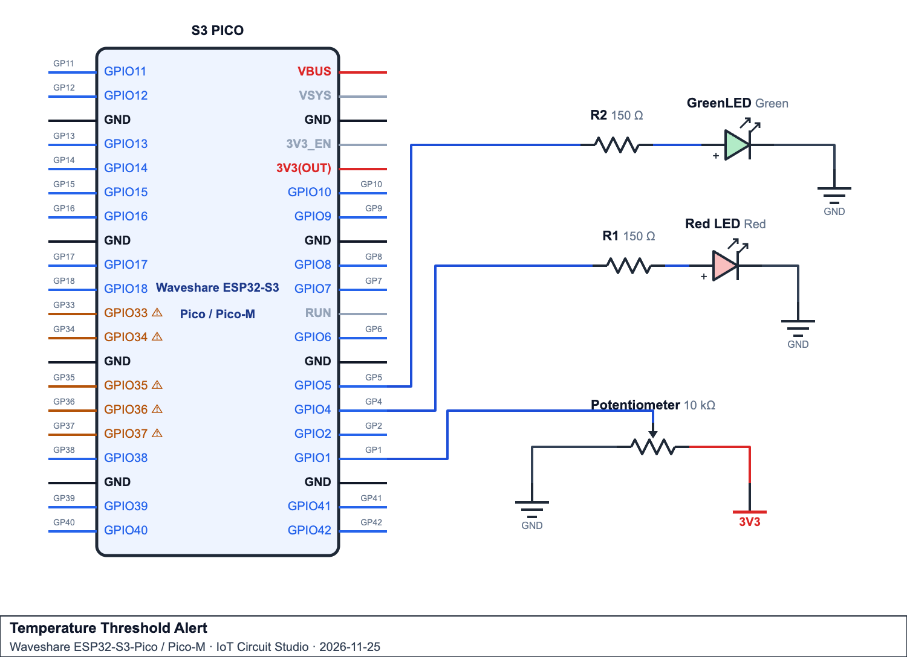
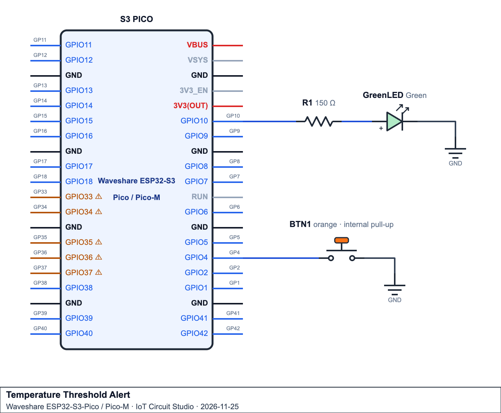
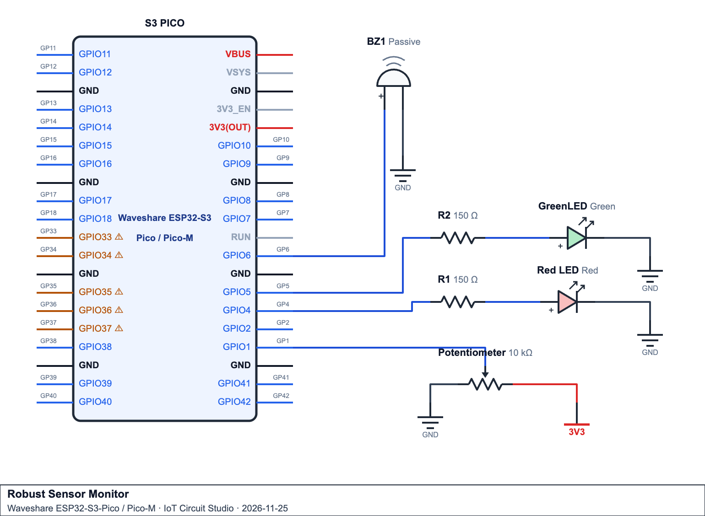

# Week 12: Debugging and Defensive Programming

## Introduction
Every program you have written this term had bugs at some point. That is normal. The difference between a five-minute fix and an hour of frustration is having a process: read the error message, find the line, work out what *type* of error it is, and fix only what that type of error needs.

This week has two parts. Part A covers **debugging**: the four categories of Arduino error (compile, linker, runtime, logic), the bug patterns that keep coming back across every piece of hardware used so far, and `Serial.print()` tracing, which is the main way to see what a running program is actually doing compared with what it was meant to do. Part B covers **defensive programming**. A program with zero bugs can still misbehave once it meets the real world: a sensor comes loose, a reading sits at the edge of its range, a count is zero when you divide by it. Part B shows how to expect those conditions and keep the program running safely instead of producing a wrong or dangerous result. Debugging fixes mistakes already in the code. Defensive programming assumes the code is correct and prepares it for an environment that won't always cooperate.


## Key Concepts

### Part A: Debugging

#### What Is Debugging?
**Debugging** is finding and fixing errors (**bugs**) in a program. Arduino errors fall into four categories, and knowing which one you have tells you where to look:

| Type | When it appears | Example |
|------|----------------|---------|
| Compile error | Before uploading. The IDE refuses to build and shows red text | Missing `;`, wrong type, undeclared variable |
| Linker error | Before uploading, after compiling succeeds | Calling a function that was declared but never defined |
| Runtime error | While the program runs on the board | Wrong pin number, integer overflow |
| Logic error | The program compiles, uploads and runs, but does the wrong thing | A backwards condition, a wrong conversion formula |

Compile and linker errors are the easiest, because the IDE tells you roughly where to look. Logic errors are the hardest. Nothing reports a problem; the board just doesn't do what the requirement said it should.

##### Real-world use in industry
A firmware team's build server catches every compile error automatically before code review starts. No automated tool catches "the alarm should have gone off and didn't." That gap is why careful manual debugging is still a core skill.

---

#### Compile Errors
Compile errors break C++ syntax rules. The Arduino IDE highlights the problem and prints a message naming the file, the line, and what it expected.

```cpp
// WRONG: missing semicolon
int ledPin = 13
pinMode(ledPin, OUTPUT);

// FIXED
int ledPin = 13;
pinMode(ledPin, OUTPUT);
```

```cpp
// WRONG: misspelled keyword
voud setup() {    // should be 'void'
  pinMode(13, OUTPUT);
}

// FIXED
void setup() {
  pinMode(13, OUTPUT);
}
```

A missing closing brace `}` gives a confusing error, often reported several lines *after* the real problem, because the compiler only notices the block never closed when it runs out of file. If the reported line looks fine, look upward for an unclosed `{`.

---

#### Type Errors
```cpp
// WRONG: integer division silently truncates
int raw = analogRead(potPin);
float temp = raw / 4095 * 100.0;   // raw/4095 is worked out as an int first, so it is almost always 0

// FIXED: force floating-point division with .0
float temp = (raw / 4095.0) * 100.0;
```

```cpp
// WRONG: storing a float result in an int variable drops the decimal part
int temperature = readTemperature();

// FIXED
float temperature = readTemperature();
```

This is the same integer-division bug you met in Week 5's single-pass scans and Week 8's threshold conversions. It turns up wherever a raw sensor value gets converted, because `/` between two `int`s always gives an `int` in C++, whatever type you store the result in.

---

#### Wrong Pin Numbers
```cpp
// WRONG: LED is wired to GPIO5 but the code says GPIO4
const int LED_PIN = 4;   // bug: LED is actually on GPIO5
digitalWrite(LED_PIN, HIGH);   // compiles and runs, but nothing visible happens
```
This is a **runtime** error. The code is valid and does exactly what it says, but what it says doesn't match the circuit. The IDE gives no warning. The only symptom is a component that never responds, so check the pin constant against the actual wiring before you start doubting the logic.

---

#### Logic Errors
```cpp
// WRONG: condition is backwards for INPUT_PULLUP (pressed = LOW, not HIGH)
if (digitalRead(buttonPin) == HIGH) {
  triggerAlert();   // fires when the button is released, not pressed
}

// FIXED
if (digitalRead(buttonPin) == LOW) {   // LOW = pressed, with INPUT_PULLUP
  triggerAlert();
}
```

```cpp
// WRONG: || used where && was intended
if (armed || motionNow) {
  start_alert();   // fires the whole time armed is true, motion or not
}

// FIXED
if (armed && motionNow) {
  start_alert();   // needs both conditions at once
}
```

```cpp
// WRONG: delay is far too short to matter
delay(2);      // 2 ms, so loop() still runs about 500 times a second

// INTENDED
delay(2000);   // 2000 ms = 2 seconds
```

Logic errors never produce a compiler message, because nothing about them breaks C++ grammar. The only way to catch them is to compare what the program does with what the requirement says, one condition at a time.

---

#### Debugging with `Serial.print()`
When a bug isn't obvious from reading the code, print the values involved at each step and compare them with what you expect:

```cpp
// Reads the sensor and returns the temperature in °C, printing each step for debugging
float readTemperature() {
  int raw = analogRead(SENSOR_PIN);
  Serial.print("DEBUG raw: ");
  Serial.println(raw);            // is the sensor giving a sensible value at all?

  float voltage = (raw / 4095.0) * 3.3;
  Serial.print("DEBUG voltage: ");
  Serial.println(voltage, 3);

  float temp = voltage * 100.0;
  Serial.print("DEBUG temp: ");
  Serial.println(temp, 1);

  return temp;
}
```
Read the printed values from top to bottom. The first one that doesn't match your expectation points to the line that introduced the bug. Everything printed correctly before it is already fine, so you don't need to keep re-checking it.

**Remove or comment out every debug `Serial.print()` once the bug is fixed.** Leftover debug output clutters the Serial Monitor for the next person, and in a tight non-blocking loop it can slow things down enough to matter.

---

#### Reading Arduino Error Messages
```
sketch.ino:14:3: error: 'pinMde' was not declared in this scope
```
- `sketch.ino`: the file the error is in
- `14`: the line number to check first
- `3`: the column on that line
- `'pinMde' was not declared`: what the compiler couldn't make sense of

**Always read the *first* error message and its line number before anything else.** One early typo (a missing `;`, an unclosed brace) often causes a pile of unrelated-looking errors further down. Fix the first one, recompile, and most of the others usually disappear.

---

### Part B: Defensive Programming

#### Why Programs Produce Bad Results
Part A fixes code that's wrong. This part is about code that is already *correct* but still runs into trouble because of real-world conditions:

| Scenario | What happens without defensive code |
|----------|--------------------------------------|
| Sensor disconnected | `analogRead()` returns a floating, random value |
| Sensor returns 0 | Division gives a wrong result or triggers a false alert |
| Pin wired to the wrong port | Always reads `HIGH` or `LOW`, never changes |
| Reading outside the physical range | A false alert fires continuously |
| Integer overflow | A counter wraps around to a negative number |

A good IoT program checks its inputs and handles odd values without falling over. Arduino code doesn't use `try`/`catch` exceptions the way Python or Java do. Instead, robust programs use **sentinel return values**, **range validation** and **defensive checks** to get the same result.

##### Real-world use in industry
A smoke alarm that went off on every electrical spike would be useless, and people would soon start ignoring it. Real detectors check that a reading is in a plausible range and often require it to persist before sounding, which is the same idea as the `errorCount` pattern below.

---

#### Exception Handling in Standard C++ (and Why Arduino Code Avoids It)
Full C++, the kind that runs on a desktop, server or phone, handles errors with **exceptions**. `throw` raises an error object, and a `try`/`catch` block anywhere up the call stack can catch it, so the functions in between don't each have to check for it.

```cpp
#include <iostream>
#include <stdexcept>

// Divides a by b, throwing an exception if b is zero
double divide(double a, double b) {
  if (b == 0) {
    throw std::invalid_argument("division by zero");   // raise the error
  }
  return a / b;
}

// Calls divide() and catches any error it throws
int main() {
  try {
    double result = divide(10, 0);
    std::cout << result;
  } catch (const std::invalid_argument& e) {   // catches only this type
    std::cerr << "Error: " << e.what() << "\n";
  } catch (const std::exception& e) {          // catches any other standard exception
    std::cerr << "Unexpected: " << e.what() << "\n";
  }
}
```
`throw` stops normal execution straight away and unwinds the call stack, running the destructor of every local object on the way, until it reaches a `catch` block whose type matches. The standard exception types (`std::exception`, `std::out_of_range`, `std::invalid_argument`, `std::runtime_error` and others, all in `<stdexcept>`) carry a `.what()` message and a type that `catch` can match, instead of a bare sentinel number.

**This course never uses `throw`/`try`/`catch`, and most embedded C++ doesn't either.** What happens if you try depends on the board:

- **AVR boards (Uno, Nano, Mega):** the Arduino toolchain compiles every sketch with `-fno-exceptions`. Write `throw std::invalid_argument("bad")` and the **compiler refuses to build it**. That's a compile error, not a runtime failure, because AVR's C++ support library was never built with the unwinding code that `catch` depends on.
- **ESP32 boards (what this course uses):** the toolchain is a full GCC, so `throw`/`try`/`catch` does compile. It is still avoided in practice, for these reasons:
  - **Throwing allocates memory on the heap.** On these boards, `throw` calls `__cxa_allocate_exception()`, which uses `malloc` to make room for the exception object. A microcontroller's heap is small and gets fragmented over long uptimes. Needing a successful allocation at the exact moment something has already gone wrong is a fragile place to put your error handling.
  - **An uncaught throw reboots the board.** If a `throw` escapes without a matching `catch` (from deep inside a library, say), the C++ runtime calls `std::terminate()`, which calls `abort()`. On the ESP32 that means a crash and reboot, not a tidy error message. A sentinel value that is merely wrong is far easier to recover from than a device that keeps restarting itself in the field.
  - **Flash and RAM cost.** Even if nothing is ever thrown, the compiler still generates unwind tables for every function that *could* throw, and those take up flash permanently. These boards have far less flash than a desktop.
  - **Unpredictable timing.** The whole non-blocking `millis()` pattern in this course exists so `loop()` keeps its timing promises (an alert, a poll interval). Unwinding an exception takes a variable amount of time that depends on the data, which is the opposite of what a real-time device needs.

Every pattern in the rest of this section (sentinel values, range validation, error counters, fallback values) solves the same problem `try`/`catch` solves on a desktop: don't let a bad input quietly corrupt the program or crash it. They just do it with tools that are cheap, need no memory allocation, and run in a predictable time.

---

### Error Sentinel Values
This is the same **sentinel** idea you used in Week 6's `get_threshold()` and Week 7's `binary_search()`. Here the sentinel means "this reading failed" rather than "not found":

```cpp
const float SENSOR_ERROR = -999.0;

// Returns the temperature in °C, or SENSOR_ERROR if the sensor looks disconnected or shorted
float readTemperature() {
  int raw = analogRead(SENSOR_PIN);
  if (raw == 0 || raw == 4095) {
    return SENSOR_ERROR;    // likely disconnected or shorted
  }
  float voltage = (raw / 4095.0) * 3.3;
  return voltage * 100.0;
}
```
The sentinel must be a value the sensor could never really return. `-999.0` is far below any realistic temperature. The **caller** has to check for it before using the result:
```cpp
float temp = readTemperature();
if (temp == SENSOR_ERROR) {
  Serial.println("ERROR: Sensor not responding.");
  return;   // skip the rest of loop() this time round
}
// safe to use temp here
```

---

### Range Validation
Check that a reading is physically possible before acting on it. A sentinel check alone won't catch a reading that didn't fail outright but is still nonsense:

```cpp
const float VALID_MIN = -10.0;
const float VALID_MAX = 85.0;

// Returns true if the value is not the error sentinel and lies inside the valid range
bool isValidReading(float value) {
  if (value == SENSOR_ERROR) return false;
  return (value >= VALID_MIN && value <= VALID_MAX);
}
```

---

### Error Counters
Count how many bad readings come in a row. One bad reading is often just electrical noise. Several in a row usually means a real hardware problem:

```cpp
int errorCount = 0;
const int MAX_ERRORS = 5;

// Reads the sensor, counts consecutive bad readings, and flags a fault after MAX_ERRORS
void loop() {
  float temp = readTemperature();

  if (!isValidReading(temp)) {
    errorCount++;
    Serial.print("Bad reading #");
    Serial.println(errorCount);

    if (errorCount >= MAX_ERRORS) {
      Serial.println("FAULT: Sensor may be disconnected.");
      digitalWrite(LED_RED, HIGH);
    }
    return;
  }

  errorCount = 0;   // reset on a good reading
  processReading(temp);
}
```

---

### Protecting Against Division by Zero
```cpp
// Returns the average of the first count readings, or SENSOR_ERROR if count is 0
float calculateAverage(float readings[], int count) {
  if (count == 0) {
    Serial.println("ERROR: No readings to average.");
    return SENSOR_ERROR;
  }
  float total = 0;
  for (int i = 0; i < count; i++) {
    total += readings[i];
  }
  return total / count;
}
```
This is the same kind of calculation as Week 5's average, but here the guard stops `count` itself from being `0`. It has nothing to do with integer truncation.

---

### Integer Overflow Protection
Every integer type has a maximum value. Go past it and the number wraps around. On the ESP32, `int` is 32 bits and wraps from `2,147,483,647` to `-2,147,483,648`. On 8-bit AVR boards such as the Uno, `int` is only 16 bits and wraps from `32767` to `-32768` much sooner. A counter that only goes up (once per loop pass, once per sensor read) should use `unsigned long`, the same type `millis()` returns. It never goes negative and counts twice as high before wrapping:

```cpp
unsigned long readingCount = 0;   // can reach 4,294,967,295 before wrapping
```

---

### Graceful Fallback
If a sensor read fails, use the last known good value instead of acting on the error value. The code that comes after it (a threshold check, for example) then keeps working normally and doesn't need its own special case for "no data":

```cpp
float lastGoodTemp = 20.0;   // safe default

// Uses the new reading if it is valid, otherwise falls back to the last good one
void loop() {
  float temp = readTemperature();
  if (isValidReading(temp)) {
    lastGoodTemp = temp;
  } else {
    temp = lastGoodTemp;    // use the last known good reading
    Serial.println("WARN: Using last good reading.");
  }
  checkThreshold(temp);
}
```

## Code Examples
Examples 1 and 2 are debugging exercises: build the circuit, run the buggy version to see the symptom, then apply the fix. Example 3 is a correct program that shows defensive programming from start to finish.

### Example 1: Temperature Threshold Alert (Type and Logic Error Hunt)

**Components:** ESP32-S3, potentiometer (temperature simulator), red LED, green LED, 150 Ω resistor for each LED.

**Intended behaviour:** red LED on above 35 °C (too hot), green LED on between 18 °C and 35 °C (comfortable), both LEDs off below 18 °C (too cold).

**Wiring:**
<p align = "center">

</p>


**Buggy version:**
```cpp
const int potPin    = 1;
const int LED_RED   = 4;
const int LED_GREEN = 5;

const float HIGH_TEMP = 35.0;
const float LOW_TEMP  = 35.0;   // Bug A

float readTemperature() {
  int raw = analogRead(potPin);
  float temp = raw / 4095 * 100.0;   // Bug B
  return temp;
}

void checkThreshold(float temp) {
  if (temp = HIGH_TEMP) {           // Bug C
    digitalWrite(LED_RED, HIGH);
    digitalWrite(LED_GREEN, LOW);
  } else if (temp >= LOW_TEMP) {
    digitalWrite(LED_RED, LOW);
    digitalWrite(LED_GREEN, HIGH);
  } else {
    digitalWrite(LED_RED, LOW);
    digitalWrite(LED_GREEN, LOW);
  }
}

void setup() {
  pinMode(LED_RED, OUTPUT);
  pinMode(LED_GREEN, OUTPUT);
  Serial.begin(115200);
}

void loop() {
  float t = readTemperature();
  checkThreshold(t);
  Serial.println(t);
  delay(500);
}
```

**Fixed version:**
```cpp
const int potPin    = 1;
const int LED_RED   = 4;
const int LED_GREEN = 5;

const float HIGH_TEMP = 35.0;
const float LOW_TEMP  = 18.0;

// Reads the potentiometer and returns it as a temperature from 0 to 100 °C
float readTemperature() {
  int raw = analogRead(potPin);
  float temp = (raw / 4095.0) * 100.0;
  return temp;
}

// Lights red when too hot, green when comfortable, and neither when too cold
void checkThreshold(float temp) {
  if (temp > HIGH_TEMP) {
    digitalWrite(LED_RED, HIGH);
    digitalWrite(LED_GREEN, LOW);
  } else if (temp >= LOW_TEMP) {
    digitalWrite(LED_RED, LOW);
    digitalWrite(LED_GREEN, HIGH);
  } else {
    digitalWrite(LED_RED, LOW);
    digitalWrite(LED_GREEN, LOW);
  }
}

// Sets both LED pins as outputs and starts the Serial Monitor
void setup() {
  pinMode(LED_RED, OUTPUT);
  pinMode(LED_GREEN, OUTPUT);
  Serial.begin(115200);
}

// Reads the temperature, updates the LEDs and prints the value twice a second
void loop() {
  float t = readTemperature();
  checkThreshold(t);
  Serial.println(t);
  delay(500);
}
```

**Code Walkthrough**
| Bug | What was wrong | The fix |
|---|---|---|
| A | `HIGH_TEMP` and `LOW_TEMP` are both `35.0`, so the "comfortable" band between them is empty and the green LED can never light. It's a logic error with no compiler warning, because both are valid constants | Give `LOW_TEMP` its own, lower value (`18.0`) |
| B | `raw / 4095` divides two `int`s, which truncates to `0` before `* 100.0` runs. This is a type error | Write `4095.0` so the division is floating-point from the start |
| C | `if (temp = HIGH_TEMP)` uses `=` (assignment) instead of a comparison. It *compiles*, quietly sets `temp` to `35.0`, and is always true, so the red LED is always on | Use `>` for a threshold comparison |

>
> Wokwi Link: _(build this circuit at wokwi.com, save the project, and paste your link here)_
>

---

### Example 2: Counter Button (Compile and Logic Error Hunt)

**Components:** ESP32-S3, push button (`INPUT_PULLUP`), LED, 150 Ω resistor.

**Intended behaviour:** each press adds 1 to `count`, prints the new value, and turns the LED on.

**Wiring:**

<p align = "center">

</p>


**Buggy version:**
```cpp
const int BUTTON = 4;
const int LED    = 10                   // Bug A
int count = 0;

void setup() {
  pinMode(BUTTON, INPUT);               // Bug B
  pinMode(LED,    OUTPUT);
  Serial.begin(9600);
}

void loop() {
  if (digitalRead(BUTTON) == HIGH) {    // Bug C
    count = count - 1;                  // Bug D
    Serial.println(count);
    digitalWrite(LED, HIGH);
  }
  delay(10000);                         // Bug E
}
```

**Fixed version:**
```cpp
const int BUTTON = 4;
const int LED    = 10;
int count = 0;

// Sets the button as a pulled-up input and the LED as an output
void setup() {
  pinMode(BUTTON, INPUT_PULLUP);
  pinMode(LED,    OUTPUT);
  Serial.begin(9600);
}

// Adds 1 to count on each press, prints it and turns the LED on
void loop() {
  if (digitalRead(BUTTON) == LOW) {
    count = count + 1;
    Serial.println(count);
    digitalWrite(LED, HIGH);
  }
  delay(200);
}
```

**Code Walkthrough**
| Bug | What was wrong | The fix |
|---|---|---|
| A | Missing `;` after `10`. This is a compile error, reported at or just after this line | Add the semicolon |
| B | `pinMode(BUTTON, INPUT)` leaves the pin floating with no pull resistor, so `digitalRead()` returns random noise | Use `INPUT_PULLUP`, which holds the pin `HIGH` until the button pulls it `LOW` |
| C | Checking `== HIGH` is backwards for `INPUT_PULLUP`. A press reads `LOW`, not `HIGH` | Check `== LOW` |
| D | `count - 1` counts down, but the requirement asks for a counter that goes up | Change to `count + 1` |
| E | `delay(10000)` freezes the program for 10 seconds, so almost every press is missed | Shorten it to `delay(200)` so one press isn't counted dozens of times |

The fixed version still has no real debouncing, and `delay(200)` is only a stopgap. That's deliberate. The Activity replaces it with the settle-time debounce pattern (`lastButtonReading`/`buttonState`/`debounceStart`) you've used since Week 5.

>
> Wokwi Link: _(build this circuit at wokwi.com, save the project, and paste your link here)_
>

---

### Example 3: Robust Sensor Monitor (Defensive Programming End to End)

Unlike Examples 1 and 2, this program has **no bugs**. It shows every defensive-programming pattern from Part B working together in one circuit.

**Components:** ESP32-S3, potentiometer (sensor simulator), red LED (fault/alert), green LED (OK), 150 Ω resistor for each LED, passive buzzer.

**Wiring:**

<p align = "center">

</p>


```cpp
const int potPin    = 1;
const int LED_RED   = 4;
const int LED_GREEN = 5;
const int BUZZER    = 6;

const float SENSOR_ERROR   = -999.0;
const float VALID_MIN      = 0.0;
const float VALID_MAX      = 100.0;
const float HIGH_THRESHOLD = 80.0;

int errorCount = 0;
const int MAX_ERRORS = 5;
float lastGoodTemp = 20.0;

const unsigned long READ_INTERVAL = 2000;
unsigned long previousReadMillis = 0;

// Returns the reading from 0 to 100, or SENSOR_ERROR if the ADC is stuck at either end
float readTemperature() {
  int raw = analogRead(potPin);

  // A raw value pinned at either ADC extreme usually means a sensor fault
  if (raw <= 1 || raw >= 4094) {
    return SENSOR_ERROR;
  }

  return (raw / 4095.0) * 100.0;
}

// Returns true if the value is not the error sentinel and lies inside the valid range
bool isValidReading(float value) {
  if (value == SENSOR_ERROR) return false;
  return (value >= VALID_MIN && value <= VALID_MAX);
}

// Shows a high reading with the red LED and a beep, or a normal one with the green LED
void processReading(float temp) {
  if (temp > HIGH_THRESHOLD) {
    digitalWrite(LED_RED,   HIGH);
    digitalWrite(LED_GREEN, LOW);
    tone(BUZZER, 1000, 150);
    Serial.print("[ALERT] High reading: ");
  } else {
    digitalWrite(LED_RED,   LOW);
    digitalWrite(LED_GREEN, HIGH);
    Serial.print("[OK]    Reading: ");
  }
  Serial.println(temp, 1);
}

// Sets up the LED and buzzer pins and starts the Serial Monitor
void setup() {
  pinMode(LED_RED,   OUTPUT);
  pinMode(LED_GREEN, OUTPUT);
  pinMode(BUZZER,    OUTPUT);
  Serial.begin(115200);
  Serial.println("Robust monitor started.");
}

// Every READ_INTERVAL ms: read, validate, then process the reading or handle the fault
void loop() {
  unsigned long currentMillis = millis();
  if (currentMillis - previousReadMillis >= READ_INTERVAL) {
    previousReadMillis = currentMillis;

    float temp = readTemperature();

    if (!isValidReading(temp)) {
      errorCount++;
      Serial.print("[SKIP] Invalid reading. Error count: ");
      Serial.println(errorCount);

      if (errorCount >= MAX_ERRORS) {
        Serial.println("[FAULT] Sensor may be disconnected!");
        digitalWrite(LED_RED,   HIGH);
        digitalWrite(LED_GREEN, LOW);
        return;   // stay in the fault state; don't let processReading() change the LEDs
      }

      temp = lastGoodTemp;   // fall back to the last known good value
    } else {
      errorCount = 0;
      lastGoodTemp = temp;
    }

    processReading(temp);
  }
}
```

**Code Walkthrough**
| Pattern | Explanation |
|---------|-------------|
| `SENSOR_ERROR = -999.0` | An impossible real-world value that signals a failed read. Same sentinel idea as Week 6's `get_threshold()` |
| `raw <= 1 \|\| raw >= 4094` | A raw ADC value stuck at either end usually means a disconnected or shorted sensor. Turn the potentiometer fully to one end to simulate this |
| `isValidReading()` | Keeps validation separate from action, so the acceptable range only needs changing in one place |
| `errorCount` | Counts consecutive failures, which separates one-off noise from a real hardware fault |
| `lastGoodTemp` | Keeps the system running safely while the sensor is briefly failing |
| `return` in the fault branch | Once `MAX_ERRORS` is reached, the red fault LED stays on. Without the `return`, `processReading()` would run straight after and switch it off again |
| `tone(BUZZER, 1000, 150)` | A passive buzzer beep with a built-in duration, so the beep itself needs no `delay()` |
| `READ_INTERVAL` / `previousReadMillis` | The whole read, validate, process cycle is non-blocking, following the pattern required since Week 4 |

>
> Wokwi Link: _(build this circuit at wokwi.com, save the project, and paste your link here)_
>

## Vocabulary
| Term | Definition |
|------|-----------|
| Exception | An object thrown with `throw` in standard C++ to signal an error, and handled by a matching `catch` block further up the call stack. Not used in this course, because microcontroller code avoids it |
| `try` / `catch` / `throw` | Standard C++'s exception-handling keywords: `try` wraps code that might fail, `throw` raises the error, `catch` handles it by type |
| Stack unwinding | What happens between a `throw` and its matching `catch`: the destructor of every local object along the way runs automatically before the error is handled |
| Bug | An error in a program that makes it behave incorrectly |
| Debugging | The step-by-step process of finding and fixing bugs |
| Compile error | A C++ syntax mistake, caught by the Arduino IDE before uploading |
| Linker error | An error found after compiling succeeds, e.g. calling a function that was never defined |
| Runtime error | A bug that only shows up while the program is running, such as a wrong pin number |
| Logic error | The program compiles and runs but gives the wrong result. No compiler message is ever shown |
| `Serial.print()` / `Serial.println()` debugging | Temporarily printing variable values to see what a running program is actually doing |
| `==` | Comparison operator: tests whether two values are equal |
| `=` | Assignment operator: stores a value. Using it inside an `if` condition by mistake is a common bug |
| Integer division | Division between two `int` values gives an `int`, throwing away the decimal part. Force float division with a literal like `4095.0` |
| Defensive programming | Writing code that expects bad real-world inputs (a disconnected sensor, an out-of-range reading) and handles them safely instead of assuming every input is fine |
| Sentinel value | A specific, physically impossible return value (e.g. `-999.0`) that means "this reading failed". Every caller must check for it before trusting the result |
| Range validation | Checking that a value is within physically possible limits before acting on it |
| Error counter | A variable that counts consecutive failures, used to tell brief noise apart from a real hardware fault |
| Fallback value | A safe, previously known good value used when a real reading isn't available |
| Integer overflow | When an integer goes past its maximum value and wraps around to a negative number. Use `unsigned long` for counters that increase often |
| `unsigned long` | A 32-bit unsigned integer type that stores `0` to `4,294,967,295`. It's the type `millis()` returns |
