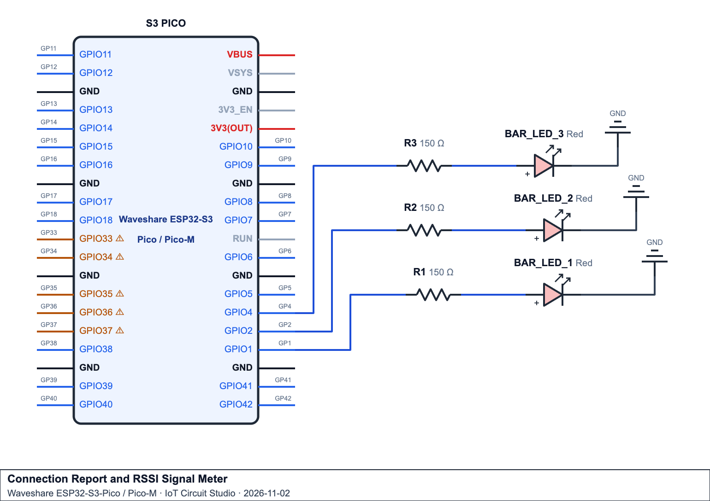

# Week 9: Wi-Fi Modes - Station Mode (STA) 

## Introduction
Station mode is how the microcontroller gets online. It joins an existing Wi-Fi network the way a phone or laptop does, so it can send readings to Supabase and fetch the time from NTP.

This page starts with what happens between `WiFi.begin()` and `WL_CONNECTED`, and what each status the radio reports means. It then covers scanning for nearby networks and measuring signal strength, giving the device a fixed IP address and a name, and using Wi-Fi events to react to connection changes as they happen.


## Key Concepts

### Key Concept 1 - What a Station Is
In Wi-Fi, every device that joins a network is called a **station** (STA). Your phone, your laptop and a smart TV are all stations. The device that runs the network, usually your home router or a phone hotspot, is the **access point** (AP).

When the microcontroller runs in Station mode (`WIFI_STA`), it joins Wi-Fi the same way a phone does:

<p align="center">

</p>

Two things follow from this picture:
- **Every station on the same router is on the same local network.** The microcontroller and your laptop can reach each other directly using their local IP addresses (e.g. your laptop can `ping 192.168.1.42`).
- **All internet traffic goes through the router.** The microcontroller has no internet connection of its own. If the router loses its internet connection, the microcontroller is still "connected to Wi-Fi" (`WL_CONNECTED`), but its Supabase sends fail.

#### An everyday comparison
Think of the access point as the reception desk of a building and each station as a visitor:
- The visitor has to find the right building (the **SSID**) and know the door code (the **password**) before they are let in.
- Once inside, reception gives the visitor a room number (the **IP address**) so mail can reach them.
- Every message between visitors, and every message to the outside world, is passed through reception. Visitors never shout directly to each other across the building.
- A visitor can only be in one building at a time. To visit a different building, they have to leave the first one.

#### What a station needs before it can join
| The station needs... | Where it comes from | In code |
|---|---|---|
| The network name (**SSID**) | Written on the router label, or the hotspot name on your phone | `SSID` constant |
| The **password** | Same place as the SSID | `PASSWORD` constant |
| A **2.4 GHz** network | The router or hotspot settings | (nothing; the microcontroller's radio cannot see 5 GHz networks at all) |
| Station mode switched on | Your sketch | `WiFi.mode(WIFI_STA);` |

The router gives the station everything else (IP address, gateway, subnet mask, DNS server) after it joins. You do not have to type these in unless you choose a static IP (Key Concept 5).

> **Tip:** Many modern routers broadcast a 2.4 GHz and a 5 GHz network with the same name. The microcontroller simply ignores the 5 GHz one. If your network is 5 GHz only, or a phone hotspot is set to "5 GHz" or "maximise compatibility" is switched off, the microcontroller will report `WL_NO_SSID_AVAIL` even though your laptop can see the network.

#### A station has two addresses
Every station is known by two different addresses, and they do different jobs:

| Address | Example | Who sets it | Changes? | Used for |
|---|---|---|---|---|
| **MAC address** | `A4:CF:12:9B:3E:70` | Burned into the microcontroller chip at the factory | Never | Identifying the device to the router over the radio link (the "who are you?" check) |
| **IP address** | `192.168.1.42` | Handed out by the router (DHCP) when the station joins | Can change each time it reconnects | Sending data between devices on the network and out to the internet |

A useful way to remember it: the **MAC address is the device's name tag**, the **IP address is its current room number**. Routers often use the MAC address to "remember" a device and give it the same IP address again, and some routers use it to block unknown devices (MAC filtering, see Key Concept 2).

#### How data travels
Station-to-station traffic always goes **through** the access point, even when the two devices are sitting side by side:


<p align="center">

</p>

This has two practical results:
- **Both stations must be in range of the router**, not of each other. A microcontroller at the far end of the house can still talk to your laptop as long as both reach the router.
- **Some networks block station-to-station traffic.** Guest networks, school/TAFE networks and some public hotspots turn on "client isolation" so stations cannot see each other. The microcontroller still reaches the internet, but `ping` from your laptop fails. A home router or your own phone hotspot is the easiest place to test local connections.

#### A station is a client
A station **starts** conversations; it does not normally wait to be contacted from the outside world:
- **Outgoing works:** the microcontroller can send a reading to Supabase or ask an NTP server for the time, and the reply comes back through the router automatically.
- **Incoming from the internet does not:** the router shares **one public internet address** between every station in the house. A web server somewhere on the internet cannot reach `192.168.1.42` directly, because that address only exists inside your local network. (This is why the course sends data *up* to a cloud database instead of having the cloud reach *down* to the device.)
- **Incoming from the local network does work:** other stations on the same router (your laptop, your phone) can reach the microcontroller by its local IP address, unless client isolation is turned on.

#### Limits of a station
- **One network at a time.** A station joins a single access point. To change networks it must disconnect first.
- **It depends on the router.** If the router is switched off, restarts or moves out of range, the station loses its connection and has to rejoin (Key Concept 6 shows how to detect this).
- **Signal strength matters.** Walls, metal and distance weaken the signal. A weak signal still shows `WL_CONNECTED` but sends can be slow or fail (Key Concept 4 shows how to measure it).
- **The radio uses power.** A station keeps listening to the router to stay connected, which uses far more current than the rest of the sketch. This matters for battery-powered devices.

#### Station vs. the other modes (quick reminder)
| Mode | Constant | The microcontroller... | Internet? |
|---|---|---|---|
| **Station** | `WIFI_STA` | **joins** an existing network | ✓ through the router |
| Access Point | `WIFI_AP` | **creates** its own network | ✗ |
| AP + Station | `WIFI_AP_STA` | does both at once | ✓ through the station side |
| Off | `WIFI_OFF` | radio switched off | ✗ |

**When to choose Station mode:** whenever the device needs the internet (cloud databases, NTP time, APIs, notifications) **and** there is a router or hotspot within range. This is by far the most common mode for IoT devices.

### Key Concept 2 - How a Station Joins a Network
`WiFi.begin(SSID, PASSWORD)` looks like a single step, but behind the scenes the radio works through four stages. Knowing them tells you *where* a failed connection stopped.
<p align="center">

</p>


| Stage | What happens | What goes wrong here |
|---|---|---|
| 1. Scan | The radio listens on each channel for a network with your SSID | Wrong SSID (capitals, spaces), a 5 GHz-only network, or out of range → `WL_NO_SSID_AVAIL` |
| 2. Authenticate | The password is checked using the WPA2/WPA3 handshake | Wrong password → `WL_CONNECT_FAILED` or `WL_DISCONNECTED` |
| 3. Associate | The router adds the microcontroller to its list of connected devices | Router full, or MAC filtering turned on in the router |
| 4. DHCP | The router hands out an IP address, gateway, subnet mask and DNS server | Router's address pool full, or a wrong static IP (Key Concept 5) |

Only after **all four** stages succeed does `WiFi.status()` return `WL_CONNECTED`. This normally takes 1-4 seconds.

### Key Concept 3 - Reading `WiFi.status()` Properly
So far we only compared `WiFi.status()` with `WL_CONNECTED`. It can return several other values, and each one points to a different problem:

| Constant | Meaning | Likely cause / what to check |
|---|---|---|
| `WL_IDLE_STATUS` | Radio is on but not trying to connect yet, or is between attempts | Normal for a moment right after `WiFi.begin()` |
| `WL_NO_SSID_AVAIL` | The network name wasn't found | SSID spelling/capitals, 5 GHz-only network, router off or out of range |
| `WL_SCAN_COMPLETED` | A network scan has finished | Only seen after `WiFi.scanNetworks()` |
| `WL_CONNECTED` | Joined the router **and** got an IP address | All good |
| `WL_CONNECT_FAILED` | The connection attempt failed | Usually a wrong password |
| `WL_CONNECTION_LOST` | Was connected, then the connection dropped | Router switched off, moved out of range |
| `WL_DISCONNECTED` | Not connected (also shown while retrying) | Often a wrong password on the microcontroller, or still retrying |

> **Note:** on the ESP32, a wrong password does not always give `WL_CONNECT_FAILED`. It often shows `WL_DISCONNECTED` while the radio keeps retrying. A wrong SSID reliably gives `WL_NO_SSID_AVAIL`. Key Concept 6 shows how Wi-Fi events give a more exact **disconnect reason**.

A small function that turns a status into words makes the Serial Monitor far more useful than a row of dots:

```cpp
// Turns a WiFi.status() value into a short message a person can understand.
const char* statusText(wl_status_t status) {
  switch (status) {
    case WL_IDLE_STATUS:     return "idle (starting up)";
    case WL_NO_SSID_AVAIL:   return "network not found - check the SSID and that it's 2.4 GHz";
    case WL_SCAN_COMPLETED:  return "scan completed";
    case WL_CONNECTED:       return "connected";
    case WL_CONNECT_FAILED:  return "connection failed - check the password";
    case WL_CONNECTION_LOST: return "connection lost";
    case WL_DISCONNECTED:    return "disconnected (wrong password, or still retrying)";
    default:                 return "unknown status";
  }
}
```

**Code Walkthrough**
| Section | Explanation |
|---|---|
| `wl_status_t status` | `wl_status_t` is the type `WiFi.status()` returns, so the function accepts exactly what `WiFi.status()` gives it |
| `switch (status)` | Picks one message per status. Each `case` returns straight away, so no `break` is needed |
| `const char*` return | Returns fixed text, which `Serial.println()` can print directly |
| `default` | Catches any value not listed, so the function always returns something |

Use it like this: `Serial.println(statusText(WiFi.status()));`

### Key Concept 4 - Scanning for Networks and Measuring Signal Strength
A station can **scan** to see every 2.4 GHz network in range, without joining any of them. This is the first thing to try when the microcontroller says it can't find your network: if your SSID isn't in the scan list, the problem is the network (5 GHz, out of range, hidden), not your code.

```cpp
int count = WiFi.scanNetworks();   // blocks for about 2-4 seconds, returns how many networks were found
for (int i = 0; i < count; i++) {
  Serial.println(WiFi.SSID(i));    // name of network i
}
WiFi.scanDelete();                 // free the memory the results used
```

| Function | Returns |
|---|---|
| `WiFi.scanNetworks()` | Number of networks found (blocking, about 2-4 s). Returns a negative number if the scan failed |
| `WiFi.scanNetworks(true)` | Starts an **asynchronous** (non-blocking) scan and returns straight away |
| `WiFi.scanComplete()` | For an async scan: `WIFI_SCAN_RUNNING` (-1) while still scanning, `WIFI_SCAN_FAILED` (-2) if it failed or wasn't started, otherwise the number of networks found |
| `WiFi.SSID(i)` | Name of network `i` (an empty string for a hidden network) |
| `WiFi.RSSI(i)` | Signal strength of network `i`, in dBm |
| `WiFi.channel(i)` | Wi-Fi channel of network `i` (1-13 on 2.4 GHz) |
| `WiFi.encryptionType(i)` | Security type, e.g. `WIFI_AUTH_OPEN`, `WIFI_AUTH_WPA2_PSK` |
| `WiFi.scanDelete()` | Frees the scan results; call it once you've finished reading them |

#### RSSI: how strong is the signal?
**RSSI** (Received Signal Strength Indicator) is measured in **dBm** (decibel-milliwatts) and is always negative. The closer to zero, the stronger the signal. Every 10 dBm is about **ten times** the signal power, so -50 dBm is 10 times stronger than -60 dBm.

| RSSI (dBm) | Quality | What to expect |
|---|---|---|
| -30 to -50 | Excellent | Right next to the router |
| -50 to -60 | Good | Reliable for anything |
| -60 to -70 | Fair | Fine for sensor data; occasional slow requests |
| -70 to -80 | Weak | Dropped requests and reconnects likely |
| below -80 | Unusable | Expect the connection to keep dropping |

Once connected, `WiFi.RSSI()` with **no** argument gives the signal strength of the network the microcontroller is joined to.

```cpp
Serial.print("RSSI: ");
Serial.print(WiFi.RSSI());   // e.g. -58
Serial.println(" dBm");
```

#### Reading the dBm scale
**dBm** means "decibels compared with 1 milliwatt". 0 dBm is 1 mW, and Wi-Fi signals arriving at an antenna are far weaker than that, which is why RSSI is always negative. The scale is **logarithmic**, not linear:

| Change in RSSI | Change in signal power |
|---|---|
| 3 dB lower | About **half** the power |
| 10 dB lower | **One tenth** of the power |
| 30 dB lower | **One thousandth** of the power (e.g. -30 dBm vs -60 dBm) |

So a drop from -50 to -53 dBm looks small but means half the signal power has been lost.

#### Why RSSI is useful
- **Troubleshooting:** if requests to the cloud database keep failing, check the RSSI first. A value below -75 dBm points to a signal problem, not a code problem.
- **Choosing where to put the device:** move the board around while printing `WiFi.RSSI()` once a second and find a spot that reads -67 dBm or better.
- **Comparing networks:** in a scan, `WiFi.RSSI(i)` shows which nearby network or router is strongest at the device's position.

#### RSSI on the ESP32-PICO and Raspberry Pi Pico W

> **Important: small boards have small antennas**
>
> Both the **ESP32-PICO** and the **Raspberry Pi Pico W** use a tiny antenna printed on the board. They often read **around 10 dB lower** than a laptop or phone in the same spot. A laptop showing full bars doesn't mean the board has a good signal, so **always check the RSSI on the board itself.**
>
> | | ESP32-PICO | Raspberry Pi Pico W |
> |---|---|---|
> | Wi-Fi chip | Built into the ESP32 | Separate Infineon CYW43439 chip |
> | Antenna | Small antenna on the module | PCB antenna at the end of the board, opposite the USB port |
> | Read RSSI (Arduino) | `WiFi.RSSI()` | `WiFi.RSSI()` (same code, using the Arduino-Pico board package) |
> | Wi-Fi band | 2.4 GHz only | 2.4 GHz only |
>
> To get the best signal on either board:
> - Keep the antenna end **clear of metal**: not under a laptop, against a metal case or covered by jumper wires.
> - On the **Pico W**, leave the antenna end hanging off the edge of the breadboard if you can. The breadboard's metal strips and nearby wires weaken the signal.
> - RSSI jumps around by a few dBm from moment to moment (people moving, doors, other devices), so look at the **trend over several readings**, not one value.

### Key Concept 5 - Connection Details, Static IP and Hostname

#### What the router tells the station
After stage 4 (DHCP), the microcontroller knows these details about its connection:

| Function | Example | Meaning |
|---|---|---|
| `WiFi.localIP()` | `192.168.1.42` | The microcontroller's own address on this network |
| `WiFi.gatewayIP()` | `192.168.1.1` | The router's address: the way out to the internet |
| `WiFi.subnetMask()` | `255.255.255.0` | Which addresses count as "local" (here, `192.168.1.0`-`192.168.1.255`) |
| `WiFi.dnsIP()` | `192.168.1.1` | The server that turns names like `supabase.co` into IP addresses |
| `WiFi.macAddress()` | `24:6F:28:AB:CD:EF` | The microcontroller's permanent hardware address (never changes) |
| `WiFi.SSID()` | `YOUR_WIFI_NAME` | The network it's joined to |
| `WiFi.BSSIDstr()` | `A4:2B:B0:11:22:33` | The MAC address of the router it's joined to |
| `WiFi.channel()` | `6` | The channel the connection uses |
| `WiFi.RSSI()` | `-58` | Current signal strength, in dBm |

#### Static IP: a fixed address
By default the router gives out addresses with **DHCP**, and the microcontroller might get `192.168.1.42` today and `192.168.1.57` tomorrow. That doesn't matter when the device only *sends* data to the cloud. It matters a lot when other devices need to *find* the microcontroller, for example a laptop opening a web page served by the microcontroller, or another device sending it commands.

`WiFi.config()` sets a fixed (static) address. It must be called **before** `WiFi.begin()`:

```cpp
IPAddress localIP(192, 168, 1, 50);     // the fixed address you want
IPAddress gateway(192, 168, 1, 1);      // your router's address
IPAddress subnet(255, 255, 255, 0);
IPAddress dns(8, 8, 8, 8);              // a public DNS server

WiFi.mode(WIFI_STA);
WiFi.config(localIP, gateway, subnet, dns);   // before begin()
WiFi.begin(SSID, PASSWORD);
```

Rules for choosing a static IP:
- The first three numbers must match your network. Check them by connecting once **without** a static IP and printing `WiFi.localIP()` and `WiFi.gatewayIP()`.
- The `gateway` must be your router's real address, or the device gets an IP but can't reach the internet.
- Pick a last number that no other device uses. Numbers near the top of the range (e.g. `.200`-`.250`) are usually outside the router's DHCP pool. Two devices with the same IP causes both to misbehave.
- A phone hotspot often uses a different range (e.g. `172.20.10.x` on iPhone). Always check first.

> **The alternative:** most routers have a "DHCP reservation" setting that always gives the same IP to the same MAC address. That keeps the address fixed without hard-coding it in the sketch, so it's the better choice when you control the router.

#### Hostname: a friendly name
The **hostname** is the name the microcontroller reports to the router, so it shows up in the router's "connected devices" list as `greenhouse-01` instead of `esp32-ABCDEF`. Set it **before** `WiFi.mode()` and `WiFi.begin()`, or it's ignored:

```cpp
WiFi.setHostname("greenhouse-01");   // letters, digits and hyphens only, no spaces
WiFi.mode(WIFI_STA);
WiFi.begin(SSID, PASSWORD);
```

### Key Concept 6 - Reacting to Connection Changes With Wi-Fi Events
Checking `WiFi.status()` on every pass of `loop()` works, but it only tells you the *current* state. It can't tell you *when* the connection changed or *why* it dropped. Wi-Fi **events** solve both: you register a function, and the Wi-Fi system calls it the moment something happens.

```cpp
WiFi.onEvent(onWiFiEvent);   // register once, in setup(), before WiFi.begin()
```

| Event | When it fires |
|---|---|
| `ARDUINO_EVENT_WIFI_STA_START` | Station mode has started |
| `ARDUINO_EVENT_WIFI_STA_CONNECTED` | Joined the router (stage 3), but no IP address yet |
| `ARDUINO_EVENT_WIFI_STA_GOT_IP` | Got an IP address (stage 4): the device can now send data |
| `ARDUINO_EVENT_WIFI_STA_DISCONNECTED` | The connection dropped, or a connection attempt failed. Fires again on every failed retry |
| `ARDUINO_EVENT_WIFI_STA_LOST_IP` | The IP address was lost |

#### The disconnect reason
When `ARDUINO_EVENT_WIFI_STA_DISCONNECTED` fires, the Wi-Fi system also passes a **reason code** in `info.wifi_sta_disconnected.reason`. This is far more exact than `WiFi.status()`:

| Reason code | Name | Usually means |
|---|---|---|
| 2 | `AUTH_EXPIRE` | Authentication timed out; weak signal |
| 8 | `ASSOC_LEAVE` | The microcontroller disconnected on purpose (`WiFi.disconnect()`) |
| 15 | `4WAY_HANDSHAKE_TIMEOUT` | Wrong password |
| 200 | `BEACON_TIMEOUT` | Router switched off or out of range |
| 201 | `NO_AP_FOUND` | Network not found: wrong SSID, 5 GHz, or out of range |
| 202 | `AUTH_FAIL` | Authentication failed: usually a wrong password |
| 203 | `ASSOC_FAIL` | Router refused the association (full, or MAC filtering) |
| 204 | `HANDSHAKE_TIMEOUT` | Password handshake didn't finish: usually a wrong password |

#### Keep event handlers short
The event function is called by the Wi-Fi system's own background task, **not** by `loop()`. It can run at any moment, even halfway through a line of code in `loop()`. The safe pattern is:
1. In the event function, only **set flags** and copy the reason code. Nothing slow: no `delay()`, no HTTP requests.
2. Mark those shared variables `volatile`, which tells the compiler they can change outside the normal flow of the program.
3. In `loop()`, check the flags, do the real work (printing, LEDs, counters) and clear them.

```cpp
volatile bool gotIPFlag        = false;
volatile bool disconnectedFlag = false;
volatile uint8_t lastReason    = 0;

// Called by the Wi-Fi system whenever the station's connection changes. Only sets flags so it finishes quickly.
void onWiFiEvent(WiFiEvent_t event, WiFiEventInfo_t info) {
  switch (event) {
    case ARDUINO_EVENT_WIFI_STA_GOT_IP:
      gotIPFlag = true;
      break;
    case ARDUINO_EVENT_WIFI_STA_DISCONNECTED:
      lastReason = info.wifi_sta_disconnected.reason;
      disconnectedFlag = true;
      break;
    default:
      break;
  }
}
```

**Code Walkthrough**
| Section | Explanation |
|---|---|
| `WiFiEvent_t event` | Which event happened, e.g. `ARDUINO_EVENT_WIFI_STA_GOT_IP` |
| `WiFiEventInfo_t info` | Extra details about the event. For a disconnect, `info.wifi_sta_disconnected.reason` holds the reason code |
| `volatile` | The flags are changed by the Wi-Fi task and read by `loop()`, so the compiler must re-read them every time |
| `default: break;` | Ignores every other event (there are many, including Access Point events) |

#### Automatic reconnect
The ESP32's Wi-Fi library has **auto-reconnect** turned on by default (`WiFi.setAutoReconnect(true)`), so after most drops it tries to rejoin by itself. It doesn't recover in every situation, though, for example if the router was missing for a long time. That's why the examples on this page also include a non-blocking `maybe_reconnect()` function as a safety net, on a longer interval so it doesn't fight the automatic retries.

### Key Concept 7 - Station Mode Troubleshooting Checklist
| Symptom in the Serial Monitor | Likely cause | Fix |
|---|---|---|
| Endless dots, then "Connection failed"; status `WL_NO_SSID_AVAIL` / reason 201 | SSID wrong, 5 GHz network, or out of range | Run a scan: is your SSID in the list? Check capitals and spaces. Use a 2.4 GHz network or hotspot |
| Status `WL_DISCONNECTED` or `WL_CONNECT_FAILED`; reason 15, 202 or 204 | Wrong password | Re-type the password (case-sensitive) |
| Connects, but HTTP requests fail | Router has no internet, or wrong gateway/DNS in a static IP | Remove `WiFi.config()` and test with DHCP; check `WiFi.gatewayIP()` |
| Connects, then keeps dropping; reason 200 | Weak signal | Check `WiFi.RSSI()`; move closer to the router |
| `Brownout detector was triggered` and the board resets | Not enough power when the radio starts | Use a better USB cable/port |
| Gets an IP like `169.254.x.x` or `0.0.0.0` | DHCP didn't finish | Wait longer; restart the router; check the router isn't full |
| Works at home but not at TAFE/café | Captive portal or enterprise (username + password) network | Use a phone hotspot |

## Code Examples

### Example 1 - Wi-Fi Network Scanner

**Components:** ESP32-PICO or Raspberry Pi Pico W only (no circuit). Output goes to the Serial Monitor. The same sketch works on both boards.

```cpp
#include <WiFi.h>  // Use the Wi-Fi library supplied by the selected board's Arduino core.

// Convert the security code reported by the Wi-Fi library into a readable label.
const char* securityText(int type) {
#if defined(ARDUINO_ARCH_ESP32)
  // The compiler includes this section when an ESP32 board is selected.
  switch (type) {
    case WIFI_AUTH_OPEN:            return "Open";
    case WIFI_AUTH_WEP:             return "WEP";
    case WIFI_AUTH_WPA_PSK:         return "WPA";
    case WIFI_AUTH_WPA2_PSK:        return "WPA2";
    case WIFI_AUTH_WPA_WPA2_PSK:    return "WPA/WPA2";
    case WIFI_AUTH_WPA2_ENTERPRISE: return "WPA2 Enterprise";
    case WIFI_AUTH_WPA3_PSK:        return "WPA3";
    case WIFI_AUTH_WPA2_WPA3_PSK:   return "WPA2/WPA3";
    default:                       return "Other";
  }
#else
  // The Pico W's Arduino core uses a different set of encryption codes.
  switch (type) {
    case ENC_TYPE_NONE: return "Open";
    case ENC_TYPE_WEP:  return "WEP";
    case ENC_TYPE_TKIP: return "TKIP";
    case ENC_TYPE_CCMP: return "CCMP";
    case ENC_TYPE_AUTO: return "Auto";
    default:           return "Other";
  }
#endif
}

// RSSI measures received signal strength in dBm.
// A value closer to zero is stronger, so check the strongest threshold first.
const char* rssiQuality(int rssi) {
  if (rssi >= -50) return "Excellent";
  if (rssi >= -60) return "Good";
  if (rssi >= -70) return "Fair";
  if (rssi >= -80) return "Weak";
  return "Very weak";
}

void scanAndPrint() {
  Serial.println("Scanning for Wi-Fi networks...");

  // Wait for the scan to finish and store the number of results.
  int count = WiFi.scanNetworks();

  // A negative result indicates a scan error.
  if (count < 0) {
    Serial.println("Scan failed.");
    return;
  }

  // Zero means the scan finished without finding any networks.
  if (count == 0) {
    Serial.println("No networks found.");
    return;
  }

  Serial.printf("%d scan result(s)\n", count);
  Serial.println(" #  RSSI(dBm)  Quality    Ch  Security         SSID");

  // Results are indexed from 0. The table numbers them from 1.
  for (int i = 0; i < count; i++) {
    String ssid = WiFi.SSID(i);             // Wi-Fi network name
    int rssi = WiFi.RSSI(i);                // Received signal strength in dBm
    int channel = WiFi.channel(i);          // Radio channel
    int security = WiFi.encryptionType(i);  // Security code from the library

    // Show a placeholder if the result contains an empty network name.
    if (ssid.length() == 0) {
      ssid = "(hidden)";
    }

    // Field widths keep the columns aligned. c_str() supplies the text for %s.
    Serial.printf("%2d  %9d  %-9s  %2d  %-15s  %s\n",
                  i + 1, rssi, rssiQuality(rssi), channel,
                  securityText(security), ssid.c_str());
  }

  // Release the memory used to store the scan results.
  WiFi.scanDelete();
}

void setup() {
  // Set the Arduino IDE Serial Monitor to the same baud rate.
  Serial.begin(115200);

  // Give the USB Serial Monitor up to five seconds to connect.
  unsigned long start = millis();
  while (!Serial && millis() - start < 5000) {
    delay(10);
  }

  // Use station mode to look for nearby access points without joining one.
  WiFi.mode(WIFI_STA);
  scanAndPrint();
}

void loop() {
  // The scan runs once in setup(). Reset the board to scan again.
}
```

**How it works**
1. `setup()` starts the Serial Monitor and waits up to 5 seconds for it to connect, so the first lines aren't lost (the Pico W's USB serial needs this; on the ESP32 the loop simply ends straight away).
2. `WiFi.mode(WIFI_STA)` switches the radio to Station mode. Scanning only needs Station mode, not an SSID or password.
3. `scanAndPrint()` calls `WiFi.scanNetworks()`, which listens on every 2.4 GHz channel for a few seconds and returns how many networks it heard. A negative number means the scan failed, and 0 means nothing was found; both print a message and stop.
4. For each network it stores the SSID, RSSI, channel and security code in variables, then prints them with a quality word from `rssiQuality()` and a security label from `securityText()`. Hidden networks have an empty name, so they're shown as `(hidden)`.
5. `WiFi.scanDelete()` frees the memory the results used.
6. The same sketch works on both boards. `#if defined(ARDUINO_ARCH_ESP32)` picks the ESP32's security codes when an ESP32 board is selected, and the Pico W's codes otherwise.
7. The blocking scan is only acceptable because it runs once, from `setup()`. Example 4 shows a non-blocking scan.

**What you should see (ESP32):**
```
Scanning for Wi-Fi networks...
5 scan result(s)
 #  RSSI(dBm)  Quality    Ch  Security         SSID
 1        -41  Excellent   6  WPA2             HomeWiFi
 2        -63  Fair        1  WPA2/WPA3        Neighbour-2.4G
 3        -72  Weak       11  WPA2             Telstra1234
 4        -80  Weak        6  Open             (hidden)
 5        -88  Very weak   1  WPA2             Office-Guest
```
On the **Pico W** the Security column shows the Pico W's simpler labels instead (`Open`, `TKIP`, `CCMP`, `Auto` or `Other`). The Pico W's Wi-Fi chip reports less detail than the ESP32, so these are only a rough guide to the security type. Your 5 GHz networks won't appear on either board, because neither can hear that band.

**Code Walkthrough**
| Section | Explanation |
|---|---|
| `#if defined(ARDUINO_ARCH_ESP32)` ... `#else` ... `#endif` | Checked by the compiler, not at run time. Only the `switch` for the selected board is compiled, because the ESP32 uses `WIFI_AUTH_...` codes and the Pico W uses `ENC_TYPE_...` codes |
| `rssiQuality()` | Checks the strongest threshold (`>= -50`) first, so the first `if` that matches gives the right word |
| `while (!Serial && millis() - start < 5000)` | Waits for the USB Serial Monitor, but gives up after 5 seconds so the board still runs without a computer attached |
| `WiFi.mode(WIFI_STA)` | Station mode is needed to scan |
| `WiFi.scanNetworks()` | Blocking scan; returns the number of networks, or a negative number if it failed |
| `count < 0` / `count == 0` | Handles a failed scan and an empty result separately, and returns early from the function |
| `WiFi.SSID(i)`, `RSSI(i)`, `channel(i)`, `encryptionType(i)` | Details of network `i`, numbered from 0. The table prints `i + 1` so it starts at 1 |
| `ssid.length() == 0` | A hidden network has an empty name, so `(hidden)` is printed instead |
| `Serial.printf("%2d  %9d  %-9s ...")` | Prints neatly lined-up columns. `%9d` means "number, padded to 9 characters"; `%-9s` means "text, padded to 9 characters, left-aligned" |
| `ssid.c_str()` | `%s` needs plain C text, so `c_str()` converts the `String` |
| `WiFi.scanDelete()` | Frees the result list once it has been printed |

### Example 2 - Connection Report and RSSI Signal Meter

**Components:** ESP32-PICO or Raspberry Pi Pico W, 3x LED (signal bars), 3x 220 Ω resistor. Each board has its own version of the code below.

**Wiring:**

<p align="center">
  
</p>

#### Raspberry Pi Pico W
```cpp
#include <WiFi.h>

const char* WIFI_NAME = "YOUR_WIFI_NAME";
const char* WIFI_PASSWORD = "YOUR_WIFI_PASSWORD";

const int BAR_LED_1 = 2;  // GP2
const int BAR_LED_2 = 3;  // GP3
const int BAR_LED_3 = 4;  // GP4

const unsigned long METER_INTERVAL = 1000;
unsigned long lastMeterTime = 0;

// Start the connection, then wait up to about 10 seconds.
bool connectWiFi() {
  WiFi.mode(WIFI_STA);
  WiFi.beginNoBlock(WIFI_NAME, WIFI_PASSWORD);
  Serial.print("Connecting to Wi-Fi");

  for (int attempt = 0; attempt < 20 && WiFi.status() != WL_CONNECTED; attempt++) {
    delay(500);
    Serial.print(".");
  }

  Serial.println();
  return WiFi.status() == WL_CONNECTED;
}

// Print six MAC address bytes as pairs of hexadecimal digits.
void printMacAddress(const uint8_t* mac) {
  for (int i = 0; i < 6; i++) {
    if (i > 0) Serial.print(':');
    if (mac[i] < 16) Serial.print('0');
    Serial.print(mac[i], HEX);
  }
  Serial.println();
}

void printConnectionInfo() {
  // The Pico W Wi-Fi library fills these arrays with MAC address bytes.
  uint8_t apMac[6] = {};
  uint8_t deviceMac[6] = {};
  WiFi.BSSID(apMac);
  WiFi.macAddress(deviceMac);

  Serial.println("----- Connection info -----");
  Serial.print("SSID:        "); Serial.println(WiFi.SSID());
  Serial.print("AP MAC:      "); printMacAddress(apMac);
  Serial.print("Channel:     "); Serial.println(WiFi.channel());
  Serial.print("IP address:  "); Serial.println(WiFi.localIP());
  Serial.print("Subnet mask: "); Serial.println(WiFi.subnetMask());
  Serial.print("Gateway:     "); Serial.println(WiFi.gatewayIP());
  Serial.print("DNS server:  "); Serial.println(WiFi.dnsIP());
  Serial.print("My MAC:      "); printMacAddress(deviceMac);
  Serial.println("---------------------------");
}

// Check the strongest RSSI threshold first.
int rssiToBars(int rssi) {
  if (rssi >= -60) return 3;
  if (rssi >= -70) return 2;
  if (rssi >= -80) return 1;
  return 0;
}

void showBars(int bars) {
  digitalWrite(BAR_LED_1, bars >= 1 ? HIGH : LOW);
  digitalWrite(BAR_LED_2, bars >= 2 ? HIGH : LOW);
  digitalWrite(BAR_LED_3, bars >= 3 ? HIGH : LOW);
}

void setup() {
  Serial.begin(115200);
  pinMode(BAR_LED_1, OUTPUT);
  pinMode(BAR_LED_2, OUTPUT);
  pinMode(BAR_LED_3, OUTPUT);
  showBars(0);

  // Give the USB Serial Monitor up to five seconds to connect.
  unsigned long serialStart = millis();
  while (!Serial && millis() - serialStart < 5000) {
    delay(10);
  }

  if (connectWiFi()) {
    printConnectionInfo();
  } else {
    Serial.println("Wi-Fi connection timed out.");
  }
}

void loop() {
  // Update the meter once per second.
  unsigned long now = millis();
  if (now - lastMeterTime < METER_INTERVAL) return;
  lastMeterTime = now;

  if (WiFi.status() != WL_CONNECTED) {
    showBars(0);
    Serial.println("Not connected -> 0 bars");
    return;
  }

  int rssi = WiFi.RSSI();
  int bars = rssiToBars(rssi);
  showBars(bars);
  Serial.printf("RSSI %d dBm -> %d bar(s)\n", rssi, bars);
}
```

#### ESP32
```cpp
#include <WiFi.h>

const char* WIFI_NAME = "YOUR_WIFI_NAME";
const char* WIFI_PASSWORD = "YOUR_WIFI_PASSWORD";

const int BAR_LED_1 = 1;
const int BAR_LED_2 = 2;
const int BAR_LED_3 = 4;

const unsigned long METER_INTERVAL = 1000;
unsigned long lastMeterTime = 0;

// Join Wi-Fi and wait up to about 10 seconds for a connection.
bool connectWiFi() {
  WiFi.mode(WIFI_STA);
  WiFi.begin(WIFI_NAME, WIFI_PASSWORD);
  Serial.print("Connecting to Wi-Fi");

  for (int attempt = 0; attempt < 20 && WiFi.status() != WL_CONNECTED; attempt++) {
    delay(500);
    Serial.print(".");
  }

  Serial.println();
  return WiFi.status() == WL_CONNECTED;
}

// The ESP32 Wi-Fi library provides formatted MAC address strings.
void printConnectionInfo() {
  Serial.println("----- Connection info -----");
  Serial.print("SSID:        "); Serial.println(WiFi.SSID());
  Serial.print("AP MAC:      "); Serial.println(WiFi.BSSIDstr());
  Serial.print("Channel:     "); Serial.println(WiFi.channel());
  Serial.print("IP address:  "); Serial.println(WiFi.localIP());
  Serial.print("Subnet mask: "); Serial.println(WiFi.subnetMask());
  Serial.print("Gateway:     "); Serial.println(WiFi.gatewayIP());
  Serial.print("DNS server:  "); Serial.println(WiFi.dnsIP());
  Serial.print("My MAC:      "); Serial.println(WiFi.macAddress());
  Serial.println("---------------------------");
}

// Check the strongest RSSI threshold first.
int rssiToBars(int rssi) {
  if (rssi >= -60) return 3;
  if (rssi >= -70) return 2;
  if (rssi >= -80) return 1;
  return 0;
}

void showBars(int bars) {
  digitalWrite(BAR_LED_1, bars >= 1 ? HIGH : LOW);
  digitalWrite(BAR_LED_2, bars >= 2 ? HIGH : LOW);
  digitalWrite(BAR_LED_3, bars >= 3 ? HIGH : LOW);
}

void setup() {
  Serial.begin(115200);
  pinMode(BAR_LED_1, OUTPUT);
  pinMode(BAR_LED_2, OUTPUT);
  pinMode(BAR_LED_3, OUTPUT);
  showBars(0);

  if (connectWiFi()) {
    printConnectionInfo();
  } else {
    Serial.println("Wi-Fi connection timed out.");
  }
}

void loop() {
  // Update the meter once per second.
  unsigned long now = millis();
  if (now - lastMeterTime < METER_INTERVAL) return;
  lastMeterTime = now;

  if (WiFi.status() != WL_CONNECTED) {
    showBars(0);
    Serial.println("Not connected -> 0 bars");
    return;
  }

  int rssi = WiFi.RSSI();
  int bars = rssiToBars(rssi);
  showBars(bars);
  Serial.printf("RSSI %d dBm -> %d bar(s)\n", rssi, bars);
}
```

**How it works**
1. `setup()` sets the three LED pins as outputs and turns them all off with `showBars(0)`.
2. `connectWiFi()` starts the connection, then checks `WiFi.status()` every 500 ms for up to 20 tries (about 10 seconds), printing a dot each time. It returns `true` if the board connected.
3. If it connected, `printConnectionInfo()` prints every detail the router handed out: SSID, the router's MAC address, channel, IP address, subnet mask, gateway, DNS server and the board's own MAC address. Otherwise it prints `Wi-Fi connection timed out.`
4. Every 1000 ms (`millis()`-gated, no `delay()`), `loop()` reads `WiFi.RSSI()` and converts it to 0-3 bars with `rssiToBars()`.
5. `showBars()` lights that many LEDs, like the signal bars on a phone.
6. If the connection drops, the meter shows 0 bars instead of reading a meaningless RSSI.

**What you should see:**
```
Connecting to Wi-Fi.....
----- Connection info -----
SSID:        YOUR_WIFI_NAME
AP MAC:      A4:2B:B0:11:22:33
Channel:     6
IP address:  192.168.1.42
Subnet mask: 255.255.255.0
Gateway:     192.168.1.1
DNS server:  192.168.1.1
My MAC:      24:6F:28:AB:CD:EF
---------------------------
RSSI -58 dBm -> 3 bar(s)
RSSI -61 dBm -> 2 bar(s)
```
Walk away from the router with the board on a power bank (or a long USB cable) and watch the bars drop.

**Code Walkthrough**
| Section | Explanation |
|---|---|
| `BAR_LED_1` ... `BAR_LED_3` | The three LED pins: GP2, GP3 and GP4 on the Pico W; GPIO1, 2 and 4 in the ESP32 version |
| `connectWiFi()` | Bounded wait: `attempt < 20` stops the loop after about 10 seconds, so the sketch never gets stuck if the network is missing |
| `WiFi.begin()` (ESP32) / `WiFi.beginNoBlock()` (Pico W) | Both start joining the network. On the Pico W, plain `WiFi.begin()` waits until it connects, so `beginNoBlock()` is used to let `connectWiFi()` print its dots and control the timeout |
| `printConnectionInfo()` | Prints the details from Key Concept 5 using `SSID()`, `channel()`, `localIP()`, `subnetMask()`, `gatewayIP()` and `dnsIP()` |
| MAC addresses (ESP32) | `WiFi.BSSIDstr()` and `WiFi.macAddress()` return ready-made text such as `A4:2B:B0:11:22:33` |
| MAC addresses (Pico W) | `WiFi.BSSID(apMac)` and `WiFi.macAddress(deviceMac)` fill a 6-byte array instead, so `printMacAddress()` prints each byte as two hex digits with `:` between them |
| `if (mac[i] < 16) Serial.print('0')` | Adds the leading zero, so the byte 5 prints as `05`, not `5` |
| `while (!Serial && ...)` (Pico W) | Waits up to 5 seconds for the USB Serial Monitor, so the connection report isn't lost |
| `rssiToBars()` | Thresholds taken from the RSSI table: -60 and above is 3 bars, below -80 is 0 |
| `bars >= 1 ? HIGH : LOW` | Lights LED 1 for 1, 2 or 3 bars; LED 2 for 2 or 3 bars; LED 3 for 3 bars only |
| `METER_INTERVAL` | RSSI jumps around a few dBm from moment to moment, so updating once a second keeps the display readable |
| `if (now - lastMeterTime < METER_INTERVAL) return;` | Leaves `loop()` early until a second has passed, instead of using `delay()` |

### Example 3 - Static IP, Hostname and Status Diagnosis

**Components:** ESP32-PICO or Raspberry Pi Pico W only (no circuit). You also need a laptop on the same network to test with `ping`. Each board has its own version of the code below.

#### Raspberry Pi Pico W
```cpp
#include <WiFi.h>

const char* WIFI_NAME = "YOUR_WIFI_NAME";
const char* WIFI_PASSWORD = "YOUR_WIFI_PASSWORD";
const char* HOSTNAME = "greenhouse-01";

// Change these example addresses to match your network.
IPAddress staticIP(192, 168, 1, 200);
IPAddress gateway(192, 168, 1, 1);
IPAddress subnet(255, 255, 255, 0);
IPAddress dns(8, 8, 8, 8);

const char* statusText(int status) {
  switch (status) {
    case WL_IDLE_STATUS:     return "idle";
    case WL_NO_SSID_AVAIL:   return "network not found";
    case WL_SCAN_COMPLETED:  return "scan completed";
    case WL_CONNECTED:       return "connected";
    case WL_CONNECT_FAILED:  return "connection failed";
    case WL_CONNECTION_LOST: return "connection lost";
    case WL_DISCONNECTED:    return "disconnected";
    default:                return "unknown status";
  }
}

bool connectWithStaticIP() {
  WiFi.setHostname(HOSTNAME);
  WiFi.mode(WIFI_STA);

  // Pico W order is IP, DNS, gateway, subnet mask.
  WiFi.config(staticIP, dns, gateway, subnet);

  Serial.println("Connecting to Wi-Fi...");
  WiFi.beginNoBlock(WIFI_NAME, WIFI_PASSWORD);

  // Check for up to 10 seconds and print each observed status change.
  int lastStatus = -1;
  unsigned long startedAt = millis();

  while (millis() - startedAt < 10000) {
    int status = WiFi.status();

    if (status != lastStatus) {
      Serial.print("Status: ");
      Serial.println(statusText(status));
      lastStatus = status;
    }

    if (status == WL_CONNECTED) return true;
    delay(500);
  }

  Serial.print("Final status: ");
  Serial.println(statusText(WiFi.status()));
  return WiFi.status() == WL_CONNECTED;
}

void setup() {
  Serial.begin(115200);

  // Give the USB Serial Monitor up to five seconds to open.
  unsigned long startedAt = millis();
  while (!Serial && millis() - startedAt < 5000) {
    delay(10);
  }

  if (!connectWithStaticIP()) {
    Serial.println("Wi-Fi connection timed out.");
    return;
  }

  Serial.print("IP address: "); Serial.println(WiFi.localIP());
  Serial.print("Gateway:    "); Serial.println(WiFi.gatewayIP());
  Serial.print("Hostname:   "); Serial.println(WiFi.getHostname());
  Serial.print("Try from your laptop: ping ");
  Serial.println(WiFi.localIP());
}

void loop() {
  // This example connects once at startup.
}
```

#### ESP32
```cpp
#include <WiFi.h>

const char* WIFI_NAME = "YOUR_WIFI_NAME";
const char* WIFI_PASSWORD = "YOUR_WIFI_PASSWORD";
const char* HOSTNAME = "greenhouse-01";

// Change these example addresses to match your network.
IPAddress staticIP(192, 168, 1, 200);
IPAddress gateway(192, 168, 1, 1);
IPAddress subnet(255, 255, 255, 0);
IPAddress dns(8, 8, 8, 8);

const char* statusText(int status) {
  switch (status) {
    case WL_IDLE_STATUS:     return "idle";
    case WL_NO_SSID_AVAIL:   return "network not found";
    case WL_SCAN_COMPLETED:  return "scan completed";
    case WL_CONNECTED:       return "connected";
    case WL_CONNECT_FAILED:  return "connection failed";
    case WL_CONNECTION_LOST: return "connection lost";
    case WL_DISCONNECTED:    return "disconnected";
    default:                return "unknown status";
  }
}

bool connectWithStaticIP() {
  // Set the ESP32 hostname before starting Wi-Fi.
  WiFi.setHostname(HOSTNAME);
  WiFi.mode(WIFI_STA);

  // ESP32 order is IP, gateway, subnet mask, DNS.
  if (!WiFi.config(staticIP, gateway, subnet, dns)) {
    Serial.println("[ERROR] Static IP settings were rejected.");
    return false;
  }

  Serial.println("Connecting to Wi-Fi...");
  WiFi.begin(WIFI_NAME, WIFI_PASSWORD);

  // Check for up to 10 seconds and print each observed status change.
  int lastStatus = -1;
  unsigned long startedAt = millis();

  while (millis() - startedAt < 10000) {
    int status = WiFi.status();

    if (status != lastStatus) {
      Serial.print("Status: ");
      Serial.println(statusText(status));
      lastStatus = status;
    }

    if (status == WL_CONNECTED) return true;
    delay(500);
  }

  Serial.print("Final status: ");
  Serial.println(statusText(WiFi.status()));
  return WiFi.status() == WL_CONNECTED;
}

void setup() {
  Serial.begin(115200);

  if (!connectWithStaticIP()) {
    Serial.println("Wi-Fi connection timed out.");
    return;
  }

  Serial.print("IP address: "); Serial.println(WiFi.localIP());
  Serial.print("Gateway:    "); Serial.println(WiFi.gatewayIP());
  Serial.print("Hostname:   "); Serial.println(WiFi.getHostname());
  Serial.print("Try from your laptop: ping ");
  Serial.println(WiFi.localIP());
}

void loop() {
  // This example connects once at startup.
}
```

**How it works**
1. `WiFi.setHostname()` runs first, because the name is sent to the router as soon as Station mode starts.
2. `WiFi.config()` sets the fixed address before the connection starts. With a static IP, stage 4 (DHCP) is skipped: the microcontroller just uses the address it was given. On the ESP32, if the settings are rejected, the sketch prints an error and stops.
3. `connectWithStaticIP()` checks `WiFi.status()` every 500 ms for up to 10 seconds and prints the status **only when it changes**, so you see the stages it passes through (e.g. `disconnected` → `connected`) instead of 20 identical lines.
4. As soon as the status is `connected`, it returns `true`. If 10 seconds pass first, it prints the final status, which tells you whether to check the SSID or the password, and returns `false`.
5. Once connected, `setup()` prints the IP address, gateway and hostname. Restart the board a few times: the IP is the same every time. Run `ping 192.168.1.200` (your address) on a laptop on the same network and you should get replies. Your router's device list should show `greenhouse-01`.

**What you should see:**
```
Connecting to Wi-Fi...
Status: disconnected
Status: connected
IP address: 192.168.1.200
Gateway:    192.168.1.1
Hostname:   greenhouse-01
Try from your laptop: ping 192.168.1.200
```
Now change the SSID to a name that doesn't exist and upload again. After 10 seconds you should see `Final status: network not found` (on some boards it shows `disconnected`), then `Wi-Fi connection timed out.`

**Code Walkthrough**
| Section | Explanation |
|---|---|
| `IPAddress staticIP(192, 168, 1, 200)` | Stores an IP address as four numbers. Must match your network's range |
| `statusText()` | Turns each `WiFi.status()` value into a short word, as in Key Concept 3 |
| `WiFi.setHostname(HOSTNAME)` | Sets the name the router displays. Must come before `WiFi.mode()` |
| `WiFi.config(staticIP, gateway, subnet, dns)` (ESP32) | Turns off DHCP and uses the fixed settings. Returns `false` if the settings were rejected, so the sketch stops with an error |
| `WiFi.config(staticIP, dns, gateway, subnet)` (Pico W) | Does the same job, but the Pico W expects the **DNS before the gateway**. Using the ESP32 order on a Pico W compiles but sets the wrong addresses |
| `WiFi.begin()` (ESP32) / `WiFi.beginNoBlock()` (Pico W) | Starts joining without waiting, so `connectWithStaticIP()` can watch the status and control the 10-second timeout |
| `lastStatus = -1` / `status != lastStatus` | Prints a status only when it changes. `-1` is a starting value no real status uses, so the first status is always printed |
| `millis() - startedAt < 10000` | Stops waiting after 10 seconds, so the sketch never gets stuck |
| `if (!connectWithStaticIP()) { ... return; }` | Leaves `setup()` early if the connection failed, so it doesn't print empty addresses |
| `while (!Serial && ...)` (Pico W) | Waits up to 5 seconds for the USB Serial Monitor, so the first status lines aren't lost |
| `WiFi.getHostname()` | Reads the hostname back, to confirm it was set |

### Example 4 - Event-Driven Connection Monitor With Non-Blocking Scan

**Components:** ESP32-PICO, 1x LED (status), 1x 220 Ω resistor, 1x push button.

**Wiring:**


<p align="center">
  
</p>

```cpp
#include <WiFi.h>

const char* SSID     = "YOUR_WIFI_NAME";      // your 2.4 GHz network name (case-sensitive)
const char* PASSWORD = "YOUR_WIFI_PASSWORD";

const int STATUS_LED = 4;
const int SCAN_BUTTON = 1;   // wired to GND, uses the internal pull-up

const unsigned long BLINK_INTERVAL           = 250;
const unsigned long RECONNECT_CHECK_INTERVAL = 10000;
const unsigned long DEBOUNCE_TIME            = 50;

// Shared with the Wi-Fi event task, so they are volatile.
volatile bool gotIPFlag        = false;
volatile bool disconnectedFlag = false;
volatile uint8_t lastReason    = 0;

bool online = false;
int dropCount = 0;
bool scanning = false;

unsigned long lastBlinkTime = 0;
bool blinkState = false;
unsigned long lastReconnectCheck = 0;

int lastButtonReading = HIGH;
int buttonState = HIGH;
unsigned long lastDebounceTime = 0;

// Called by the Wi-Fi system whenever the station's connection changes. Only sets flags so it finishes quickly.
void onWiFiEvent(WiFiEvent_t event, WiFiEventInfo_t info) {
  switch (event) {
    case ARDUINO_EVENT_WIFI_STA_GOT_IP:
      gotIPFlag = true;
      break;
    case ARDUINO_EVENT_WIFI_STA_DISCONNECTED:
      lastReason = info.wifi_sta_disconnected.reason;
      disconnectedFlag = true;
      break;
    default:
      break;
  }
}

// Turns a disconnect reason code into a short explanation.
const char* reasonText(uint8_t reason) {
  switch (reason) {
    case 2:   return "authentication expired (weak signal?)";
    case 8:   return "disconnected on purpose";
    case 15:  return "handshake timeout - probably the wrong password";
    case 200: return "beacon timeout - router off or out of range";
    case 201: return "network not found - check the SSID and 2.4 GHz";
    case 202: return "authentication failed - probably the wrong password";
    case 203: return "router refused the connection";
    case 204: return "handshake timeout - probably the wrong password";
    default:  return "other reason";
  }
}

// Handles any flags the event function has set: prints the change and updates the online state and drop counter.
void handleWiFiFlags() {
  if (gotIPFlag) {
    gotIPFlag = false;
    online = true;
    Serial.print("[EVENT] Online. IP: ");
    Serial.print(WiFi.localIP());
    Serial.print("  RSSI: ");
    Serial.print(WiFi.RSSI());
    Serial.println(" dBm");
  }

  if (disconnectedFlag) {
    disconnectedFlag = false;
    if (online) {          // count real drops only, not every failed retry
      dropCount++;
      online = false;
    }
    Serial.printf("[EVENT] Disconnected - reason %d: %s (drops so far: %d)\n",
                  lastReason, reasonText(lastReason), dropCount);
  }
}

// Shows the connection on the LED: solid when online, blinking when offline. Never waits.
void updateStatusLed() {
  if (online) {
    digitalWrite(STATUS_LED, HIGH);
    return;
  }
  if (millis() - lastBlinkTime >= BLINK_INTERVAL) {
    lastBlinkTime = millis();
    blinkState = !blinkState;
    digitalWrite(STATUS_LED, blinkState ? HIGH : LOW);
  }
}

// Safety net: if still offline every 10 seconds, starts a new connection attempt without waiting for it.
void maybe_reconnect() {
  if (millis() - lastReconnectCheck < RECONNECT_CHECK_INTERVAL) return;
  lastReconnectCheck = millis();

  if (!online && !scanning) {
    Serial.println("[WARN] Still offline - starting a new connection attempt...");
    WiFi.begin(SSID, PASSWORD);
  }
}

// Returns true once for each new, debounced press of the scan button.
bool scanButtonPressed() {
  bool pressed = false;
  int reading = digitalRead(SCAN_BUTTON);

  if (reading != lastButtonReading) {
    lastDebounceTime = millis();
  }
  if (millis() - lastDebounceTime > DEBOUNCE_TIME && reading != buttonState) {
    buttonState = reading;
    if (buttonState == LOW) pressed = true;
  }
  lastButtonReading = reading;
  return pressed;
}

// Starts a background scan when the button is pressed, and prints the results when it finishes.
void updateScan() {
  if (!scanning && scanButtonPressed()) {
    Serial.println("[SCAN] Started (non-blocking)...");
    WiFi.scanNetworks(true);   // async: returns straight away
    scanning = true;
    return;
  }

  if (scanning) {
    int count = WiFi.scanComplete();
    if (count == WIFI_SCAN_RUNNING) return;   // not finished yet, check again next pass

    if (count == WIFI_SCAN_FAILED) {
      Serial.println("[SCAN] Failed.");
    } else {
      Serial.printf("[SCAN] %d networks:\n", count);
      for (int i = 0; i < count; i++) {
        Serial.printf("  %4d dBm  ch %2d  %s\n", WiFi.RSSI(i), WiFi.channel(i), WiFi.SSID(i).c_str());
      }
      WiFi.scanDelete();
    }
    scanning = false;
  }
}

// Runs once at start-up: sets up the pins, registers the event function and starts joining Wi-Fi.
void setup() {
  Serial.begin(115200);
  pinMode(STATUS_LED, OUTPUT);
  pinMode(SCAN_BUTTON, INPUT_PULLUP);

  WiFi.onEvent(onWiFiEvent);     // register before begin() so no event is missed
  WiFi.mode(WIFI_STA);
  WiFi.setAutoReconnect(true);   // already the default; written here so it's obvious
  WiFi.begin(SSID, PASSWORD);    // no waiting: the GOT_IP event tells us when it's done
  Serial.println("Connecting in the background...");
}

// Runs over and over forever. Each pass checks what is due and returns quickly (no delay()).
void loop() {
  handleWiFiFlags();
  updateStatusLed();
  maybe_reconnect();
  updateScan();
}
```

**How it works**
1. `setup()` registers `onWiFiEvent()` **before** `WiFi.begin()`, then starts connecting without waiting. There's no blocking retry loop at all: the `GOT_IP` event says when the connection is ready.
2. When the Wi-Fi system gets an IP or loses the connection, it calls `onWiFiEvent()`, which only sets a flag and saves the reason code.
3. `handleWiFiFlags()` in `loop()` does the real work: prints the IP and RSSI when online, or the reason code and its meaning when disconnected. `dropCount` only goes up when the device was online and then dropped, not for every failed retry.
4. `updateStatusLed()` keeps the LED solid while online and blinks it every 250 ms while offline.
5. Auto-reconnect usually brings the connection back by itself. `maybe_reconnect()` is a slower safety net every 10 s.
6. Pressing the button starts a **non-blocking** scan with `WiFi.scanNetworks(true)`. `updateScan()` checks `WiFi.scanComplete()` on each pass and prints the list once it's finished, so the LED keeps blinking and events keep being handled during the scan.

**What you should see:**
```
Connecting in the background...
[EVENT] Online. IP: 192.168.1.42  RSSI: -55 dBm
```
Switch off your hotspot:
```
[EVENT] Disconnected - reason 200: beacon timeout - router off or out of range (drops so far: 1)
[EVENT] Disconnected - reason 201: network not found - check the SSID and 2.4 GHz (drops so far: 1)
```
Switch it back on and `[EVENT] Online...` appears again. Try a wrong password to see reason 15, 202 or 204.

**Code Walkthrough**
| Section | Explanation |
|---|---|
| `WiFi.onEvent(onWiFiEvent)` | Registers the event function once. Must come before `WiFi.begin()` |
| `volatile` flags | Written by the Wi-Fi task, read by `loop()` |
| `if (online) { dropCount++; ... }` | `DISCONNECTED` fires on every failed retry too, so this counts only real connected → disconnected changes |
| `WiFi.scanNetworks(true)` / `WiFi.scanComplete()` | Async scan: start it, then check each pass until it stops returning `WIFI_SCAN_RUNNING` |
| `!scanning` in `maybe_reconnect()` | Doesn't start a reconnect in the middle of a scan |
| `loop()` | Four short functions, no `delay()`, so every job keeps running |

### Example 5 - Fetching Data From JSONPlaceholder

**Components:** ESP32-PICO or Raspberry Pi Pico W only (no circuit). Output goes to the Serial Monitor. The same sketch works on both boards.

So far the microcontroller has only looked at its own connection. This example uses that connection to **ask a web server for data**. [JSONPlaceholder](https://jsonplaceholder.typicode.com) is a free, fake online API made for practising: it needs no account and no key, and always sends back the same sample data.

| Address (after `https://jsonplaceholder.typicode.com`) | Returns |
|---|---|
| `/todos/1` | One to-do item: `userId`, `id`, `title`, `completed` |
| `/users/1` | One user: name, email, address, phone and so on |
| `/posts/1` | One blog post: `userId`, `id`, `title`, `body` |
| `/comments?postId=1` | Every comment on post 1, as a list |

Open [jsonplaceholder.typicode.com/todos/1](https://jsonplaceholder.typicode.com/todos/1) in your browser first. The microcontroller receives this same text:

```json
{
  "userId": 1,
  "id": 1,
  "title": "delectus aut autem",
  "completed": false
}
```

The reply is **JSON**: a list of `"name": value` pairs inside `{ }`. Text values are in quotes (`"delectus aut autem"`); numbers and `true`/`false` are not. The sketch below pulls out each value with a small function, `jsonValue()`, so no extra library is needed.

```cpp
#include <WiFi.h>
#include <HTTPClient.h>
#include <WiFiClientSecure.h>

const char* WIFI_NAME     = "YOUR_WIFI_NAME";
const char* WIFI_PASSWORD = "YOUR_WIFI_PASSWORD";
const char* API_BASE      = "https://jsonplaceholder.typicode.com/todos/";

const int FIRST_TODO = 1;
const int LAST_TODO  = 5;
const unsigned long FETCH_INTERVAL = 10000;   // one request every 10 s is plenty for a free test API

int todoId = FIRST_TODO;
unsigned long lastFetchTime = 0;
bool firstFetch = true;

// Joins Wi-Fi and waits up to about 10 seconds. Returns true if the board connected.
bool connectWiFi() {
  WiFi.mode(WIFI_STA);
  WiFi.begin(WIFI_NAME, WIFI_PASSWORD);
  Serial.print("Connecting to Wi-Fi");

  for (int attempt = 0; attempt < 20 && WiFi.status() != WL_CONNECTED; attempt++) {
    delay(500);
    Serial.print(".");
  }

  Serial.println();
  return WiFi.status() == WL_CONNECTED;
}

// Finds "key" in a simple JSON reply and returns its value as text, without quotes. Returns "" if the key isn't there.
String jsonValue(const String& json, const char* key) {
  String pattern = "\"" + String(key) + "\":";
  int start = json.indexOf(pattern);
  if (start < 0) return "";

  start += pattern.length();
  while (start < (int)json.length() && json[start] == ' ') start++;   // skip spaces after the colon
  if (start >= (int)json.length()) return "";

  // Text value: read up to the closing quote.
  if (json[start] == '"') {
    int end = json.indexOf('"', start + 1);
    if (end < 0) return "";
    return json.substring(start + 1, end);
  }

  // Number or true/false: read up to the next comma, closing brace or new line.
  int end = start;
  while (end < (int)json.length() && json[end] != ',' && json[end] != '}' && json[end] != '\n') end++;
  String value = json.substring(start, end);
  value.trim();
  return value;
}

// Asks JSONPlaceholder for one to-do item with an HTTPS GET and prints its fields. Returns true if the server replied 200 (OK).
bool fetchTodo(int id) {
  String url = String(API_BASE) + id;
  Serial.print("[HTTP] GET ");
  Serial.println(url);

  WiFiClientSecure client;
  client.setInsecure();          // JSONPlaceholder is HTTPS-only

  HTTPClient http;
  if (!http.begin(client, url)) {
    Serial.println("[ERROR] Could not start the request.");
    return false;
  }

  int code = http.GET();
  if (code != 200) {
    Serial.print("[HTTP] Request failed, code: ");
    Serial.println(code);
    http.end();
    return false;
  }

  String body = http.getString();   // the reply, as JSON text
  http.end();

  Serial.println("[HTTP] 200 OK");
  Serial.print("  User ID:   "); Serial.println(jsonValue(body, "userId"));
  Serial.print("  To-do ID:  "); Serial.println(jsonValue(body, "id"));
  Serial.print("  Title:     "); Serial.println(jsonValue(body, "title"));
  Serial.print("  Completed: "); Serial.println(jsonValue(body, "completed") == "true" ? "yes" : "no");
  return true;
}

// Runs once at start-up: starts Serial and joins Wi-Fi.
void setup() {
  Serial.begin(115200);

  // Give the USB Serial Monitor up to five seconds to connect (needed on the Pico W).
  unsigned long serialStart = millis();
  while (!Serial && millis() - serialStart < 5000) {
    delay(10);
  }

  if (connectWiFi()) {
    Serial.print("Connected. IP address: ");
    Serial.println(WiFi.localIP());
  } else {
    Serial.println("Wi-Fi connection timed out.");
  }
}

// Runs over and over forever. Fetches the next to-do item every 10 seconds (the first one straight away).
void loop() {
  if (!firstFetch && millis() - lastFetchTime < FETCH_INTERVAL) return;
  firstFetch = false;
  lastFetchTime = millis();

  if (WiFi.status() != WL_CONNECTED) {
    Serial.println("[ERROR] Not connected to Wi-Fi - skipping this fetch.");
    return;
  }

  fetchTodo(todoId);

  // Move on to the next item, and go back to the first after the last.
  todoId++;
  if (todoId > LAST_TODO) todoId = FIRST_TODO;
}
```

**How it works**
1. `setup()` waits up to 5 seconds for the Serial Monitor, then `connectWiFi()` joins the network with the same bounded wait as Example 2.
2. `loop()` fetches straight away the first time, then once every 10 seconds (`millis()`-gated, no `delay()`). If Wi-Fi has dropped, it skips that fetch instead of sending a request that can't succeed.
3. `fetchTodo()` builds the address (e.g. `https://jsonplaceholder.typicode.com/todos/3`), sends an **HTTPS GET** and checks the reply code. Anything other than `200` is printed as an error.
4. On a `200`, `http.getString()` reads the whole JSON reply, and `jsonValue()` pulls out `userId`, `id`, `title` and `completed`, which are printed one per line.
5. `todoId` then moves on to the next item, going back to 1 after item 5, so you see a different to-do every 10 seconds.

**What you should see:**
```
Connecting to Wi-Fi.....
Connected. IP address: 192.168.1.42
[HTTP] GET https://jsonplaceholder.typicode.com/todos/1
[HTTP] 200 OK
  User ID:   1
  To-do ID:  1
  Title:     delectus aut autem
  Completed: no
[HTTP] GET https://jsonplaceholder.typicode.com/todos/2
[HTTP] 200 OK
  User ID:   1
  To-do ID:  2
  Title:     quis ut nam facilis et officia qui
  Completed: no
```
Item 4 (`et porro tempora`) shows `Completed: yes`. Change `LAST_TODO` to `200` to step through all 200 to-do items. Set both `FIRST_TODO` and `LAST_TODO` to `999` (there are only 200 items) to see a `404` (not found) error code.

**Code Walkthrough**
| Section | Explanation |
|---|---|
| `#include <HTTPClient.h>` / `<WiFiClientSecure.h>` | `HTTPClient` builds and sends the request; `WiFiClientSecure` adds HTTPS. Both come with the ESP32 and Pico W board packages, so nothing extra is installed |
| `API_BASE` + `id` | `String(API_BASE) + id` joins the address and the item number into one `String`, e.g. `.../todos/3` |
| `client.setInsecure()` | JSONPlaceholder only answers over HTTPS. This encrypts the data but skips checking the server's certificate, which keeps the example short |
| `http.begin(client, url)` | Prepares the request. Returns `false` if the address can't be used, so the sketch prints an error instead of carrying on |
| `http.GET()` | Sends the request and waits for the reply code. `200` means OK, `404` means the address is wrong, and a negative number means the request never reached the server (no Wi-Fi, DNS problem) |
| `http.getString()` | Reads the JSON reply into a `String`. Only called after a `200` |
| `http.end()` | Frees the connection. Called on every path, success or error |
| `jsonValue(body, "title")` | Searches for `"title":`, skips any spaces, then reads the value. A value in quotes is read up to the closing quote; a number or `true`/`false` is read up to the next `,`, `}` or new line |
| `jsonValue(...) == "true" ? "yes" : "no"` | `completed` arrives as the text `true` or `false`, so it's compared as text and printed as a friendlier word |
| `firstFetch` | Lets the first fetch happen straight away instead of waiting 10 seconds after start-up |
| `todoId++` / `if (todoId > LAST_TODO)` | Steps through items 1-5, then starts again from 1 |
| `FETCH_INTERVAL` | JSONPlaceholder is a free shared service, so a request every 10 seconds is polite and plenty for testing |

> **Note:** `jsonValue()` only works for simple, flat replies like `/todos/1`, where each name appears once and no values are nested inside other `{ }` or `[ ]`. It also can't read a text value that contains a `\"` (escaped quote). That's fine for this example, but bigger replies such as `/users/1` need a proper JSON library.

## Vocabulary
| Term | Definition |
|---|---|
| Station (STA) | Any device that joins a Wi-Fi network, such as a phone, laptop or a microcontroller in `WIFI_STA` mode |
| Access point (AP) | The device that runs a Wi-Fi network, usually a router or hotspot |
| SSID | The name of a Wi-Fi network; case-sensitive |
| BSSID | The MAC address of the access point the station is joined to |
| Authentication | The password check when joining a network (the WPA2/WPA3 handshake) |
| Association | The router adding the station to its list of connected devices |
| DHCP | The service on the router that hands out IP addresses, gateway, subnet mask and DNS automatically |
| Static IP | A fixed IP address set in the sketch with `WiFi.config()`, instead of one handed out by DHCP |
| DHCP reservation | A router setting that always gives the same IP to the same MAC address |
| Gateway | The router's IP address; the way out from the local network to the internet |
| Subnet mask | Decides which IP addresses are on the local network, e.g. `255.255.255.0` |
| DNS | The service that turns names like `supabase.co` into IP addresses |
| MAC address | A device's permanent hardware address, e.g. `24:6F:28:AB:CD:EF` |
| Hostname | A friendly name the device reports to the router, set with `WiFi.setHostname()` |
| RSSI | Received Signal Strength Indicator, in dBm. Always negative; closer to 0 is stronger |
| dBm | Decibels relative to one milliwatt; every 10 dBm is about ten times the power |
| Channel | One of the 2.4 GHz frequency slots (1-13) a network uses |
| `WiFi.scanNetworks()` | Lists nearby networks. Blocking by default; `scanNetworks(true)` runs in the background |
| `WiFi.scanComplete()` | Reports an async scan's progress: `WIFI_SCAN_RUNNING`, `WIFI_SCAN_FAILED` or the number found |
| `wl_status_t` | The type of value `WiFi.status()` returns, e.g. `WL_CONNECTED`, `WL_NO_SSID_AVAIL` |
| Wi-Fi event | A notification from the Wi-Fi system, such as `ARDUINO_EVENT_WIFI_STA_GOT_IP`, delivered to a function registered with `WiFi.onEvent()` |
| Disconnect reason | A code passed with the disconnect event that says why the connection dropped or failed |
| `volatile` | Tells the compiler a variable can change outside the normal flow of the program, such as from an event function |
| Auto-reconnect | The Wi-Fi library automatically rejoining after a drop; on by default, set with `WiFi.setAutoReconnect()` |
| API | A web address that a program (not a person) asks for data, e.g. `https://jsonplaceholder.typicode.com/todos/1` |
| JSON | A text format for data: `"name": value` pairs inside `{ }`, e.g. `{"id": 1, "completed": false}` |
| HTTPS GET | A request that asks a web server to send data back, over an encrypted connection |
| JSONPlaceholder | A free, fake online API for practising requests; needs no account or key |
